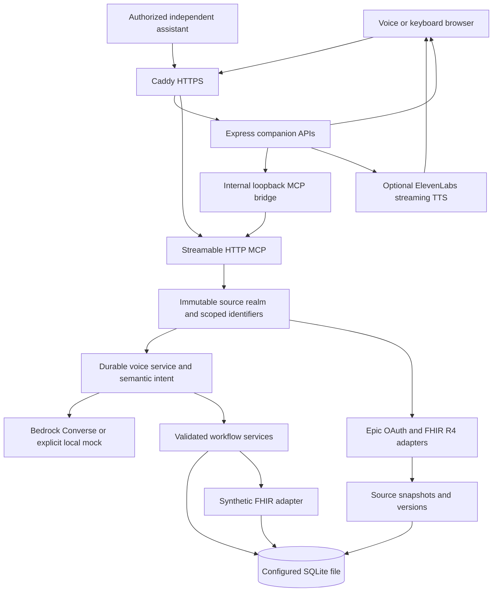
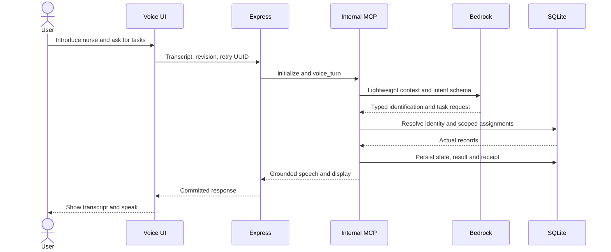
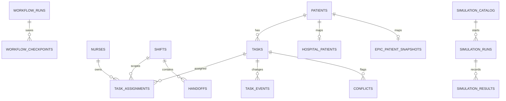
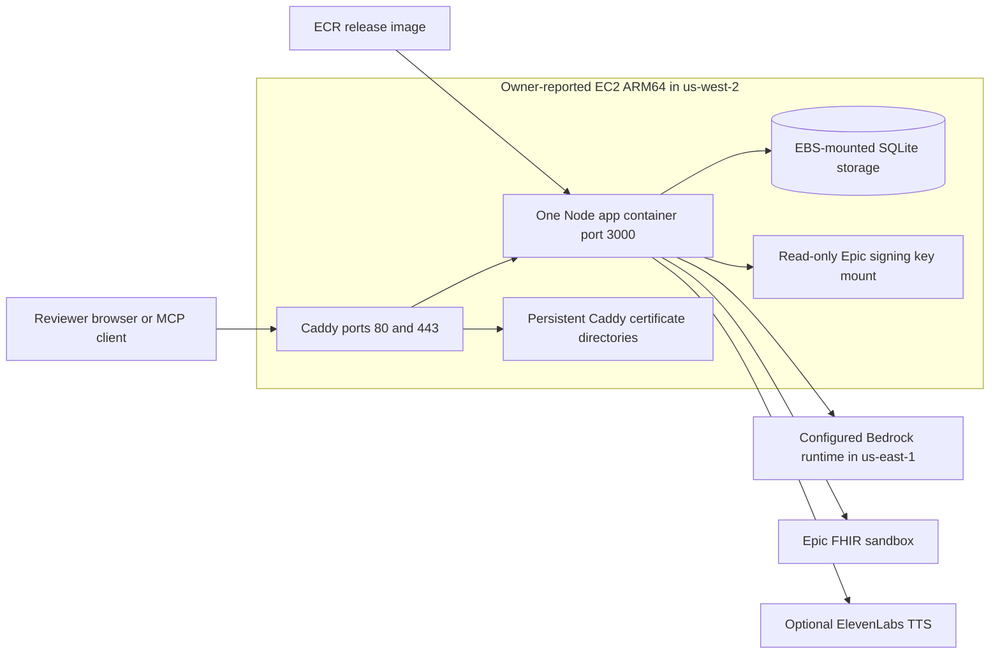
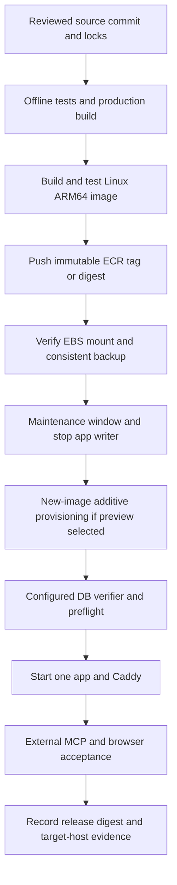

# ShiftWeave — Engineering and Operations Documentation

**Review date:** 23 October 2026 · **Source baseline:** `603fd97` · **Audience:** developers, QA, reviewers and deployment owners

This is the current consolidated guide. [review.md](review.md) records risks and acceptance gates; [FRICTION_LOG.md](FRICTION_LOG.md) records the evidence-backed engineering history. Older design documents remain useful context, but their completion claims and tool counts are not current specifications.

## 1. Purpose, scope and delivery status

ShiftWeave coordinates nursing tasks, discrepancies and shift handoffs. A nurse can speak or type, retrieve scoped records, ask contextual follow-ups, propose supported local changes, explicitly confirm them, and recover supported interrupted workflows using durable checkpoints.

The browser demonstrates an Alexa+ style experience named Medi. It is not evidence of installed Alexa hardware or Alexa cloud registration. The hackathon requirements are in [important.md](important.md); implementation constraints are in [AGENTS.md](AGENTS.md) and the [repository skill](.agents/skills/hackathon-guidelines/SKILL.md).

### Evidence labels used throughout

| Label | Meaning |
|---|---|
| Implemented | Behavior is present in the reviewed source; not automatically externally verified |
| Configured | A template or local setting exists; does not establish permission or successful connectivity |
| Tested now | Executed during this documentation review against the stated environment |
| Historical verification | A dated report or engineering record supports a previous result; not re-executed here |
| Owner-reported deployment | Infrastructure described by the owner and reflected in deployment documents; AWS inventory was not queried |
| Planned / recommended | Work to do, not a completed capability |
| Inferred / unknown | Interpretation or missing evidence, explicitly identified |

### Current capability boundary

| Capability | Status and limit |
|---|---|
| MCP initialization, discovery, execution | Tested now through real loopback Streamable HTTP and official SDK clients |
| Synthetic hospital database and six guided scenarios | Tested now; actual SQLite reads, writes, retries and saved scenario progress |
| Bedrock semantic voice requests | Implemented; historical live 21-question and 13-question runs passed, with failures during earlier runs; no paid inference in this review |
| Free local execution | Explicit `LLM_PROVIDER=mock`; deterministic interpretation and speech templates, not live LLM inference |
| Epic clinical reads | Implemented; historical sandbox reports support successful reads; not reverified live here |
| Epic clinical note creation | Implemented and gated; historical approved attempt returned 403; no successful external publication established |
| Speech capture/playback/interruption | Implemented and historically tested with simulated browser speech adapters; physical audio acceptance remains outstanding |
| EC2 deployment | Owner-reported prior release; latest repository release not verified on AWS here |
| Clinical production use | Not established; public name-based preview is intentionally not clinician authentication |

The system must not diagnose, recommend treatment, administer medication, alter clinical orders, invent missing facts, or claim an operation succeeded without backend evidence. A draft is not accepted custody; local finalization is not Epic publication. Missing allergies do not mean “no allergies.”

## 2. Technology and repository map

Versions below are manifest declarations, not claims about the newest available versions. Use both lockfiles for reproducible installs.

| Layer | Implementation |
|---|---|
| Runtime/build | TypeScript ESM; local checks used Node 22.14.0 / npm 10.9.2; Docker targets Node 24 Bookworm slim |
| Backend | Express `^5.3.0`, Zod `^4.6.7` |
| MCP | `@modelcontextprotocol/sdk ^1.32.1`, minimum negotiated protocol `2025-11-25` |
| Database | `better-sqlite3 ^13.0.3`, embedded SQLite |
| Model | AWS Bedrock Runtime SDK `^3.1153.0`, Converse tool-use adapter; explicit local mock adapter |
| Frontend | React `^18.3.1`, Vite `^6.1.0`, client TypeScript `^5.7.2`, lucide icons |
| Voice | Browser SpeechRecognition/media capture, browser synthesis, optional ElevenLabs HTTP/streaming TTS |
| Edge/deployment | Caddy 2, Docker Compose, Linux ARM64 deployment template |
| License | ISC, as declared in [package.json](package.json) |

| Path | Responsibility |
|---|---|
| [src/server.ts](src/server.ts) | Express routes, per-session MCP factory, tool registration, health and shutdown |
| [src/runtime-config.ts](src/runtime-config.ts) | Hosted-mode, origin, model and local-review guards |
| [src/agent](src/agent) | Model adapter, legacy multi-step orchestrator, HTTP MCP client bridge |
| [src/db](src/db) | Required connection, executable schema, additive migrations and explicit JSON ingestion; do not remove this directory |
| [src/providers](src/providers) | SQLite provider, Epic OAuth/mapping/snapshot reads, synthetic FHIR store/HTTP adapter |
| [src/services](src/services) | Voice state machine, semantic planning, mutations, handoffs, conflicts, recovery, source policy and staff profile |
| [client/src](client/src) | Voice canvas, question guide, simulations, preserved operational/staff UI and typed API clients |
| [scripts](scripts) | Provisioning, build-runtime utilities, isolated tests, explicit live probes and maintenance tools |
| [data/hospital](data/hospital) | Explicit synthetic FHIR and workflow seed definitions |
| [data/simulations/catalog.json](data/simulations/catalog.json) | Six developer-managed scenario definitions |
| [data/incoming](data/incoming) | Original JSON-only fixture importer/template; not production clinical data |
| [deploy](deploy) | EC2 Compose template, Caddy configuration, update runbook and dated integration reports |
| [Dockerfile](Dockerfile), [compose.yaml](compose.yaml) | Image build and generic named-volume example; not a substitute for existing EC2 bind mounts |
| [compose.hospital.yaml](compose.hospital.yaml) | Optional HAPI/PostgreSQL overlay, unnecessary for SQLite preview; not target-host validated |

Generated `build/`, `client/dist/`, local `.env`, keys, backups and `.sandbox/` are not source-of-truth configuration. A legacy `data/shiftweave.db` is still tracked despite ignore rules and fails a read-only corruption check; see [R-02](review.md#r-02). Never deploy that file over a healthy database.

## 3. Architecture and request flows



The diagram shows logical components. UI, Express, services, MCP and SQLite run in one application process/container; the diagram does not imply separate deployed microservices. Epic, Bedrock and ElevenLabs are separate configured services. Direct companion display reads may query services/SQLite without another MCP call; voice commands and simulation actions cross the MCP boundary.

### Voice lifecycle

1. User enables the microphone or opens the keyboard input. Browser recognition creates interim/final text; current endpointing permits roughly 1.4 seconds of silence, with a shorter confirm/cancel path. Browser/service support varies.
2. Client submits `POST /api/voice` with session UUID, utterance, current revision and retry UUID. Maximum utterance length is 2,000 characters. It retains the exact request for an uncertain retry.
3. Gateway creates a loopback MCP connection and calls `voice_turn`. Internal capability headers select the trusted realm; browsers do not receive that capability.
4. Explicit confirmation/control paths use deterministic state checks. Ordinary configured Bedrock requests use semantic interpretation with lightweight durable context first. A combined introduction and question can share one model plan.
5. Backend resolves names/titles in scope, refreshes relevant records when required, validates intent, retrieves actual records and stages or executes the allowed operation. General chat does not eagerly fetch the entire clinical dataset.
6. Current single-pass workflow speech comes from controlled templates populated with backend facts. General conversation is model-generated; supported legacy/repair paths additionally validate fact references. There is no claim that every clinical sentence is unconstrained LLM prose.
7. Saved display/revision and speech are returned. Optional ElevenLabs supplies audio; browser synthesis is a visible fallback. Capture remains available for supported interruption/echo handling. A Bluetooth headset can reduce playback quality when its microphone is active; physical device behavior needs separate testing.



### Workflow durability

[MutationService](src/services/mutation.service.ts) binds an idempotency key to canonical request JSON. An immediate SQLite transaction commits the domain change, receipt, workflow checkpoint and audit entry together. Reusing a key with a different request or actor is rejected. Model/tool execution persists intent before invocation and results afterward; restart recovery reconciles saved results with source versions before continuing.

Task completion, discrepancy resolution, escalation, custody acceptance and local sign-off have different semantics. Discrepancy resolution collects a verified status and the human's own review note, then asks for confirmation. Bare status text cannot become a fabricated verification note. Draft creation can follow an explicit draft request; internal checkpoint writes are not separate human-confirmation steps.

MCP sessions expire or disappear on process restart. Durable workflow/session records do not. Reconnect, retain the business workflow/session ID and reuse the exact original request key after an ambiguous outcome. Do not invent a new key to force an uncertain external write through. The UI intentionally starts a new visible conversation on reload; recovery of older uncertain sessions is less discoverable and remains [R-09](review.md#r-09).

These mechanisms cover tested failure windows, not every disk loss, power failure, backup rollback or distributed failure. Process-local locks and SQLite do not support arbitrary multi-replica execution.

## 4. MCP and companion APIs

### MCP contract

- Endpoint: `/mcp`, methods POST for protocol requests, GET for an existing session's SSE channel, DELETE for session termination.
- Initialize using protocol `2025-11-25`; retain `mcp-session-id`; use `Content-Type: application/json`, `Accept: application/json, text/event-stream` and the negotiated `MCP-Protocol-Version` where required.
- Hosted deployments require `Authorization: Bearer` with the configured service token for every MCP method. Staff-auth mode also requires the existing staff session.
- Tool failures can be successful HTTP exchanges with MCP `isError: true`; inspect the tool result, not HTTP status alone.
- Session factory creates one server/transport pair per initialization. Idle cleanup uses a 30-minute cutoff on a five-minute sweep. Active-stream/TTL/load behavior still merits stress testing.
- The bearer scheme is preconfigured service authorization, not implemented OAuth discovery for arbitrary clients. A connecting assistant must support custom bearer headers or an approved adapter.

### Source-specific tool inventory

| Shared tools in both external Epic and trusted preview | Purpose |
|---|---|
| `get_assigned_tasks` | Nurse/shift-scoped stored assignments; optional status filter |
| `get_task_details` | Scoped task, patient, recent events and discrepancy |
| `get_task_changes` | Stored changes since a validated timestamp, optional unit filter |
| `get_handoff_context` | Stored work, conflicts, authority and source context |
| `create_handoff_draft` | Durable requested draft; does not transfer custody |
| `get_workflow_checkpoint` | Latest allowed saved workflow progress |
| `save_workflow_checkpoint` | Validated idempotent checkpoint; managed voice/mutation checkpoints protected |
| `resume_workflow` | Reconcile saved state and recover supported workflows |
| `acknowledge_task` | Supported explicit acknowledgement/custody/escalation actions |
| `voice_turn` | Stateful natural-language workflow entry |
| `get_voice_display` | Restore source-scoped visible voice context |

| Profile | Additional tools | Count |
|---|---|---:|
| Ordinary external Epic | `get_epic_patient_context`, `sync_epic_workspace`, `preview_epic_handoff_note`, `publish_reviewed_handoff_note` | 15 total |
| Trusted dashboard preview | `claim_hospital_task`, `select_voice_source`, `refresh_hospital_records`, `review_simulation` | 15 total |
| Internal/staff/legacy | Conditional tools including `operational_sandbox`; determined by mode and authorization | Discover at runtime; do not apply a universal count |

Actual schemas live in [src/server.ts](src/server.ts), [voice.service.ts](src/services/voice.service.ts) and [simulation.service.ts](src/services/simulation.service.ts). Older 9/13/16/20-tool documents describe prior inventories or different internal profiles.

For an independent assistant: initialize, `tools/list`, call `get_voice_display` with a new UUID, then call `voice_turn` with its current revision. Preserve session UUID and increment from the returned revision. The default external realm is Epic regardless of client name; it does not select the synthetic hospital merely because the dashboard uses it. Authorized Epic tools fetch configured Epic endpoints; generic task/handoff tools read local workflow records backed by those mappings/snapshots. Not every tool performs a fresh Epic HTTP read.

### HTTP route reference

These routes exist in current source; registration does not establish cloud permission. Existing guards can deny routes based on profile.

| Method/path | Contract and notable behavior |
|---|---|
| `GET /readyz` | Minimal SQLite `SELECT 1`; 200/503. Does not prove schema, Epic, Bedrock or audio readiness |
| `GET /health` | Provider/configuration diagnostics; not an externally verified dependency health check |
| `POST /api/voice` | `{session_id, utterance, expected_revision, idempotency_key}`; UUID IDs, nonnegative revision |
| `GET /api/voice/:sessionId` | Direct saved display read in selected source scope |
| `GET /api/voice-sources`, `POST /api/voice-source` | Source availability/selection; production anonymous preview cannot select or restore Epic |
| `GET /api/simulations`, `POST /api/simulations` | Availability and `list/start/read/step/ask`; actions bridge to MCP |
| `GET /api/tts/config`, `POST /api/tts`, `/api/tts/stream` | Optional buffered/streaming speech; stream handler accepts GET query or POST body; upstream failures return sanitized 502/fallback |
| `GET /api/convai/session`, `POST /api/convai/tools` | Optional signed-agent session/webhook paths; security/scoping review outstanding, see R-04 |
| `GET /api/tasks`, `/api/conflicts`, `/api/handoffs`, `/api/execution-trace` | Database-backed companion views; traces are polled, not a token stream |
| `POST /api/conflicts/:id/resolve`, `/api/tasks/:id/acknowledge`, `/api/handoffs/:id/finalize` | Existing validated human workflow operations |
| `GET /api/handoffs/:id/epic-note-preview`, `POST /api/handoffs/:id/publish-note` | Exact-note review and separately gated external publication; unavailable in preview |
| `GET /api/providers`, `POST /api/provider/switch` | Legacy provider inspection; generic live-FHIR activation explicitly rejected; preview cannot change global provider |
| `POST /api/chat`, `GET /api/conversations/:id`, `POST /api/chaos/simulate` | Legacy orchestrator, saved dialogue and deliberate interruption control |
| `/api/staff/config`, `/api/staff/login`, `/api/staff/me`, `/api/staff/logout`, `POST /api/operations/:action` | Preserved separate staff profile; not a required login for public synthetic preview |

Malformed Zod requests commonly return 400; uncaught domain errors commonly return 409; staff/auth/origin guards use 401/403 and some operation routes use 422. Exact statuses are route-specific. Global domain errors still return raw message text outside the sanitized TTS path; see R-03. `/healthz` is not the implemented health endpoint.

## 5. Persistence and source isolation

[connection.ts](src/db/connection.ts) opens the explicit `SQLITE_DB_PATH`, enables WAL, foreign keys, `synchronous=FULL` and `busy_timeout=5000`. Production requires an existing file and refuses silently creating an empty substitute. SQLite runs within the Node process, not as a separately networked database service.

The current local read-only inspection found **30 application tables**, plus SQLite statistics tables. A count of “11 canonical tables” in startup output refers to the original core, not the full schema. A previously reported deployment count of 23 tables describes an earlier profile/version.

| Table group | Tables |
|---|---|
| Core domain (8) | `nurses`, `shifts`, `patients`, `tasks`, `task_assignments`, `task_events`, `conflicts`, `handoffs` |
| Workflow/observability (4) | `workflow_runs`, `workflow_checkpoints`, `audit_log`, `operation_receipts` |
| Epic snapshots (2) | `epic_patient_snapshots`, `epic_snapshot_versions` |
| Staff/operational extensions (9) | `staff_accounts`, `staff_sessions`, `staff_voice_sessions`, `staff_shift_memberships`, `patient_care_team`, `operational_task_versions`, `operational_notes`, `sandbox_documents`, `sandbox_source_resources` |
| Hospital (2) | `hospital_patients`, `hospital_fhir_resources` |
| Simulations (3) | `simulation_catalog`, `simulation_runs`, `simulation_results` |
| Source isolation (2) | `source_identifiers`, `dashboard_voice_sources` |



This is a selected relationship view, not a replacement for executable DDL. [schema.ts](src/db/schema.ts), [operational-schema.ts](src/db/operational-schema.ts) and the hospital/simulation/source schema strings govern current tables. Preserve `src/db`; do not rewrite a `.db` file to apply a text schema. Initialization performs additive DDL and a specific nullable-acuity migration, but has no general versioned migration ledger or down-migration strategy.

Task status is separate from custody. `PENDING/IN_PROGRESS/COMPLETED/CANCELLED/FLAGGED_CONFLICT` describes work; assignment `ACTIVE/CARRIED_FORWARD/TRANSFERRED/UNASSIGNED` describes responsibility. Handoffs use `DRAFT/UNDER_REVIEW/ACKNOWLEDGED/FINALIZED`. External publication uses `NOT_REQUESTED/PENDING/SYNCED/FAILED/UNCERTAIN` independently.

### Shared file, separate realms

[source-context.ts](src/services/source-context.ts) binds `epic`, `preview` or trusted internal `legacy` to execution. [source-policy.ts](src/services/source-policy.ts) scopes IDs, retry keys, workflows, patients, nurses, tasks and handoffs. Only a private process-local capability permits trusted preview selection. Synthetic IDs use `hospital:`; Epic snapshots retain endpoint provenance. Separate source fingerprints prevent preview changes invalidating Epic recovery and vice versa.

Both sources may share the physical file. This is application-level isolation, not separate tenants, encryption keys or clinical access authorization. Hosted public preview blocks access to Epic companion routes and publication; external MCP retains its service token. Eleven source-isolation checks passed with controlled Epic HTTP responses. Optional ConvAI routes need additional review rather than inheriting that assurance automatically.

## 6. Epic Sandbox to simulated hospital: what changed and why

### Original purpose

Epic Sandbox supplied a non-production interoperability target: backend OAuth with an RS384 private-key JWT, matching public JWKS, actual FHIR R4 patient/encounter/condition/allergy/order reads, and evaluation of human-reviewed clinical-note creation. It was not intended to authenticate a spoken nurse name or automatically supply ShiftWeave's local shift/custody/checkpoint model.

### Documented evidence, not a universal Epic limitation

[EPIC_SANDBOX_ASSESSMENT.md](EPIC_SANDBOX_ASSESSMENT.md) and [epic-dataset-audit.json](deploy/epic-dataset-audit.json) record a bounded seven-patient assessment dated 22 October. Returned totals were 17 encounters, 18 conditions, nine allergy resources and seven medication requests; no MedicationAdministration or DocumentReference clinical records were returned. Counts are records, not distinct diagnoses or positive allergies. Several linked directory/care-team/location/task/observation requests returned 403; a List search returned 400 requiring a supported code. Older encounter dates did not prove a current ward feed.

[epic-write-report.json](deploy/epic-write-report.json) records the approved 21 October DocumentReference.Create attempt as **FAILED/HTTP 403**, with readback not attempted. A 403 alone does not prove the exact cause, universal sandbox policy or what another hospital environment permits. Historical prose making those broader claims is not adopted here.

### Transition and current implementation

The recorded decision was to retain Epic integration and add a visibly synthetic, writable hospital for reliable demonstration of missing workflow cases. An authenticated operational sandbox and local reviewer catalog preceded the hosted hospital profile; they are distinct profiles, not one interchangeable dataset.

The current hospital defaults to **SQLite**, not a mandatory remote HAPI service. [fhir-r4.json](data/hospital/fhir-r4.json) is an explicit FHIR-shaped seed bundle; [workflow.json](data/hospital/workflow.json) defines synthetic nurses/tasks/conflicts. Provisioning stores FHIR JSON in `hospital_fhir_resources`, maps patient snapshots through `hospital_patients`, and reuses the real task/assignment/handoff/event/receipt/checkpoint tables. Runtime answers read stored data; JSON is not a per-question canned answer source.

At this review, the configured local database `data/workflow-sandbox-1792609735104.db` passed `quick_check` and had zero foreign-key violations. It contained three hospital nurses, three hospital patients, nine hospital tasks and 17 hospital FHIR resources. The catalog had 12 total entries because older review entries coexist with six `hospital-` scenarios; hosted discovery filters to hospital scenarios. Counts are local observations, not a remote database inventory.

| Replaced or retained | Actual outcome |
|---|---|
| Preview's dependence on sparse Epic sandbox records | Replaced by explicitly synthetic hospital context for preview only |
| Epic endpoints, signing key configuration, OAuth and read/note services | Retained; no automatic synthetic fallback on Epic failure |
| Local coordination and durable recovery | Reused, with real SQL operations and human confirmation |
| Model mock | Retained only as explicit free local execution; production requires Bedrock |
| Synthetic patient/staff/task definitions | Deliberate seed fixtures, not claims of real staff, clinical orders or ongoing external hospital activity |
| Real Epic clinical writes and practitioner identity | Deferred pending appropriate authorization and institution-specific validation |
| Generic `live-fhir-api` switch | Still disabled; dedicated Epic snapshot/sync paths are separate and implemented |
| External FHIR hospital alternative | Adapter/Compose option retained; requires explicit `HOSPITAL_DATA_SOURCE=fhir`; not verified as a deployed HAPI service |

### Guided scenarios

| Hospital scenario | Demonstrated behavior |
|---|---|
| Understand a patient record | Scoped patient retrieval and allergy follow-up |
| Confirm coordination task update | Proposal, explicit confirmation, persisted status/readback |
| Missing information | Missing allergy/patient and clinical-boundary refusal |
| Review, accept, finalize handoff | Requested draft, explicit incoming custody, local sign-off |
| Interrupt and resume | Deliberate orchestrator exception after committed steps, then checkpoint reconciliation |
| Unavailable integration | Expected refusal/error from an unavailable/hidden Epic operation; requires reads disabled; not an injected real Epic outage |

The catalog's expected text is explanatory, not a runtime oracle. Simulation `COMPLETED` means the step executed, not that every clinical claim was independently asserted. Runs store frozen scenario definitions, cursor, actual outputs and follow-ups in SQLite. Shared preview users change shared state; scenarios do not reset records. Jordan also has assigned work, a source discrepancy and access to confirmed self-claim of eligible unowned synthetic tasks. Discrepancy review is covered outside the six original guided scenarios.

Benefits are reproducibility, deliberate missing/conflicting data and actual durable mutations without clinical side effects. Limits are a small curated cohort, fixed scenario/initial shift data, no autonomous hospital event feed, and no proof of Epic clinical interoperability from synthetic success. A hosted database makes the demonstration online; it does not turn synthetic records into real-time Epic data.

### Real-world interoperability still required

Obtain institution-approved identity/roles, patient and encounter crosswalks, supported ward/shift/task contracts, appropriate SMART permissions and verified author/note types. Test paging, documents/Binary, stale/empty/denied states, source updates, explicit custody and independent remote write reconciliation. Complete governance/privacy/security review and physical audio acceptance. Do not interpret a medication order as administration, a missing record as a discrepancy, or local task completion as an Epic order update.

## 7. Configuration and local setup

Never paste populated environment files or expanded Compose output into tickets. Only variable names and non-secret examples appear here. `.env` is local and not included in the Docker image. Existing shell environment values can override dotenv values.

| Variables | Role and requirements |
|---|---|
| `NODE_ENV`, `HOST`, `PORT` | Local default loopback:3000; container 0.0.0.0:3000; production activates stricter guards |
| `SQLITE_DB_PATH` | Explicit persistent existing file in production; no connection string or hosted SQL service required |
| `PUBLIC_ORIGIN`, `MCP_AUTH_TOKEN` | Exact hosted origin without trailing slash and persistent random token of at least 32 characters |
| `LLM_PROVIDER` | `mock` locally or `bedrock`; Gemini is removed from runtime |
| `AWS_REGION`, `BEDROCK_MODEL_ID` | Bedrock region/model or inference profile; shipped model example is `us.anthropic.claude-sonnet-4-6`, not proof of access |
| AWS credential chain | Prefer owner-managed role/temporary credentials; adapter also supports `AWS_BEARER_TOKEN_BEDROCK`; never expose credentials to React |
| `LLM_MAX_OUTPUT_TOKENS` | Model output cap; single-pass voice caps at 512 or a smaller configured value |
| `HOSPITAL_SIMULATION_ENABLED`, `HOSPITAL_DATA_SOURCE` | Enable provisioned hospital; source `sqlite` by default or explicit `fhir` |
| `HOSPITAL_FHIR_BASE_URL`, `HOSPITAL_FHIR_TOKEN` | Only explicit external synthetic FHIR mode; errors do not fall back to SQLite |
| `SIMULATION_MODE` | Older loopback-only review mode, not the hosted hospital flag; production must not use it |
| `STAFF_AUTH_REQUIRED`, `SANDBOX_SESSION_SECRET` | Existing separate staff profile; anonymous hospital preview uses false; hosted hospital plus staff-auth true is rejected |
| `EPIC_CLIENT_ID`, `EPIC_KID`, `PRIVATE_KEY_PATH`, `PRIVATE_KEY_PASSPHRASE` | Backend signing identity and readable matching private key |
| `EPIC_TOKEN_URL`, `EPIC_FHIR_BASE_URL`, `EPIC_TEST_PATIENT_IDS` | Actual authorized endpoint and allowlisted sandbox patients |
| `EPIC_READS_ENABLED`, `EPIC_WRITES_ENABLED` | Explicit independent read/write gates; keep writes false until authorized and verified |
| `EPIC_CREATE_REVIEW_TASKS`, `EPIC_DEMO_NURSE_ID`, `EPIC_DEMO_SHIFT_ID` | Local source-review tasks and initial configured non-synthetic sync context; verify IDs in DB |
| `EPIC_NOTE_ENCOUNTER_ID`, `EPIC_NOTE_AUTHOR_REFERENCE` | Optional reviewed eligible note bindings; not proof of clinician identity |
| `EPIC_JWKS_URL`, `EPIC_SMART_SCOPE_VERSION`, `EPIC_FHIR_ID_SCHEME` | Registration/diagnostic context; environment names alone do not configure Epic's portal |
| `ELEVENLABS_API_KEY`, `ELEVENLABS_VOICE_ID`, `ELEVENLABS_MODEL_ID` | Optional TTS, model example `eleven_flash_v2_5`; agent ID not required for ordinary streaming TTS |
| `ELEVENLABS_AGENT_ID`, `ELEVENLABS_STREAMING_LATENCY` | Optional ConvAI and streaming tuning; separate security/readiness limits apply |
| `APP_IMAGE`, `DOMAIN` | EC2 Compose image tag/digest and Caddy host; preserve existing EBS bind paths |

The complete shipped templates are [.env.example](.env.example) and [.env.deploy.example](.env.deploy.example). `MCP_ENDPOINT` appears in older configuration but server routes use `/mcp`; it is not a supported arbitrary endpoint override.

### Fresh free local hospital preview — PowerShell

Run from the repository root. Use a **new healthy path** rather than the tracked legacy database. These commands explicitly populate synthetic records; do not run them against clinical data as a generic update.

```powershell
# Copy only if .env does not already exist; preserve existing private settings.
if (!(Test-Path .env)) { Copy-Item .env.example .env }
npm ci
npm --prefix client ci
$env:NODE_ENV='development'
$env:HOST='127.0.0.1'
$env:PORT='3000'
$env:SQLITE_DB_PATH='./data/local-hospital-review.db'
$env:LLM_PROVIDER='mock'
$env:STAFF_AUTH_REQUIRED='false'
$env:SIMULATION_MODE='false'
$env:EPIC_READS_ENABLED='false'
$env:EPIC_WRITES_ENABLED='false'
$env:HOSPITAL_SIMULATION_ENABLED='true'
$env:HOSPITAL_DATA_SOURCE='sqlite'
npm run hospital:prepare
npm run build
npm start
```

Open `http://127.0.0.1:3000/?workspace=voice` or `/?workspace=simulations`. `hospital:prepare` initializes/provisions the chosen local file and takes a backup; normal server startup never imports hospital seed data automatically. It preserves an existing provisioned dataset on repeat runs, not a resettable per-tester world.

For frontend iteration, `npm run dev` and `npm run dev:client` run backend/Vite separately; the Vite proxy targets port 3000. A custom backend port requires an intentional proxy adjustment. For Bedrock intent testing, explicitly select `bedrock` and securely supply the existing authorized region/model/credentials; that can incur cost and is not necessary for the free path.

The original two-patient fixture is a separate optional local path: explicitly select a different fresh DB, disable hospital mode, then `npm run db:init` and `npm run import:data`. The importer reads JSON only. Avoid `npm run setup`, `db:clean`, `sandbox:setup`, `simulation:setup` or `connect-epic --fresh` as generic production updates; they initialize/import, modify datasets or select workspaces.

### Independent external MCP check

With the server running and its service token privately supplied:

```powershell
$env:MCP_SERVER_URL='http://127.0.0.1:3000/mcp'
npm run test:mcp-independent
```

This client imports no server/database/dashboard code, verifies external Epic default, absence of preview tools and rejection of a synthetic task ID. It does not prove an Epic patient fetch succeeds. Use an authorized allowlisted Epic request separately for that. Do not pass private internal source headers to external testers.

## 8. AWS and deployment architecture

### Resource inventory and evidence level

No AWS account, console, IAM, EC2, ECR, EBS or DNS API was contacted during this review. The deployment owner's description is preserved in [deploy/UPDATE_CHECKLIST.md](deploy/UPDATE_CHECKLIST.md) and reflected in [deploy/compose.ec2.yaml](deploy/compose.ec2.yaml). It describes an older deployed image, not verification that current `603fd97` is live.

| Resource | Purpose/configuration in supplied deployment | Evidence and gap |
|---|---|---|
| EC2 | One `t4g.medium` ARM64 host in `us-west-2` | Owner-reported; instance health/AMI/patches/role not inspected |
| Elastic IP/domain | Prior public origin `https://32.189.84.182.nip.io` | Owner-reported prior endpoint; no fresh remote availability check |
| EBS | Dedicated 32 GB KMS-encrypted `shiftweave-data`, mounted `/mnt/shiftweave` | Reported; filesystem, attachment, KMS key/policy and mount persistence not exported |
| ECR | Private image repository in `us-west-2`; old tag `2026-10-23-006` | Reported; new image not built, scanned, pushed or pulled here |
| Docker app | Node 24, non-root UID 1000, container port 3000, one replica | Implemented in Dockerfile/template; target ARM64 execution unverified |
| Caddy | Public 80/443, automated TLS, streaming proxy to app | Template present; certificates/DNS/renewal not verified remotely |
| Bedrock | Optional local/required production model, configured example in `us-east-1` | Implemented adapter; historical inference evidence only |
| IAM | Required credentials/role for selected model and deployment operations | No policy, instance-profile or permission-boundary definitions found |
| Secrets | Host `.env.deploy`, read-only Epic key mount | Template approach; Secrets Manager/SSM integration not implemented |
| Logs | App Docker `json-file`, 10 MB × 3 files; SQLite audit records | Implemented template; no CloudWatch agent, alarms or dashboard definitions found |
| Backups | Consistent SQLite backup utility and local backup mounts | Implemented; no verified scheduled off-host backup/snapshot restore policy |
| Networking | Compose private app port; Caddy published ports | No VPC/subnet/routes/security-group/NACL definitions found |

No RDS, DynamoDB, ECS, Lambda, ALB, WAF, Route 53 hosted zone, CloudWatch deployment, multi-AZ failover or infrastructure-as-code stack is established by this repository. Their absence from source is an evidence gap, not proof they do not exist in the owner's AWS account.



Single-host deployment fits the current synchronous SQL joins, atomic transactions, modest demo footprint and session architecture. Trade-offs are one writer host, shared public-preview state, host operations and a single failure domain. EBS encryption does not by itself establish HIPAA compliance, zero-loss recovery or negligible total operating cost. EC2/EBS/public IPv4, registries, models, TTS, snapshots and data transfer can incur charges; no cost estimate was verified here.

A future managed SQL service requires a persistence redesign; replacing the SQLite filename with a PostgreSQL/DynamoDB URL will not work. Do not put the WAL file on EFS/NFS or share it across app hosts. The optional HAPI/PostgreSQL overlay adds another database and memory footprint and is not required for this release's SQLite preview.

### Exact persistent mounts for the existing EC2 setup

| Host | Container | Access |
|---|---|---|
| `/mnt/shiftweave/storage` | `/app/storage` | Read/write DB, WAL/SHM and seeder backups |
| `/mnt/shiftweave/backups` | `/app/backups` | Consistent backup destinations |
| `/mnt/shiftweave/keys` | `/run/epic` | Read-only signing-key directory |
| `/mnt/shiftweave/Caddyfile` | `/etc/caddy/Caddyfile` | Read-only |
| `/mnt/shiftweave/caddy-data` | `/data` | Persistent TLS data |
| `/mnt/shiftweave/caddy-config` | `/config` | Persistent Caddy configuration state |

`SQLITE_DB_PATH=/app/storage/shiftweave.db` maps to the existing hosted file. `PRIVATE_KEY_PATH=/run/epic/private_key.pem` maps to the existing key. Preserve UID 1000 access without world-writable permissions. Caddy's updated template receives `DOMAIN` only, not the app's entire secret file.

### Release procedure — reference, not executed here

Use the full [EC2 update checklist](deploy/UPDATE_CHECKLIST.md). Build/push commands belong in the owner's deployment environment, after review; this documentation task performs none of them.



1. Preserve current image digest, Compose/Caddy/environment, certificate directories and consistent DB snapshot. Verify `/mnt/shiftweave` is the intended mounted volume and has capacity. Do not upload the development `.db`.
2. Build a new immutable Linux ARM64 image from the full current source. Native `better-sqlite3` must be installed for the target platform; never copy Windows `node_modules`. Existing Dockerfile includes hospital/catalog assets and compiled production utilities.
3. Review/copy the EC2-specific Compose template; do not replace bind mounts with root Compose named volumes. Merge environment names, preserving existing secret values and `APP_IMAGE`.
4. Choose anonymous preview explicitly: `HOSPITAL_SIMULATION_ENABLED=true`, `HOSPITAL_DATA_SOURCE=sqlite`, `STAFF_AUTH_REQUIRED=false`, `SIMULATION_MODE=false`. Production requires Bedrock, exact origin, service token and existing DB. Staff/Epic-only is a separate profile with hospital disabled.
5. During maintenance, stop app writes and use the SQLite backup API. With the new image, run `node build/scripts/setup-hospital.js` against the existing mounted healthy DB if preview provisioning is required. This is additive and takes another backup. Do not run fixture ingestion or replace the schema/database manually.
6. Run `node build/scripts/verify-configured-hospital.js` for preview and `node build/scripts/preflight.js`; start app and Caddy. Preflight is configuration checking plus optional hospital capability, not permission verification for every dependency.
7. Run `node build/scripts/smoke.js` locally, then the independent compiled client against the public `/mcp`; verify it defaults Epic and rejects synthetic IDs. Separately verify intended authorized Epic reads and browser synthetic workflows.
8. Test physical microphone, interruption, TTS, error recovery and persisted synthetic confirmation on HTTPS. Record digest, source commit, DB backup, test IDs and results. Restore rehearsal and off-host backup remain required operational work.

Representative host commands, after the owner prepares the reviewed image/environment:

```sh
cd /mnt/shiftweave
docker compose --env-file /mnt/shiftweave/.env.deploy -p shiftweave config --quiet
docker compose --env-file /mnt/shiftweave/.env.deploy -p shiftweave pull app
# Stop writes and create the consistent pre-update backup per the full runbook first.
docker compose --env-file /mnt/shiftweave/.env.deploy -p shiftweave run --rm --no-deps app node build/scripts/setup-hospital.js
docker compose --env-file /mnt/shiftweave/.env.deploy -p shiftweave run --rm --no-deps app node build/scripts/verify-configured-hospital.js
docker compose --env-file /mnt/shiftweave/.env.deploy -p shiftweave run --rm --no-deps app node build/scripts/preflight.js
docker compose --env-file /mnt/shiftweave/.env.deploy -p shiftweave up -d app https
docker compose --env-file /mnt/shiftweave/.env.deploy -p shiftweave exec -T app node build/scripts/smoke.js
```

Never run `docker compose down -v` as an update. Never copy only a live DB while ignoring WAL. Do not restore an older snapshot simply because a new image fails: preserve current state, stop all writers, restore consistently into a clean location, check integrity/foreign keys and reconcile post-backup actions. Rolling back to an old image can also remove the new source-isolation protections.

### Security and operational ownership

Use reviewed least-privilege model/inference-profile access and separate ECR deployment permissions; actual IAM policies must come from the owner. Preserve IMDSv2 if adopting an instance role and validate container credential access. Keep app port 3000 private and restrict host administration. These are required deployment checks, not verified AWS settings.

The anonymous preview is intentionally open to synthetic-data testers. It can spend Bedrock/TTS quota and mutate shared simulation state; service-token protection on `/mcp` does not rate-limit public companion APIs. No new login is proposed here. Capacity/abuse/spend controls, meaningful readiness monitoring, backup retention, restore objectives, patching and alerting require owner sign-off before wider exposure.

Audit/checkpoint data may contain record content, review notes or dialogue needed for recovery. It is not a tamper-proof compliance archive. TTS errors are sanitized; other error/audit paths still need minimization. GET streaming TTS can place speech text in URLs, so avoid logging query strings containing sensitive content. No PHI deployment, BAA, security certification or clinical compliance is established.

## 9. Testing, reproducibility and evidence

The documentation review ran the following without paid model calls, live Epic calls, Docker deployment or configured-database mutation:

| Check | Result on 23 October 2026 |
|---|---|
| `npm run typecheck` | Passed |
| `npm run build` | Passed backend and production frontend |
| `npm test` | 220 checks passed in temporary SQLite/ephemeral server; includes real process-exit recovery |
| `npm run test:deployment` | Passed hosted guards, MCP/origin handling, controlled Epic failures/partial pages and consistent backup groups |
| `npm run test:hospital` | 20 checks passed, six scenarios and all 15 preview tools exercised |
| `npm run test:source-isolation` | 11 checks passed; controlled Epic HTTP contract, not live Epic |
| `npm run test:runtime-package` | Passed compiled plain-Node provisioner/server/client, preservation of updates and no duplicate initial handoff; not a Docker/ARM64 test |
| Configured local DB, read-only | `quick_check=ok`, zero foreign-key violations; counts recorded in section 6 |
| Tracked legacy DB, read-only | Failed with `SQLITE_CORRUPT`; do not ship it as a ready DB |

The test counts are separate suites with overlapping concerns, not an additive coverage percentage. Controlled model replies in `npm test` establish host behavior under those replies, not Bedrock availability or universal language accuracy.

Historical records in [memory.md](memory.md) and [PREVIEW_TEST_GUIDE.md](PREVIEW_TEST_GUIDE.md) report a successful 21-question live Bedrock/MCP sequence and a later 13-turn Jordan review replay. Earlier runs exposed validation/routing faults and intermittent provider timeout/reset; those failures are retained as friction. Historical browser tests exercised real React/HTTP/MCP/SQLite with simulated recognition/playback, not real microphone acoustics. No fresh cloud/hardware evidence is asserted here.

### Commands by safety category

| Category | Commands and caution |
|---|---|
| Isolated routine checks | `npm test`, `test:deployment`, `test:hospital`, `test:source-isolation`, `test:runtime-package` after build |
| Browser regression | `npm run test:preview-guide`, `npm run test:voice-browser`; need installed Playwright/browser, may set `PLAYWRIGHT_MODULE_PATH`; speech adapters simulated |
| Explicit paid Bedrock | `npm run test:preview-questions-live`, add `-- --jordan-review` or `-- --edge-cases`; temporary DB, live model cost |
| Live Epic/config-dependent | `test:epic`, `test:epic-reads`, `test:epic-live`, `test:recovery` and Epic probes; inspect scripts and authorization first |
| Dataset maintenance | `hospital:prepare`, `hospital:setup`, `simulation:setup`, `simulation:catalog`, `sandbox:setup`, `db:clean`, `epic:connect`; not read-only tests |
| Explicit external write probe | `scripts/publish-approved-epic-note.ts`; never include in an unattended regression or retry without human approval |

Use a temporary DB and `PORT=0` **before importing application modules** for new mutation tests. Some legacy scripts inherit more environment state than the isolated runner; inspect them rather than running every package script indiscriminately. No CI workflow or dependency vulnerability scan was executed/found as a current release gate.

## 10. Troubleshooting

| Symptom | Likely layer and safe next step |
|---|---|
| `SQLITE_CORRUPT` using default legacy file | Stop using that artifact; preserve evidence and select a healthy deliberate database/consistent backup; do not delete live state |
| Production DB missing | Check bind mount, resolved `SQLITE_DB_PATH`, EBS mount and UID 1000 access; startup refuses an empty substitute |
| Hospital enabled but not populated | Explicitly provision the intended healthy DB, then verify; restart does not auto-seed |
| Nurse not found / wrong task set | Confirm source realm, registered name/badge and actual assignment/shift/unit; same display name across profiles does not imply same identity |
| Incoming nurse unavailable | No applicable saved outgoing handoff, or ambiguous handoffs; leaving a shift alone does not create one |
| Discrepancy repeats / asks for note | Ask to review discrepancy; provide actual verified status and what was checked, then confirm; do not invent a note to bypass review |
| MCP 401/403 | Check service token, origin, staff profile and source/session binding; never remove guards to make it appear functional |
| MCP 404/session expired | Initialize a new transport; retain business session/workflow/retry IDs and reconcile saved outcome |
| Revision/stale confirmation error | Reload actual display/current source; a changed record invalidates prior confirmation |
| Epic 403/empty/partial result | Inspect exact approved API, client/environment and section outcome; empty is not permission success or a negative clinical history |
| Mock-looking answer | Verify explicit `LLM_PROVIDER`; database-backed workflow speech is templated by design even with Bedrock intent |
| Long delay | Separate endpointing, model inference/repair, tool retrieval, TTS and playback; current metrics are buffered-turn durations, not TTFT |
| TTS unavailable | Visible browser fallback; check provider quota/credential privately. Raw TTS provider errors are intentionally hidden |
| Mic unavailable | Use localhost/HTTPS, browser permission/support and input device; test actual headset behavior separately |
| Public preview cannot select Epic | Intended production guard; use authorized external MCP or the preserved staff profile |
| Port already in use | Do not terminate unknown listeners; use current process or a deliberate free port; Vite proxy remains port 3000 |
| Optional FHIR host unused | Explicitly select `HOSPITAL_DATA_SOURCE=fhir`; the overlay URL alone does not change SQLite default |

## 11. Known limits and next work

Public synthetic demo readiness is supported by current local checks; clinical production readiness and latest AWS deployment are not certified. Priorities and acceptance criteria are in [review.md](review.md#findings-register): public-preview cost/abuse controls, remove or quarantine corrupted distributed DB artifact, audit error/ConvAI boundaries, verify AWS/IAM/backups on target, real audio/latency testing, versioned migration/release controls and authorized Epic interoperability. Do not expand clinical capabilities to hide missing source access.

## 12. Documentation provenance and contradictions

All first-party Markdown paths returned by `rg --files --hidden` were inventoried, including nested deployment, ingestion and skill documents; dependency/generated directories were excluded. Source, scripts, manifests/locks, deployment templates, dated JSON reports, Git history and current test output were cross-checked. Private environment values were not reproduced. This is not a line-by-line security audit of dependencies or an AWS account audit.

| Existing documents | How to interpret them now |
|---|---|
| [README.md](README.md), [understanding.md](understanding.md), [IMPLEMENTATION_STATUS.md](IMPLEMENTATION_STATUS.md), [remaining.md](remaining.md) | Mixed historical/current summaries; some obsolete deterministic-only, no-auth, Gemini and generic-provider statements. This guide and current code take precedence for current behavior |
| [architecture.md](architecture.md), [mcp.md](mcp.md), [schema.md](schema.md), [plain_schema.md](plain_schema.md), [field_schema.md](field_schema.md), [how_it_works.md](how_it_works.md) | Design context/core field inventory; not full current DDL, tool count, streaming or universal recovery guarantees |
| [goal.md](goal.md), [plan.md](plan.md), [apicall.md](apicall.md), [callapi.md](callapi.md) | Original ambitions and API proposals; apply corrections in [incomingapikey.md](incomingapikey.md), not assumptions about generic bedside Task writes |
| [EPIC_WORKFLOW.md](EPIC_WORKFLOW.md), [EPIC_SANDBOX_ASSESSMENT.md](EPIC_SANDBOX_ASSESSMENT.md), [OPERATIONAL_SANDBOX.md](OPERATIONAL_SANDBOX.md) | Dated integration evidence and distinct operational profile; workstation paths/ports/accounts are not universal deployment defaults |
| [SIMULATIONS.md](SIMULATIONS.md), [MCP_DATASET.md](MCP_DATASET.md), [HOSPITAL_DATABASE_COVERAGE.md](HOSPITAL_DATABASE_COVERAGE.md), [file.md](file.md) | Evolution and point-in-time inventories; early review-only hosting/tool counts and old data counts are superseded by current profile-specific code |
| [MCP_VERIFICATION.md](MCP_VERIFICATION.md), [VOICE_VERIFICATION.md](VOICE_VERIFICATION.md), [PREVIEW_TEST_GUIDE.md](PREVIEW_TEST_GUIDE.md) | Dated verification records; later appended sections override earlier implementation descriptions, not external access checks |
| [DEPLOYMENT.md](DEPLOYMENT.md), [deploy/ARCHITECTURE.md](deploy/ARCHITECTURE.md), [deploy/UPDATE_CHECKLIST.md](deploy/UPDATE_CHECKLIST.md), [deploy/VERIFICATION.md](deploy/VERIFICATION.md), [CLEANUP_REPORT.md](CLEANUP_REPORT.md) | Existing operations detail; old Node/tool/test counts are historical; EC2 update checklist preserves owner's mounts |
| [deploy/epic-note-preview.md](deploy/epic-note-preview.md) | Exact historical synthetic sandbox note preview, not proof of successful publication |
| [data/incoming/README.md](data/incoming/README.md) | JSON-only import contract |
| [memory.md](memory.md), [FRICTION_LOG.md](FRICTION_LOG.md) | Chronological records; claims require source/test corroboration and are not ongoing availability guarantees |
| [AGENTS.md](AGENTS.md), [important.md](important.md), [skill](.agents/skills/hackathon-guidelines/SKILL.md), [project context](.agents/skills/hackathon-guidelines/references/project-context.md) | Project requirements/navigation; old Gemini references do not re-enable removed runtime code |

These three consolidated files replace the old unqualified review/friction narrative while preserving relevant history with provenance. Other source documents were not rewritten in this documentation-only change. Outstanding contradiction cleanup remains R-11.

### Documentation validation record

The local checker inventoried 41 first-party Markdown files including this new guide, validated all 259 local path/anchor links across the three deliverables, checked documented `npm run` names against package scripts and referenced compiled Node utilities against build output, and verified all 15 finding IDs and 20 history IDs. All five Mermaid blocks passed structural checks for diagram type, balanced labels/subgraphs and fences; no Mermaid rendering engine was installed, so rendered layout/engine validation is not claimed. No remote AWS/provider URL was probed. A comparison against configured credential values found no such values in the deliverables. Whitespace validation passed with line-ending notices only. Only these three Markdown deliverables were changed.
