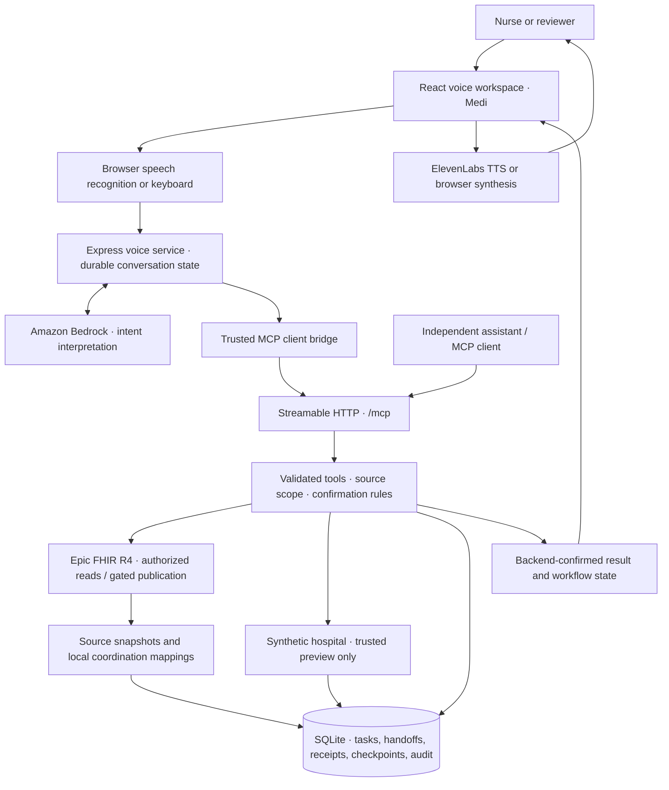

# ShiftWeave

### A shift ends. Responsibility continues.

**A voice-first nursing workflow platform powered by an independently accessible MCP server.**

ShiftWeave helps the next nurse understand what remains, what needs verification and what they are accepting responsibility for. Ask Medi naturally, inspect the underlying records, confirm supported changes and recover interrupted work from saved progress.

Built for the **Amazon Developer Hackathon — Alexa+ track**, with **Amazon Bedrock** powering language understanding. The browser provides a simulated assistant experience; native Alexa+ integration is not claimed.

## Live URLs

| Resource | URL | What to expect |
| --- | --- | --- |
| **Live application** | [**https://32.189.84.182.nip.io/**](https://32.189.84.182.nip.io/) | Voice workspace and synthetic hospital preview. For the best voice-testing experience, open in Chrome and allow microphone access. |
| **MCP server** | **https://32.189.84.182.nip.io/mcp** | Streamable HTTP endpoint for compatible MCP clients |
| Source code | https://github.com/agrasenrai/dev_assist | Application, MCP implementation and executable checks |
| Engineering friction log | [FRICTION_LOG.md](FRICTION_LOG.md) | Challenges, decisions, resolutions and remaining issues |

**Preview access:** No account is required for the public synthetic hospital. Choose a demo nurse by speaking or typing their name. Name selection is demonstration context, not clinician authentication.

**MCP access:** `/mcp` is a protocol endpoint, not a webpage or a normal REST GET endpoint. Use an MCP client with Streamable HTTP and the configured service bearer credential. Credentials are not published in this repository. External clients default to **Epic**, not the hospital preview.

These are the project's submission URLs. Hosted availability and the deployed revision must be checked separately from local repository tests.

## Why ShiftWeave

Unfinished work survives a shift change. Understanding that work often means reconstructing context: which tasks remain, which records disagree, who owns the next step and whether a previous action actually completed.

ShiftWeave brings those questions into one conversation backed by stored records. Its value is **clear information, explicit ownership and recoverable execution**.

## What you can demonstrate

- **Natural conversation:** Introduce yourself and ask for tasks in the same sentence, then ask contextual follow-up questions.
- **Grounded answers:** Retrieve current task status, patient context and available allergy information. Missing records stay missing.
- **Human discrepancy review:** Inspect conflicting sources, provide a verified status and review note, then confirm the change.
- **Deliberate handoffs:** Prepare and inspect drafts. Accepting responsibility is separate from generating or reading a handoff.
- **Confirmed updates:** Propose supported task changes or self-assignment of available simulation work; persist them after explicit confirmation.
- **Interruption recovery:** Restore saved progress and reconcile committed results before retrying remaining work.
- **Independent MCP access:** Discover and execute tools from another compatible assistant without loading the dashboard or distributing database files.

## Try it in three minutes

Open the live application, allow microphone access and select the round voice button. The keyboard button opens text input if speech recognition is unavailable.

| Ask Medi | What to look for |
| --- | --- |
| “Hi Medi, I am Seema Patel. What are my tasks?” | Identity selection and stored assignments in one turn |
| “Which tasks are still pending?” | A status-filtered follow-up |
| “Tell me about Rowan Morgan.” | Patient context from synthetic FHIR records |
| “What are their allergies?” | The same patient carried into the next question |
| “What are Taylor Brooks's allergies?” | An honest unavailable-information response |
| “Show me the handoff Reema Roy prepared for me.” | A saved handoff, without automatic custody transfer |
| “Mark Check discharge paperwork completed.” | A confirmation request before the write |
| “Confirm.” Then: “Has that task been completed?” | A committed update reflected in a subsequent read |

For discrepancy review, start a separate conversation as **Jordan Lee**, ask **“Show my discrepancies”**, then **“What do you need from me?”** Review the evidence before supplying your own verified status and explanation.

For recovery, open **Workspace tools → Recovery controls**, choose **Simulate Wi-Fi Drop / Crash**, then **Resume Saved Workflow**. This injects a controlled workflow interruption; it does not disconnect the device's Wi-Fi.

**The preview is persistent and shared.** Earlier testers may have changed statuses, accepted handoffs or claimed available work. Use current returned records rather than expecting every baseline task to remain unchanged. See the [preview testing guide](PREVIEW_TEST_GUIDE.md) for more questions and expected behavior.

## Architecture: conversation to committed action



Bedrock interprets requests; backend services resolve scoped records, enforce permissions and validate actions. Workflow facts come from retrieved results, with controlled rendering for grounded answers. General conversation can use the model without first loading a full patient/task bundle.

MCP provides the tool interface. **ShiftWeave implements the durable workflow semantics behind it:** retry receipts, checkpoints, explicit custody, source reconciliation and audit records. An MCP connection alone does not provide those guarantees.

### Recovery and consistency

Local workflow mutations commit domain changes, retry receipts, checkpoints and audit events transactionally. Retrying the exact request with its original idempotency key reuses the recorded result where applicable. Recovery checks current stored state before continuing.

SQLite uses WAL mode, foreign keys, `synchronous=FULL` and a busy timeout. These mechanisms support tested process-interruption recovery; they do not promise recovery from lost storage or universal exactly-once execution across external systems.

## MCP tool inventory

The ordinary external Epic profile and trusted hospital preview each expose **15 tools**: **11 shared tools** plus **4 profile-specific tools**. There are **19 distinct tool names across the two profiles**. Discover schemas through `tools/list`; source code is authoritative for arguments.

### Shared workflow tools

| Tool | Purpose |
| --- | --- |
| `get_assigned_tasks` | Retrieve nurse/shift-scoped assignments and status filters |
| `get_task_details` | Inspect a source-scoped task |
| `get_task_changes` | Retrieve recorded task events |
| `get_handoff_context` | Retrieve assignments, conflicts and handoff context |
| `create_handoff_draft` | Save a draft without transferring responsibility |
| `get_workflow_checkpoint` | Read saved workflow progress |
| `save_workflow_checkpoint` | Persist permitted progress with retry protection |
| `resume_workflow` | Reconcile and resume supported saved workflows |
| `acknowledge_task` | Record supported explicit task/custody acknowledgement |
| `voice_turn` | Process natural-language turns with context and confirmation rules |
| `get_voice_display` | Retrieve saved session and current display state |

### External Epic tools

`get_epic_patient_context` · `sync_epic_workspace` · `preview_epic_handoff_note` · `publish_reviewed_handoff_note`

These require configured credentials, allowed patient identifiers and target-environment permissions. Note publication additionally requires the exact preview/review flow and enabled writes. Discovery does not prove publication permission.

### Trusted preview tools

`claim_hospital_task` · `select_voice_source` · `refresh_hospital_records` · `review_simulation`

These are available to the trusted preview bridge, not ordinary external clients. The separately authenticated staff profile has its own operational context and is not the public preview.

### Connect an independent assistant

1. Configure `https://32.189.84.182.nip.io/mcp` as a **Streamable HTTP** server.
2. Supply `Authorization: Bearer <service-token>` securely where required.
3. Initialize and negotiate protocol **`2025-11-25` or later**, then call `tools/list`.
4. Call `get_voice_display` with a new session UUID to obtain current context.
5. Send questions to `voice_turn`, retaining `session_id`, the latest `expected_revision` and a new UUID `idempotency_key` per new turn.
6. After a network failure, retry the **exact request and key**. Preserve the logical session ID for follow-ups; reconnecting may require a new MCP transport session.

Human confirmation must come from the user. An assistant must not manufacture confirmation or report success beyond the returned tool result.

An executable official-SDK client is included:

```sh
# Load MCP_AUTH_TOKEN securely in the environment first.
node build/scripts/verify-mcp-independent.js https://32.189.84.182.nip.io/mcp
```

This verifies discovery, external Epic default and rejection of preview access. It does not establish current Epic credentials or write permissions.

## Epic and the synthetic hospital

**Epic remains integrated.** Its sandbox was used to validate authorized clinical reads. The tested access and patient cohort did not cover every nursing assignment, discrepancy and handoff scenario needed for an understandable demonstration. A recorded note-publication attempt returned HTTP 403; successful live publication is not claimed.

The synthetic hospital supplies those review scenarios without presenting invented records as live Epic data:

- Synthetic FHIR R4 resources and workflow fixtures are explicitly provisioned into the **configured SQLite database**.
- Runtime queries retrieve stored resources, tasks, assignments and handoffs; the frontend does not answer from a fixed task array.
- `data/hospital/fhir-r4.json`, `data/hospital/workflow.json` and `data/simulations/catalog.json` are provisioning inputs, not substitutes for runtime database reads.
- The bundled hospital includes Seema Patel, Reema Roy and Jordan Lee, with patient, task, missing-information, discrepancy, handoff and recovery scenarios.
- Ordinary server restarts do not reimport the dataset or reset workflow changes.

**The two paths are isolated at the application layer.** External MCP sessions default to Epic. Trusted preview sessions use synthetic records. Source-scoped identifiers, query rules and retry state prevent the cross-source access covered by isolation tests. Both sources may share one physical SQLite file; this is not physical database or tenant isolation.

An Epic failure is reported as an Epic failure. It never silently falls back to synthetic hospital data. Local coordination tasks are not generic Epic clinical orders, and local finalization is not successful Epic publication.

## Technology stack

- **Interface:** React, Vite, browser speech recognition and optional ElevenLabs streaming TTS.
- **Backend:** TypeScript, Node.js, Express and Zod runtime validation.
- **MCP:** Official TypeScript SDK, Streamable HTTP and protocol minimum `2025-11-25`.
- **Language model:** Amazon Bedrock Converse adapter; explicit deterministic local mode also available.
- **Persistence:** SQLite through `better-sqlite3`.
- **Clinical integration:** Epic FHIR R4 and backend OAuth with registered signing keys.
- **Deployment:** Docker Compose, Caddy, Amazon EC2, EBS, KMS and ECR.

## Run locally

Use **Node.js 24** and npm. Local deterministic mode needs no cloud credentials; Bedrock and ElevenLabs are optional for local use.

```sh
git clone https://github.com/agrasenrai/dev_assist.git
cd dev_assist
npm ci
npm --prefix client ci
```

Copy `.env.example` to `.env` and set the local preview profile:

```dotenv
NODE_ENV=development
HOST=127.0.0.1
PORT=3000
SQLITE_DB_PATH=./data/shiftweave.db
LLM_PROVIDER=mock
STAFF_AUTH_REQUIRED=false
HOSPITAL_SIMULATION_ENABLED=true
HOSPITAL_DATA_SOURCE=sqlite
EPIC_READS_ENABLED=false
EPIC_WRITES_ENABLED=false
```

Then provision the chosen database and start the application:

```sh
npm run build:client
npm run hospital:start
```

Open **http://127.0.0.1:3000/**. `hospital:start` initializes the configured database, explicitly provisions the hospital and starts the existing server. Provisioning creates a backup and uses stable receipts to preserve existing workflow updates on normal repeat runs.

For subsequent source development after provisioning, use `npm run dev`. Optional frontend development uses `npm run dev:client` in another terminal.

**Local `mock` mode is explicitly deterministic.** Use Bedrock to evaluate the model-backed natural-language experience. Cloud failures do not silently select mock mode.

### Optional service configuration

| Integration | Main environment variables |
| --- | --- |
| Bedrock | `LLM_PROVIDER=bedrock`, `AWS_REGION`, `BEDROCK_MODEL_ID`, supported AWS credentials |
| ElevenLabs TTS | `ELEVENLABS_API_KEY`, `ELEVENLABS_VOICE_ID`, `ELEVENLABS_MODEL_ID`; agent ID is optional for normal TTS |
| Epic | `EPIC_CLIENT_ID`, `EPIC_KID`, `PRIVATE_KEY_PATH`, `EPIC_TOKEN_URL`, `EPIC_FHIR_BASE_URL`, `EPIC_TEST_PATIENT_IDS`, `EPIC_READS_ENABLED` |
| Hosted access | `PUBLIC_ORIGIN`, `MCP_AUTH_TOKEN`, `HOST`, `PORT` |
| Persistent storage | `SQLITE_DB_PATH` |

Keep secrets server-side and outside Git. `.env.example` lists configuration names; example values are not evidence of authorized access. Preflight checks configuration, not complete interoperability.

## AWS and deployment

The owner-provided deployment uses:

| Component | Responsibility |
| --- | --- |
| **Amazon Bedrock** | Claude Sonnet 4.6 through the Converse adapter; configured in `us-east-1` |
| **Amazon EC2** | Single `t4g.medium` ARM64 host in `us-west-2` |
| **Amazon EBS and AWS KMS** | Dedicated encrypted persistent filesystem for application data |
| **Amazon ECR** | Versioned application container images |
| **Docker Compose and Caddy** | Non-root Node.js application, HTTPS reverse proxy and certificate persistence |

The existing deployment maps `/mnt/shiftweave/storage` to `/app/storage`, keeps Epic private keys mounted read-only and supplies credentials through a host environment file. The SQLite file is preserved across image updates.

For a build/provision/start sequence in the appropriate environment:

```sh
npm run build
# Explicitly provisions synthetic data into SQLITE_DB_PATH; review the target first.
node build/scripts/setup-hospital.js
npm start
```

Hosted mode requires `LLM_PROVIDER=bedrock`, an existing explicit database path, exact `PUBLIC_ORIGIN` and a service token of at least 32 characters. The public hospital profile uses `HOSPITAL_SIMULATION_ENABLED=true` and `STAFF_AUTH_REQUIRED=false`. Keep Epic writes disabled unless separately authorized and verified.

Use the [EC2 update checklist](deploy/UPDATE_CHECKLIST.md) and [EC2 Compose template](deploy/compose.ec2.yaml) for the existing bind-mounted deployment. Preserve the host database, backups, signing keys and Caddy certificate directories. Build Linux ARM64 dependencies inside the image; do not copy Windows `node_modules`.

Run **one application process/container** against this deployment: transport sessions and concurrency controls include process-local state. Durable checkpoints survive restarts, but they do not make this a horizontally scaled deployment.

Do not upload a developer database over hosted records, use fixture-reset commands as migrations or copy a live SQLite file without accounting for WAL. Use a consistent backup and rehearse restoration. The latest image deployment, AWS permissions and physical device experience require target-host verification.

## Testing and evidence

```sh
npm run typecheck
npm test
npm run test:mcp
npm run test:hospital
npm run test:source-isolation
npm run test:deployment
npm run build
npm run test:runtime-package
```

The core regression runner uses a temporary database and ephemeral port. Hospital and isolation checks exercise stored simulation data and source boundaries; controlled FHIR responses in isolation tests are not live Epic verification.

Additional checks:

| Command | Purpose / requirements |
| --- | --- |
| `npm run test:voice-browser` | Browser voice lifecycle with simulated speech adapters; Playwright/browser required |
| `npm run test:preview-guide` | Preview guide behavior and browser layout |
| `npm run test:preview-questions-live` | Opt-in live Bedrock conversations against isolated synthetic data; can incur inference charges |
| `npm run epic:probe` | Configured live Epic connectivity/read probe; credentials and authorization required |
| `npm run test:mcp-configured` | Compare a running configured server's returned records against its database; authorized context required |

Recorded verification includes official-SDK MCP connections, persistent updates, duplicate-request handling, interruption recovery, source isolation and live Bedrock conversation replays. See [PREVIEW_TEST_GUIDE.md](PREVIEW_TEST_GUIDE.md), [VOICE_VERIFICATION.md](VOICE_VERIFICATION.md) and [FRICTION_LOG.md](FRICTION_LOG.md) for dated results and limitations. Historical passing checks do not establish current cloud availability or the hosted release's state.

## Security, scope and honest limits

- **Nursing coordination only:** No autonomous diagnosis, treatment recommendations, medication administration or clinical-order modification.
- **Backend-confirmed outcomes:** Proposed changes differ from committed changes; missing data and provider failures remain visible.
- **Human ownership:** Reading a draft does not accept custody. Handoff acceptance and task completion have separate meanings.
- **Synthetic public preview:** Spoken nurse names are not verified identities. Do not introduce real patient information into the anonymous preview.
- **Service authorization:** External MCP uses the configured bearer boundary. Existing staff authentication is a separate profile.
- **External publication:** An enabled tool is not permission to publish. Epic writes remain gated by target authorization and exact-note review.
- **Operational limits:** Single-host SQLite, paid public voice routes, backup recovery, mobile/browser compatibility and provider availability need deployment-specific controls and validation.
- **No compliance claim:** HTTPS and encrypted storage do not by themselves establish HIPAA compliance or clinical readiness.

## Troubleshooting

| Symptom | Check |
| --- | --- |
| Hospital enabled but not populated | Confirm `SQLITE_DB_PATH`; explicitly provision with `hospital:prepare` in a source checkout or the compiled setup script |
| Nurse or tasks not found | Check source, provisioned records and current assignment scope; a synthetic name is not an Epic identity mapping |
| External MCP cannot see simulation tasks | Expected: ordinary external sessions default to Epic and reject preview records |
| `/mcp` shows an error in a browser | Connect with an MCP client, initialization, required headers and service authorization |
| Microphone listens but no words appear | Check HTTPS/localhost, browser permissions and competing capture apps; try keyboard input and another supported browser |
| Bluetooth playback becomes muffled | Simultaneous headset microphone use can switch audio profiles; try a separate input device |
| Epic returns missing data or permission errors | Check keys, patient allowlist, scopes and target permissions; no synthetic fallback is performed |
| Hosted startup fails | Check exact origin, token length, Bedrock selection, readable key paths and an existing writable database |

## Repository guide

```text
client/src/          Voice workspace and workflow interface
src/server.ts       Express routes and MCP server/tool registration
src/agent/          Model adapters, orchestration and MCP bridge
src/services/       Conversation, handoff, mutation, recovery and source policies
src/providers/      SQLite, Epic and synthetic FHIR integration
src/db/             Required connection, executable schema and initialization
data/hospital/      Explicit synthetic hospital provisioning inputs
data/simulations/   Guided scenario catalog
scripts/            Setup, verification, backups and integration checks
deploy/             Deployment templates and update guidance
```

### Read further

- [Engineering friction log](FRICTION_LOG.md)
- [Preview questions and MCP cross-check guide](PREVIEW_TEST_GUIDE.md)
- [EC2 update checklist](deploy/UPDATE_CHECKLIST.md)
- [Deployment architecture](deploy/ARCHITECTURE.md)

## What comes next

Validate the hosted release and physical microphone experience across target devices, measure end-to-end latency, strengthen preview spending/abuse controls and rehearse backup recovery. Real clinical adoption additionally requires institution-approved identity and workflow mappings, authorization review and verified Epic interoperability—including publication permissions where required.

**License:** ISC, as declared in `package.json`.
