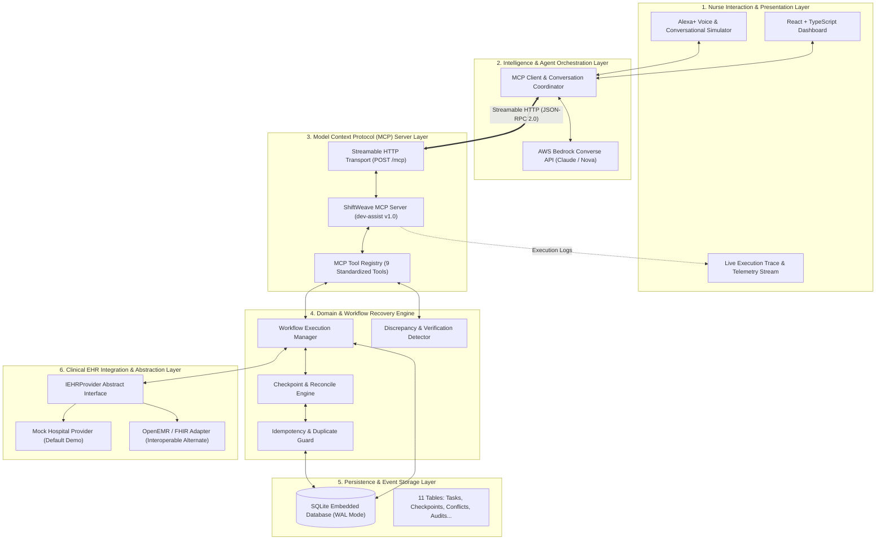
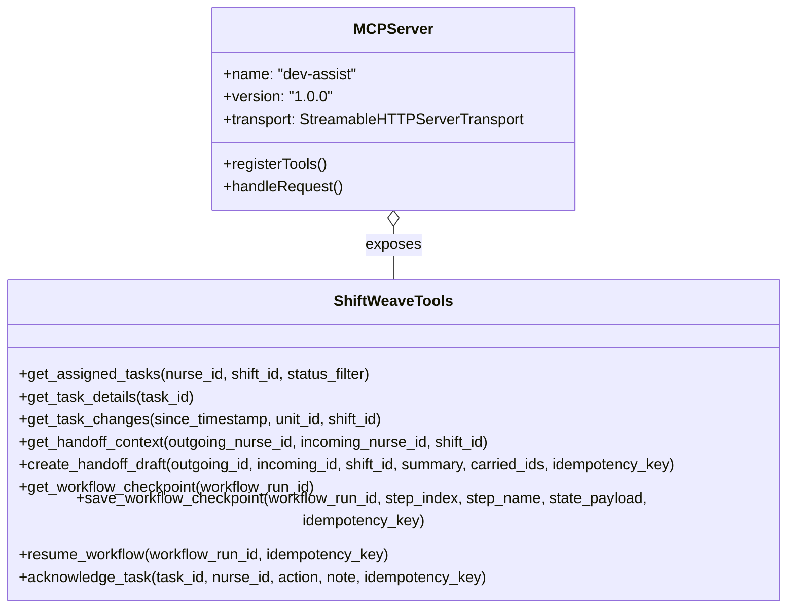

# ShiftWeave — System Architecture Specification

> **Document Version**: 1.0.0  
> **Status**: Approved Architectural Baseline  
> **Target Track**: Amazon Developer Hackathon — Alexa+ Track  
> **Transport**: Streamable HTTP (`StreamableHTTPServerTransport`)  
> **MCP Protocol Spec Version**: `2025-11-25`  
> **Mini Challenge**: AWS Bedrock Integration (Converse API)

---

## 1. System Overview & Architectural Topology

ShiftWeave is an MCP-native, AI-assisted nursing workflow coordination and failure recovery platform. It provides outgoing nurses (**Seema**) and incoming nurses (**Reema**) with automated, grounded shift handoffs, real-time discrepancy detection, and zero-loss workflow recovery across server or network interruptions.



---

## 2. Core Architectural Pillars

### Pillar 1: MCP Spec `2025-11-25` over Streamable HTTP
* The core server is built upon the official `@modelcontextprotocol/sdk` utilizing `StreamableHTTPServerTransport`.
* Transport operates over standard HTTP `POST /mcp` with streaming response chunks, strictly meeting the Alexa+ hackathon requirement.
* Exposes standardized capabilities through `tools/list` (runtime discovery) and `tools/call` (runtime invocation).

### Pillar 2: Deterministic State & Zero-Loss Recovery
* Multi-step operations (retrieving tasks $\to$ detecting conflicts $\to$ drafting handoff $\to$ transferring custody) are tracked inside `workflow_runs`.
* After every successful tool invocation, intermediate state is committed as an immutable entry in `workflow_checkpoints` accompanied by an `idempotency_key`.
* If a network failure, server crash, or client disconnect occurs, the agent does **not** blindly replay previous operations. Instead, it queries the latest checkpoint, verifies the current database truth, and resumes only the uncommitted work.

### Pillar 3: Provider Abstraction & Swappability (`IEHRProvider`)
* Clinical data sources are decoupled from the MCP server logic via an interface contract.
* This allows ShiftWeave to effortlessly switch between a local test fixture (`MockHospitalProvider`) and external health systems (`OpenEMRProvider`) without rewriting a single line of agent prompt or MCP tool schemas, proving genuine architectural interoperability to judges.

### Pillar 4: Observable Execution Trace Telemetry
* Every tool discovery, execution latency, argument payload, returned record, and checkpoint save is written to `audit_log`.
* This stream powers the React dashboard's live execution trace panel, allowing hospital supervisors and competition judges to inspect the reasoning and execution of the AI agent in real-time.

### Pillar 5: Strict Clinical Safety Guardrails
* **No Clinical Diagnostics**: The platform will not diagnose diseases, interpret EKGs/labs, or recommend treatment regimens.
* **No Autonomous Order Alterations**: AI does not write medication prescriptions or modify physician orders.
* **Non-Silent Conflict Resolution**: When clinical records conflict (e.g., EHR shows medication given, but nurse notes state delayed), the system isolates the discrepancy in the `conflicts` table and requires explicit human verification.

---

## 3. Subsystem Breakdown & Internal Architecture

### 3.1 Nurse Interaction Layer (Frontend)
The frontend serves a dual role:
1. **Alexa+ Conversational Experience**: Provides a voice/chat bubble interface simulating the Alexa+ assistant interaction (`"Alexa, what is pending for my shift, and what did Seema leave unresolved?"`).
2. **Clinical Shift Dashboard**:
   * **Shift Header**: Current unit, authenticated incoming nurse, outgoing nurse, and active shift countdown.
   * **Task Board**: Visual breakdown of tasks (Pending, In Progress, Completed, Flagged Conflict).
   * **Conflict Review Drawer**: Interactive panel presenting conflicting data sources (System A vs System B) requiring nurse confirmation.
   * **Handoff Report View**: Synthesized, structured markdown draft ready for sign-off.
   * **Live Execution Trace**: Chronological timeline displaying real MCP tool calls, latencies, and checkpoint saves.

---

### 3.2 Agent Orchestration Layer (AWS Bedrock & MCP Client)
The agent layer acts as the bridge between the nurse's natural language and the MCP server:

```
[Nurse Request] 
      │
      ▼
[Agent Orchestrator] ──(1. tools/list)──> [MCP Server]
      │                                         │
      ├<──────(Returns 9 Tool Schemas)──────────┘
      │
      ▼
[AWS Bedrock Converse API] (Prompt + Tools Config + Conversation History)
      │
      ├──────(Returns Tool Use Directive: "get_handoff_context")─────┐
      │                                                              │
      ▼                                                              ▼
[Agent Orchestrator] ──(2. tools/call: get_handoff_context)──> [MCP Server]
      │                                                              │
      ├<─────────(Returns Context JSON + Checkpoint Ref)─────────────┘
      │
      ▼
[AWS Bedrock Converse API] (Generates Grounded Summary)
      │
      ▼
[Nurse Response / UI Update]
```

* **LLM Provider Options (Side-by-Side Comparison)**:
  * **Option A: AWS Bedrock Converse API** *(Optional Mini-Challenge)*:
    * Used specifically if participating in the AWS Builder Mini Challenge and AWS IAM credentials are provided.
    * Models: `anthropic.claude-3-5-sonnet` or `amazon.nova-pro`.
  * **Option B: Google Gemini API / Free Mock Runner (Recommended Free & Fast Alternative)**:
    * **Cost**: $0.00 (100% Free tier).
    * **Setup Time**: Instant (no AWS credit card verification or model approval wait times).
    * **Operation**: Uses free Gemini Flash/Pro API or an internal tool-calling loop using standard OpenAI-compatible/Gemini endpoints.
* **Grounded Generation**: Irrespective of LLM provider, the model is prompted with strict instructions to generate handoff narratives using only retrieved tool data, eliminating hallucinations.

---

### 3.3 MCP Server Layer (`src/server.ts`)
* Built with Node.js, Express, and `@modelcontextprotocol/sdk`.
* Hosted on port `3000` exposing `POST /mcp`.
* Generates unique session IDs via `randomUUID()` per client connection.
* Implements the **9 Standardized Tools**:



---

### 3.4 Resilience & Recovery Engine
The failure recovery architecture ensures zero duplicate operations and transparent recovery:

```mermaid
sequenceDiagram
    autonumber
    actor Nurse as Reema (Incoming Nurse)
    participant UI as Dashboard / Voice Sim
    participant Agent as Agent Coordinator
    participant MCP as MCP Server
    participant DB as SQLite Storage
    participant Outage as Chaos / Outage Trigger

    Nurse->>UI: "Alexa, prepare my handoff and resume unfinished work"
    UI->>Agent: Initiate Workflow (workflow_type: GENERATE_HANDOFF)
    Agent->>MCP: tools/call: get_assigned_tasks
    MCP->>DB: Fetch tasks for Seema
    MCP->>DB: save_workflow_checkpoint (Step 1: FETCH_TASKS)
    MCP-->>Agent: Return task list

    Agent->>MCP: tools/call: get_task_changes
    MCP->>DB: save_workflow_checkpoint (Step 2: GET_CHANGES)
    MCP-->>Agent: Return changes

    Note over Outage,MCP: [SIMULATED CRASH / SERVER DROP]
    Outage->>MCP: Terminate process / Drop connection
    Agent--xMCP: tools/call: create_handoff_draft (FAILS / TIMEOUT)

    Note over Nurse,UI: Server restarts / Reconnected
    Nurse->>UI: "Alexa, resume my handoff workflow"
    UI->>Agent: Resume Request (workflow_run_id: wf_run_98234)
    Agent->>MCP: tools/call: resume_workflow (wf_run_98234)
    MCP->>DB: Query latest checkpoint
    DB-->>MCP: Last confirmed step = Step 2 (GET_CHANGES)
    MCP->>DB: Check current state in tasks table
    MCP-->>Agent: Recovery Plan: Steps 1 & 2 verified; DO NOT repeat. Resume at Step 3 (CREATE_DRAFT)
    Agent->>MCP: tools/call: create_handoff_draft (with idempotency_key)
    MCP->>DB: Commit Draft & Final Checkpoint
    MCP-->>Agent: Draft created successfully
    Agent-->>UI: Display completed handoff & recovery audit trace
```

---

### 3.5 Clinical Data & Provider Abstraction Layer

```typescript
export interface IEHRProvider {
  readonly providerId: string;
  readonly providerName: string;

  ping(): Promise<boolean>;
  getPatientsByUnit(unitId: string): Promise<Patient[]>;
  getTasksForNurse(nurseId: string, shiftId: string): Promise<Task[]>;
  getRecentEvents(since: Date): Promise<TaskEvent[]>;
  updateTaskStatus(taskId: string, newStatus: TaskStatus, idempotencyKey: string): Promise<{ success: boolean; committedVersion: string }>;
}
```

#### Provider Implementations (Side-by-Side Options):
1. **`MockEHRProvider`** (Primary Default Fixture — 100% Free & Local):
   * Loads realistic, de-identified ICU/Med-Surg clinical scenarios (Seema $\to$ Reema handoff).
   * Generates controlled status changes and deliberately injects realistic discrepancies (e.g., medication timing conflict in Room 305-B).
   * **Cost & Setup**: $0, instant (runs in-memory / local SQLite).
2. **Interoperable Provider 2 (Choose Option A or Option B)**:
   * **Option A: `AlternateHospitalMock` (Recommended Free & Fast Alternative)**:
     * Simulates a secondary regional hospital system exposing a distinct JSON/FHIR schema structure mapped through `IEHRProvider`.
     * **Advantage**: Proves 100% of the MCP provider-swapping value to judges in under 5 minutes without downloading Docker images or setting up external servers.
     * **Cost & Setup**: $0, 5 minutes.
   * **Option B: `OpenEMRProvider` (Heavy Production Alternative)**:
     * Connects via REST/FHIR standards to an external or Dockerized OpenEMR instance.
     * **Tradeoff**: Requires running a multi-container Docker stack (MySQL + Apache + OpenEMR) which requires high RAM and several hours of setup time. Use only if a pre-existing live OpenEMR server is already available.

---

### 3.6 Persistence Layer (SQLite Database Architecture)

Configured for high concurrency and resilience:
* **Journal Mode**: `WAL` (Write-Ahead Logging) allows concurrent readers alongside writers.
* **Foreign Keys**: `PRAGMA foreign_keys = ON;` enforces referential integrity.
* **Synchronous**: `NORMAL` ensures durability with sub-millisecond local latency.

```
┌────────────────────────────────────────────────────────┐
│                   SQLite Database                      │
├──────────────────────────┬─────────────────────────────┤
│ Clinical & Operations    │ Resilience & Traceability   │
├──────────────────────────┼─────────────────────────────┤
│ • patients               │ • workflow_runs             │
│ • nurses                 │ • workflow_checkpoints      │
│ • shifts                 │ • audit_log                 │
│ • tasks                  │ • task_events               │
│ • task_assignments      │ • conflicts                 │
│ • handoffs               │                             │
└──────────────────────────┴─────────────────────────────┘
```

---

## 4. MCP Streamable HTTP Protocol Implementation Details

### 4.1 Transport Endpoint Lifecycle
* **Endpoint**: `POST /mcp`
* **Headers**:
  * `Content-Type: application/json`
  * `Accept: application/json, text/event-stream`
* **Session Handling**: Handled via `StreamableHTTPServerTransport` with server-side session generator.
* **JSON-RPC Protocol Framing**:
  * Request:
    ```json
    {
      "jsonrpc": "2.0",
      "id": "req_001",
      "method": "tools/call",
      "params": {
        "name": "get_assigned_tasks",
        "arguments": {
          "nurse_id": "nurse_seema_01",
          "shift_id": "shift_20261019_night"
        }
      }
    }
    ```
  * Response:
    ```json
    {
      "jsonrpc": "2.0",
      "id": "req_001",
      "result": {
        "content": [
          {
            "type": "text",
            "text": "{\"tasks_count\": 4, \"tasks\": [...]}"
          }
        ]
      }
    }
    ```

---

## 5. Security, Safety, and Compliance Architecture

| Architectural Layer | Threat / Risk | Architectural Mitigation |
| :--- | :--- | :--- |
| **Clinical Safety** | Agent gives unauthorized dosage or diagnostic advice | Rigid prompt boundaries + system policy reject filters. Output validation rejects diagnostic keywords. |
| **Data Integrity** | Interrupted write causes duplicate task execution | UUIDv4 `idempotency_key` enforced at database unique constraint level. Duplicate transactions return previously committed record. |
| **Discrepancy Resolution** | Agent silently accepts wrong task status | System isolates conflicting sources into `conflicts` table. UI requires explicit nurse verification. |
| **Access Control** | Unauthenticated user views patient roster | Nurse badge validation and shift context checked in `get_assigned_tasks`. |
| **Audit Compliance** | System actions cannot be verified | All tool executions, arguments, latencies, and outcomes written to immutable `audit_log`. |

---

## 6. Architecture Verification Matrix

| Requirement | Hackathon / Document Source | ShiftWeave Architectural Component |
| :--- | :--- | :--- |
| **MCP Spec $\ge$ 2025-11-25** | `important.md.docx` | `@modelcontextprotocol/sdk` v1.32+ with standard tool schemas |
| **Streamable HTTP Transport** | `important.md.docx` | `StreamableHTTPServerTransport` on Express `/mcp` in `src/server.ts` |
| **AWS Bedrock Integration** | `important.md.docx` (Mini Challenge) | Bedrock Converse API ToolConfig matching MCP schemas |
| **Creative Multi-turn Workflow** | `important.md.docx` | Multi-step handoff generation, conflict isolation, and interruption recovery |
| **Persistent Recovery** | `ShiftWeave_Project_Document.docx` | `workflow_checkpoints` + `workflow_runs` with idempotency tokens |
| **Provider Swappability** | `ShiftWeave_Project_Document.docx` | `IEHRProvider` interface swapping `MockEHR` with `OpenEMR` |
| **Observable UI Trace** | `ShiftWeave_Project_Document.docx` | Real-time streaming from `audit_log` to React Dashboard |
| **Field Schema Consistency** | `field_schema.md` | All 11 entities directly aligned with database repositories |

---

## 7. Zero-Cost & Rapid Development Feasibility Matrix

To ensure that the project is **100% free of cloud costs**, requires **no credit card approvals**, and can be developed rapidly within **1 to 2 days**, the architecture provides a lightweight, local-first alternative for every component:

| System Layer | Default "Heavy / Paid" Approach | **Recommended Free & Fast Alternative** | Cost | Setup Time | Local Feasibility |
| :--- | :--- | :--- | :--- | :--- | :--- |
| **Database** | Cloud Postgres / RDS / AWS DynamoDB | **Embedded SQLite (WAL Mode)** | **$0.00** | **1 minute** | 100% Local file (`shiftweave.db`), zero installation needed. |
| **Transport** | AWS API Gateway / Cloud Hosting | **Local Express + Streamable HTTP** | **$0.00** | **Already in repo** | Runs locally on `http://localhost:3000/mcp`. |
| **EHR Provider 1** | Complex FHIR Server Integration | **`MockEHRProvider`** (TypeScript in-memory) | **$0.00** | **10 minutes** | Realistic clinical mock data loaded with Seema $\to$ Reema scenario. |
| **EHR Provider 2 (Interoperability)** | Full Dockerized OpenEMR + MySQL + Apache | **`AlternateHospitalMock`** (JSON Adapter) | **$0.00** | **15 minutes** | Fully proves MCP runtime discovery and provider swapping to judges without Docker or heavy RAM usage. |
| **AI / Agent** | AWS Bedrock (Requires AWS account, billing, model approval) | **Google Gemini Free Tier / Local Mock Runner** | **$0.00** | **2 minutes** | Zero credit card needed. Instant API key or local mock loop. (AWS Bedrock adapter remains as a plug-in toggle). |
| **Frontend UI** | Cloud Vercel/Amplify Deployment | **Local React + Vite Dashboard** | **$0.00** | **5 minutes** | Runs on `http://localhost:5173` with instant hot-reload. |
| **Resilience Chaos** | Chaos Mesh / AWS Fault Injection | **In-Memory Network Disconnect Button** | **$0.00** | **5 minutes** | Simple toggle endpoint on Express to simulate connection drop and test recovery. |

### Conclusion on Feasibility:
* **Total Financial Cost**: **$0.00** (Zero).
* **Total External Dependencies**: None (No Docker containers, no paid cloud accounts, no credit card required).
* **Development Velocity**: Complete end-to-end working pipeline (Backend + SQLite + MCP Server + Frontend Dashboard) can be fully implemented and verified in 1–2 days.

