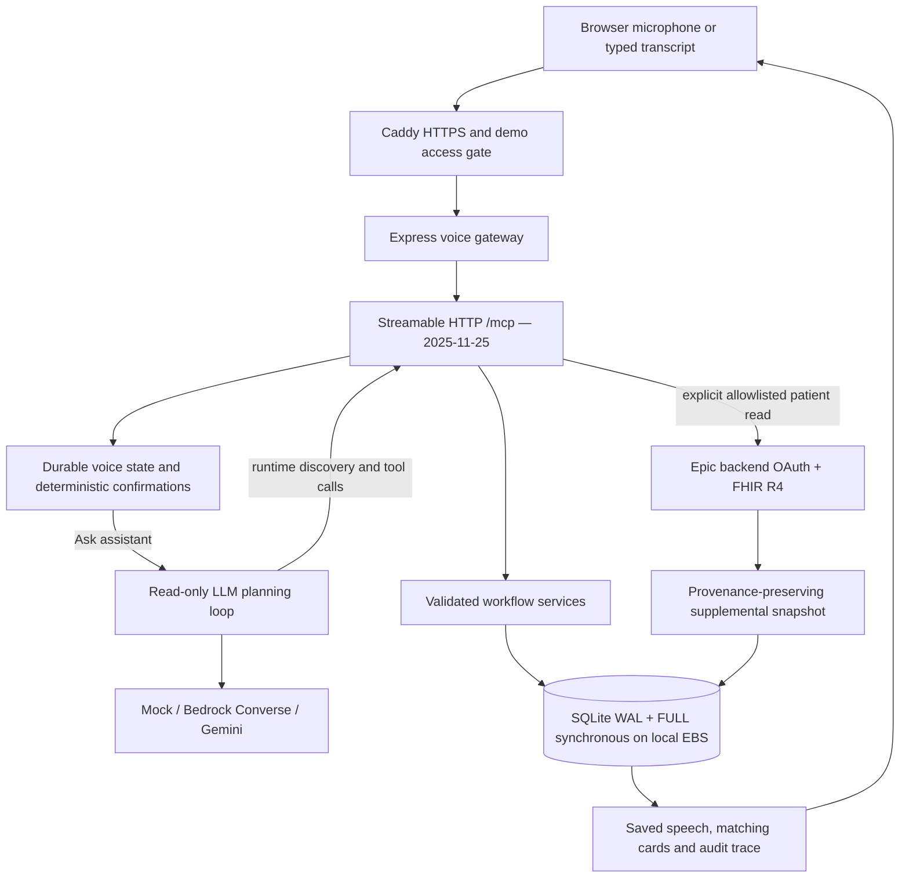

# Deployment architecture and tradeoffs

This decision applies to the current hackathon implementation, not every future hospital deployment. The primary optimization is trustworthy completion of a nursing workflow with visible evidence and low operational complexity.

## Why this topology

| Decision | Reason | Tradeoff |
| --- | --- | --- |
| Always-on EC2 process | Preserves HTTP MCP sessions, avoids application scale-to-zero cold starts, supports ordinary Node/native SQLite | Host administration and ongoing cost; no automatic multi-zone failover |
| One origin for UI/API/MCP | Simple browser routing, HTTPS microphone support and fewer cross-origin failure modes | Shared deployment lifecycle |
| SQLite on EBS-backed local filesystem | Existing SQL joins and atomic receipt/domain/event/checkpoint transactions remain intact | One writer host; disk failure needs backup recovery |
| No DynamoDB rewrite | Current schema/services use joins and synchronous SQL transactions throughout; changing storage is a redesign, not an environment switch | A future multi-region service needs a deliberate data-access redesign |
| Bedrock optional | Real AWS tool-use integration can substantiate mini-challenge participation | Model access, cost, region and IAM remain user configuration |
| Deterministic confirmations | Models cannot authorize custody, resolve discrepancies or publish notes merely by emitting a tool call | Less open-ended phrasing for state-changing actions |
| Epic as supplemental source | Approved patient reads can be shown without pretending medication orders are nurse assignments | Hospital identity, roster, encounter and task mappings remain separate work |

EBS is attached block storage; use a filesystem mounted on the same host as SQLite. SQLite WAL is not designed for processes accessing one file across an NFS/EFS network filesystem. EBS persistence does not remove the need for off-host backups. A second app replica sharing this database is unsupported. The deployed demo is not highly available.

## Reliability and correctness

1. Voice clients retain the exact request UUID across ambiguous network failures and page refreshes.
2. The gateway initializes a real MCP session and calls `voice_turn`. The server validates tool arguments and display revision.
3. Local mutations commit their receipt, domain changes, checkpoint and audit in a SQLite transaction. FULL synchronous strengthens commit durability; busy timeout tolerates brief lock contention.
4. Assistant execution persists planned tool intent before invocation and the observed result afterward. A lost response is reconciled against durable state before replaying remaining steps.
5. The assistant's read-only path exposes only permitted tools; the execution guard also rejects forbidden calls. Human commands go through deterministic source-version checks and confirmation expiry.
6. External reads run outside database transactions. The final snapshot and receipt are committed atomically. Failed/partial retrieval is not represented as an empty success.
7. The voice display commits only at the expected revision, keeping spoken output and visible state together. Per-session locking prevents concurrent voice commands in the single process.

MCP supplies transport and discovery, not business-level exactly-once semantics. These guarantees come from services and database constraints. Server restart invalidates MCP sessions but does not erase workflow checkpoints. Receipts are retained with workflow history; independent three-day pruning has been removed. Historical database rollback, full disk loss and remote writes with uncertain outcomes remain outside a universal zero-loss guarantee.

## Latency design

The fast path for identity, task display and explicit confirmations is deterministic and makes no LLM call. “Ask assistant…” invokes the selected planner only when requested. The planner uses discovered tool schemas, bounded sequential execution and a per-iteration time-budget check. Each model request has a timeout. Bedrock reuses its client across the turn, caps output tokens and avoids hidden SDK retries. The bridge uses local HTTP within the host, so MCP calls do not traverse the public TLS endpoint.

The time-budget check is not a strict global cancellation deadline: an already-running request can continue until its own timeout. Ambiguous failure preserves the retry key and checkpoint. Never auto-retry a human or external write just to reduce perceived latency.

Measure these separately:

- `LLM:DECISION`: time until a complete planning response, labelled by provider and iteration.
- `ORCHESTRATOR:TOOL_CALL:*`: actual tool duration.
- `VOICE:TURN_FINISHED`: server-side voice turn duration and receipt outcome.
- Smoke test discovery time: transport initialize plus runtime tool discovery.

These are **not TTFT**. Current LLM responses are buffered, browser speech begins after a complete response, and browser recognition/network/TTS time is outside the server metric. MCP's streaming-capable transport alone does not imply token streaming. Add provider streaming and cancellation-aware speech only after evaluating partial-output safety; do not claim it is implemented here.

For a defensible latency report, capture at least 20 runs per scenario/model on the target host, separate warm/cold starts and successful/failed turns, and publish p50/p95 with sample counts. No target percentile is asserted without measurement. Do not choose a model by a synthetic speed claim alone.

## Reasoning accuracy and clinical scope

Use the model for bounded tool planning. Preserve native tool-use IDs and results, constrain nurse/shift arguments server-side, and render nurse-facing facts from retrieved records. Existing deterministic rendering replaces free-form cloud-model final prose. This reduces ungrounded clinical narration but also limits conversational flexibility; it is not proof of universal reasoning correctness.

Evaluate: wrong-nurse queries, stale confirmations, conflicting status, missing source data, prompt-like text inside records, repeated requests, interrupted writes and lost responses. A successful demo shows refusal or an explicit error where appropriate. Do not add automatic “best guess” diagnosis, treatment, medication administration or order updates.

## Judging alignment

- **Idea:** multi-turn handoff with explicit custody and interruption recovery rather than Q&A alone.
- **Technical:** actual MCP discovery, version negotiation, durable receipts, source reconciliation and measured traces.
- **Design:** one voice/display state, clear source labels, human confirmation, typed fallback and visible errors.
- **Impact:** accountable nursing coordination. Do not claim clinical outcome improvements without a study.
- **AWS mini challenge:** demonstrate a real Bedrock turn or deployed AWS infrastructure and document the integration; configuration files alone are not evidence of execution or an award.
- **Friction log:** record observed integration problems and resolutions honestly. The rules permit up to 10% bonus; they do not guarantee it.

See the official references and operational instructions in [DEPLOYMENT.md](../DEPLOYMENT.md).
