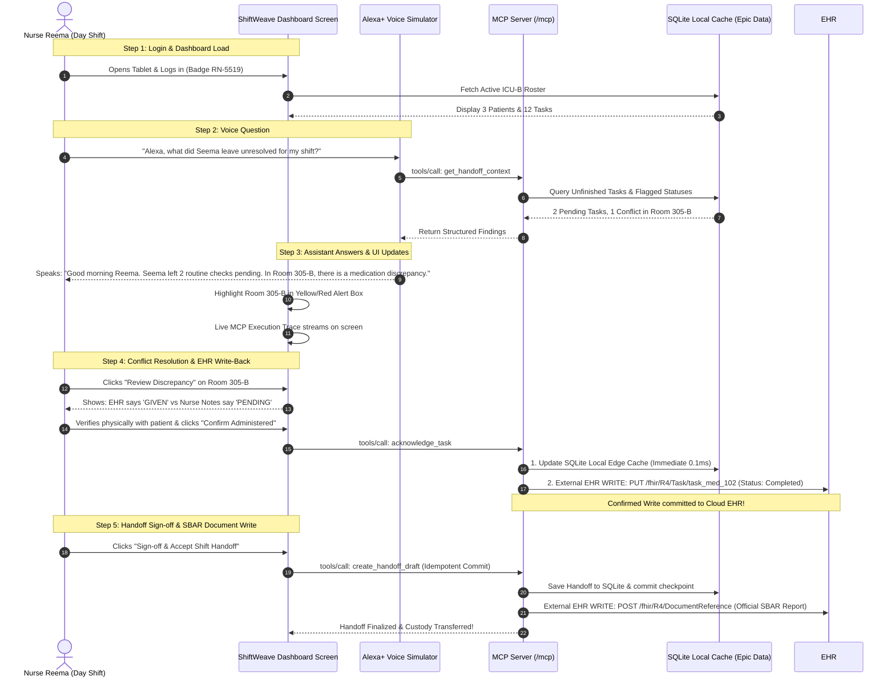

# ShiftWeave — How It Works (End-to-End System, Data & UI Guide)

> **Implementation note (20 October 2026):** This document includes intended design and historical claims. Use [IMPLEMENTATION_STATUS.md](IMPLEMENTATION_STATUS.md) for current verified behavior and limitations; use [incomingapikey.md](incomingapikey.md) for corrected Epic API guidance. External write-back, production authentication, universal recovery guarantees and fixed latency claims are not established by this document.

> **Goal of this Document**: Explain in simple, intuitive terms exactly how the entire system works, how hospital data (Epic / FHIR) is used, and what a nurse actually sees on the UI screen step-by-step.

---

## 1. The Core Hospital Problem: Seema $\to$ Reema Shift Change

Imagine a real hospital ICU at **6:55 AM**:
* **Seema** has been working the 12-hour night shift (7 PM to 7 AM). She is exhausted.
* **Reema** arrives for the day shift (7 AM to 7 PM).
* **The Dilemma**:
  * Reema needs to know in 5 minutes:
    1. Kaunse patients mere under hain?
    2. Seema ne kya complete kiya aur kya pending chhod diya?
    3. Kya kisi record mein **confusion/conflict** hai? (Jaise system bol raha hai injection lag gaya, par Seema ke note mein likha hai injection pharmacy se aaya hi nahi!)
    4. Agar handoff draft banate waqt light chali jaye ya server band ho jaye, toh kya dubara shuru se karna padega?

---

## 2. Epic Systems vs ShiftWeave: Kaun Kya Karta Hai?

Ek simple analogy se samajhte hain:

```
┌──────────────────────────────────────────────┐
│  Epic Systems / Hospital EHR                 │
│  (Central Database / System of Record)       │
│  • Patient Master Record                     │
│  • Doctor Prescriptions                      │
│  • Lab Test History                          │
└──────────────────────┬───────────────────────┘
                       │ 
                       ▼ (Sync via FHIR R4 Standard Format)
┌──────────────────────────────────────────────┐
│  ShiftWeave (Local MCP AI Assistant)         │
│  • Live Shift Coordination                   │
│  • Nursing Task Custody (Seema → Reema)      │
│  • Conflict Detection (EHR vs Nurse Notes)   │
│  • Zero-Loss Checkpoint Recovery             │
│  • Alexa+ Voice / UI Dashboard               │
└──────────────────────────────────────────────┘
```

### Kyun hum Dataset / Local Cache use karte hain?
1. **Epic Central EHR** bohot bada aur slow hota hai. Emergency ICU mein nurse har 2 second mein Epic ke heavy cloud par request nahi bhej sakti.
2. Hospital mein ShiftWeave ek **Edge Cache** ki tarah kaam karta hai:
   * Epic FHIR format ka data ShiftWeave ke SQLite database mein cached rehta hai.
   * Nurse ka handoff **instant (0ms delay)** hota hai.
   * Agar hospital ka internet cut ho jaye, tab bhi handoff chalta rahega!

---

## 3. Step-by-Step User Journey: Reema Shift Kaise Legi?



---

## 4. UI Screen-by-Screen Walkthrough (What User Sees)

### Screen 1: The Main Shift Dashboard
Jab Reema subah login karegi, screen par yeh dikhega:

```
┌──────────────────────────────────────────────────────────────────────────────────────────────────┐
│ 🏥 ShiftWeave | AI Shift Coordination & Recovery                     [● MCP Server: Connected]   │
├──────────────────────────────────────────────────────────────────────────────────────────────────┤
│ CURRENT SHIFT: ICU-B Ward                                                                        │
│ Outgoing: Seema Patel, RN (Night Shift)  ➔  Incoming: Reema Roy, RN (Day Shift)                  │
│ Shift Time: 07:00 AM - 07:00 PM  |  Sync Status: Synced with Epic FHIR Cache (06:58 AM)          │
├───────────────────────────────────────────────────┬──────────────────────────────────────────────┤
│ 📋 ACTIVE PATIENT TASK BOARD                      │ 💬 ALEXA+ & MCP OBSERVABILITY PANEL          │
│                                                   │                                              │
│ [Filter: All (12) | Pending (2) | Conflict (1)]   │ ┌──────────────────────────────────────────┐ │
│                                                   │ │ 🎙️ Alexa+ Conversational Assistant       │ │
│ ┌──────────────────────────────────────────────┐  │ │                                          │ │
│ │ 🛏️ Room 304-A | James Clark (Acuity 2)       │  │ │ Reema: "Alexa, what did Seema leave      │ │
│ │ • 06:00 AM - Q4 Vitals & Neuro Check [✓ DONE]│  │ │        unresolved for my shift?"         │ │
│ │ • 08:00 AM - Morning Blood Sugar    [⏳ PEND] │  │ │                                          │ │
│ └──────────────────────────────────────────────┘  │ │ Alexa+: "Seema completed 9 tasks.        │ │
│                                                   │ │         2 routine checks are pending.    │ │
│ ┌──────────────────────────────────────────────┐  │ │         Room 305-B has a status conflict │ │
│ │ 🛏️ Room 305-B | Elena Rostova (Acuity 1)     │  │ │         requiring verification."         │ │
│ │ • 06:00 AM - IV Vancomycin 1g                │  │ └──────────────────────────────────────────┘ │
│ │   ⚠️ STATUS CONFLICT DETECTED!               │  │                                              │
│ │   Epic EHR: COMPLETED vs Notes: PENDING      │  │ ┌──────────────────────────────────────────┐ │
│ │   [ 👉 Click to Review & Resolve ]           │  │ │ ⚡ Real-Time MCP Execution Trace         │ │
│ └──────────────────────────────────────────────┘  │ │ [07:00:10] tools/list (9 tools)     10ms │ │
│                                                   │ │ [07:00:11] get_assigned_tasks       24ms │ │
│ ┌──────────────────────────────────────────────┐  │ │ [07:00:12] get_handoff_context      32ms │ │
│ │ 🛏️ Room 306   | Marcus Vance (Acuity 3)      │  │ │ [07:00:13] save_checkpoint (chk_01) 8ms  │ │
│ │ • 06:30 AM - IV Saline Flush        [✓ DONE] │  │ └──────────────────────────────────────────┘ │
│ └──────────────────────────────────────────────┘  │                                              │
└───────────────────────────────────────────────────┴──────────────────────────────────────────────┘
```

---

### Screen 2: The Conflict Review Modal (Handling Medical Discrepancy)
Jab Reema **"Click to Review & Resolve"** par click karti hai, yeh safety popup khulta hai:

```
┌────────────────────────────────────────────────────────────────────────┐
│ ⚠️ DISCREPANCY DETECTED: Room 305-B (Elena Rostova)                    │
├────────────────────────────────────────────────────────────────────────┤
│ Order: IV Vancomycin 1g Infusion (Scheduled 06:00 AM)                  │
│                                                                        │
│  Source A: Epic EHR System           Source B: Nurse Shift Notes       │
│  ┌───────────────────────────────┐   ┌───────────────────────────────┐ │
│  │ Status: COMPLETED             │   │ Status: PENDING               │ │
│  │ Logged: 06:10 AM by Barcode   │   │ Note: "Awaiting pharmacy      │ │
│  │ Machine ID: BC-Pump-04        │   │        batch release at 06:30"│ │
│  └───────────────────────────────┘   └───────────────────────────────┘ │
│                                                                        │
│ 🛡️ Safety Rule: AI is NOT allowed to guess. Reema must confirm:       │
│                                                                        │
│ [ ✓ Confirm Given to Patient ]  [ ⏳ Mark as Delayed ]  [ 🚩 Escalate ]│
└────────────────────────────────────────────────────────────────────────┘
```
Reema buttons me se select karegi $\to$ Background mein MCP tool `acknowledge_task` run hoga $\to$ Database instantly update ho jayega!

---

### Screen 3: Interruption & Failure Recovery Demo (The Hackathon Winning Feature!)
Judges ko dikhane ke liye screen ke niche ek **Chaos Simulator** box hoga:

```
┌──────────────────────────────────────────────────────────────────────────────────────────────────┐
│ 🧪 HACKATHON JUDGING DEMO CONTROLS (Simulating Failures & Interoperability)                       │
├──────────────────────────────────────────────────────────────────────────────────────────────────┤
│                                                                                                  │
│  [ 💥 Button 1: Simulate Server Crash / Network Drop ]                                            │
│    • Dikhata hai ki handoff generate hote waqt beech mein connection cut ho gaya.                │
│    • UI par message aayega: "⚠️ Connection Lost! Last confirmed state saved at Checkpoint #2."  │
│                                                                                                  │
│  [ 🔄 Button 2: Reconnect & Resume Workflow ]                                                     │
│    • Server reconnect hote hi MCP tool `resume_workflow` call hoga.                              │
│    • System Step 1 aur 2 ko DOBARA RUN NAHI KAREGA (zero duplicate work).                        │
│    • Seedhe Step 3 se resume karke handoff ready kar dega!                                       │
│                                                                                                  │
│  [ 🔀 Button 3: Swap Provider (Epic Cache ➔ Alternate Hospital API) ]                             │
│    • Prove karega ki bina agent code badle hum backend provider swap kar sakte hain.             │
└──────────────────────────────────────────────────────────────────────────────────────────────────┘
```

---

## 5. Summary: Data Kaise Use Hoga?

1. **Input Data**:
   * Patient profile, allergies, task names, aur scheduled times **Epic on FHIR standard format** mein aate hain.
   * Hamari `src/db/ingest.ts` pipeline unhe SQLite mein load karti hai.
2. **Runtime Use**:
   * Nurse bolti hai $\to$ LLM MCP tool call karta hai $\to$ SQLite se instant data read hota hai $\to$ Screen par real-time task status aur live tool execution stream dikhta hai.
3. **Safety & Zero-Loss**:
   * Discrepancies nurse ko alert karti hain.
   * Server crash hone par koi data loss nahi hota, checkpoint se resume ho jata hai.

Yeh pura flow **100% Free, Local, aur Instant** chalega!
