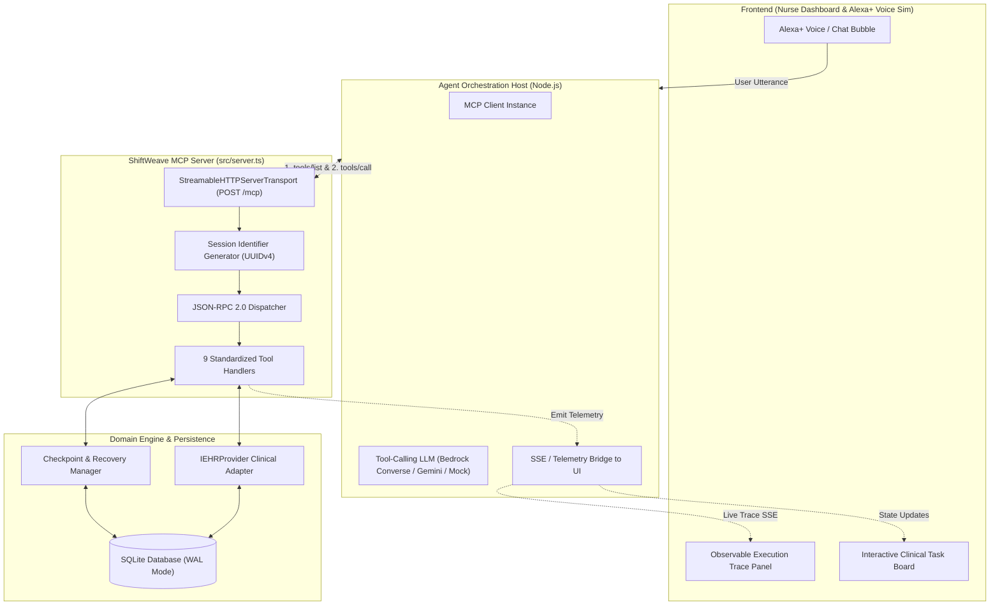
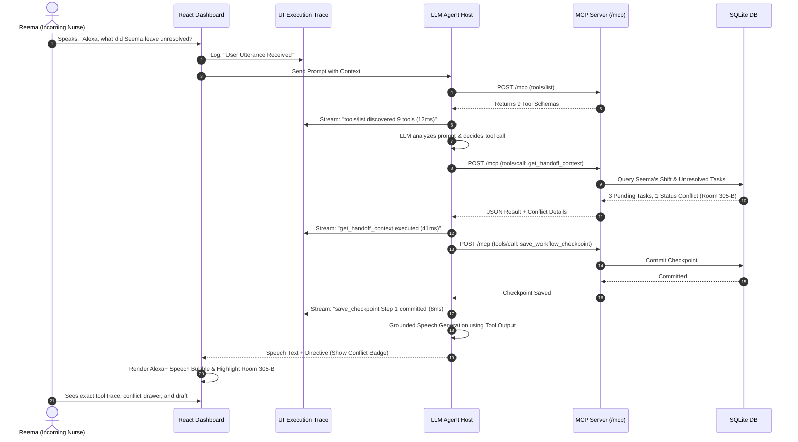

# ShiftWeave — Model Context Protocol (MCP) & UI Architecture Deep Dive

> **Document Version**: 1.0.0  
> **Status**: Approved Architectural & UI Guide  
> **MCP Protocol Spec Version**: `2025-11-25` (or later)  
> **Transport**: Streamable HTTP (`StreamableHTTPServerTransport`) on Express `/mcp`  
> **Target Track**: Amazon Developer Hackathon — Alexa+ Track

---

## 1. What is MCP & Why it is the Core of ShiftWeave

The **Model Context Protocol (MCP)** is an open protocol developed to standardize how AI applications, agents, and large language models (LLMs) discover, inspect, and invoke tools, data resources, and prompts exposed by host servers.

In ShiftWeave, MCP is **not** a basic database wrapper. It serves as:
1. **Dynamic Tool Discovery Surface**: The LLM agent does not hardcode what it can do; it queries `tools/list` over Streamable HTTP at runtime to discover capabilities, schemas, and parameter constraints.
2. **Provider-Agnostic Clinical Layer**: Exposes standardized nursing tools that remain identical whether connected to our local test provider (`MockEHRProvider`) or a hospital system (`OpenEMR`).
3. **Observable Execution Pipeline**: Every tool invocation produces structured telemetry that streams directly to the nurse-facing React dashboard.
4. **Resilient Transaction Boundary**: Every stateful tool call enforces idempotency and writes to `workflow_checkpoints` to allow zero-loss recovery from mid-turn crashes.

---

## 2. MCP Technical Protocol Architecture

ShiftWeave implements MCP over **Streamable HTTP** on Express endpoint `POST /mcp` as mandated by the hackathon requirements.

### 2.1 Protocol Topology



---

### 2.2 Why Streamable HTTP Transport?

Unlike legacy `stdio` (which requires local CLI process spawning) or legacy HTTP+SSE (which required dual unidirectional endpoints), **Streamable HTTP** (`StreamableHTTPServerTransport`):
* Operates over a single standard HTTP route (`POST /mcp`).
* Supports bidirectional chunked transfer encoding and event streams over standard web infrastructure.
* Assigns each connection a cryptographically unique `sessionId` via `randomUUID()`.
* Fully decouples the agent/client from the server host.

### 2.3 JSON-RPC 2.0 Handshake & Message Lifecycle

All MCP communications follow the JSON-RPC 2.0 specification:

#### 1. Runtime Tool Discovery (`tools/list`)
Before making decisions, the agent queries the server to inspect what tools exist:

**Request**:
```json
{
  "jsonrpc": "2.0",
  "id": 1,
  "method": "tools/list",
  "params": {}
}
```

**Response**:
```json
{
  "jsonrpc": "2.0",
  "id": 1,
  "result": {
    "tools": [
      {
        "name": "get_assigned_tasks",
        "description": "Retrieve tasks assigned to the authenticated nurse for the active shift.",
        "inputSchema": {
          "type": "object",
          "properties": {
            "nurse_id": { "type": "string", "description": "Unique nurse ID" },
            "shift_id": { "type": "string", "description": "Optional shift filter" },
            "status_filter": { "type": "array", "items": { "type": "string" } }
          },
          "required": ["nurse_id"]
        }
      },
      {
        "name": "resume_workflow",
        "description": "Verifies state and identifies remaining unexecuted work after an interruption.",
        "inputSchema": {
          "type": "object",
          "properties": {
            "workflow_run_id": { "type": "string" },
            "idempotency_key": { "type": "string" }
          },
          "required": ["workflow_run_id", "idempotency_key"]
        }
      }
    ]
  }
}
```

#### 2. Runtime Tool Invocation (`tools/call`)
When the LLM decides to execute an action (e.g. fetching tasks for Seema):

**Request**:
```json
{
  "jsonrpc": "2.0",
  "id": 2,
  "method": "tools/call",
  "params": {
    "name": "get_assigned_tasks",
    "arguments": {
      "nurse_id": "nurse_seema_01",
      "shift_id": "shift_20261019_night"
    }
  }
}
```

**Response**:
```json
{
  "jsonrpc": "2.0",
  "id": 2,
  "result": {
    "content": [
      {
        "type": "text",
        "text": "{\"shift_id\":\"shift_20261019_night\",\"tasks_count\":4,\"tasks\":[{\"task_id\":\"task_vital_101_01\",\"patient_name\":\"James Clark\",\"room\":\"Room 304-A\",\"status\":\"COMPLETED\"}]}"
      }
    ],
    "isError": false
  }
}
```

---

## 3. The 9 MCP Tools: Internal Processing Map

ShiftWeave registers 9 specialized tools inside `src/server.ts`:

| # | Tool Name | Scope | Idempotent | Purpose |
| :-: | :--- | :---: | :---: | :--- |
| **1** | `get_assigned_tasks` | Query | Yes | Fetches active tasks assigned to a specific nurse badge. |
| **2** | `get_task_details` | Query | Yes | Pulls complete clinical context, patient details, and change history. |
| **3** | `get_task_changes` | Query | Yes | Retrieves events that occurred since a given timestamp or checkpoint. |
| **4** | `get_handoff_context` | Query | Yes | Compiles cross-patient operational summaries and uncompleted tasks. |
| **5** | `create_handoff_draft`| Mutation | Yes (Key) | Commits structured, grounded handoff narrative to database. |
| **6** | `get_workflow_checkpoint` | Query | Yes | Retrieves the latest checkpoint for an in-progress or interrupted run. |
| **7** | `save_workflow_checkpoint` | Mutation | Yes (Key) | Saves intermediate state to enable zero-loss resumption after failure. |
| **8** | `resume_workflow` | Mutation | Yes (Key) | Reconciles database state vs checkpoint; executes only remaining steps. |
| **9** | `acknowledge_task` | Mutation | Yes (Key) | Records explicit human sign-off, conflict resolution, or custody transfer. |

---

## 4. UI Architecture & MCP Real-Time Integration

The React dashboard is designed around **real-time observability** of the MCP server. Rather than hiding behind an opaque chat window, the UI visually exposes MCP tool invocations, state checkpoints, and recovery traces.

### 4.1 Dashboard Layout Architecture

```
┌──────────────────────────────────────────────────────────────────────────────────────────────────┐
│  ShiftWeave | Nursing Shift Handoff & Recovery Coordinator             [● MCP Server: Connected] │
├──────────────────────────────────────────────────────────────────────────────────────────────────┤
│  SHIFT STATUS HEADER                                                                             │
│  Unit: ICU-B  |  Outgoing: Seema Patel, RN  |  Incoming: Reema Roy, RN  |  Shift End: 07:00 AM   │
├───────────────────────────────────────────────────┬──────────────────────────────────────────────┤
│  AREA A: CLINICAL TASK BOARD & CONFLICTS          │  AREA B: ALEXA+ & MCP EXECUTION TRACE        │
│                                                   │                                              │
│  [Filter: All (12) | Pending (2) | Conflict (1)]  │  ┌────────────────────────────────────────┐  │
│                                                   │  │ 💬 Alexa+ Conversational Assistant     │  │
│  ┌─────────────────────────────────────────────┐  │  │                                        │  │
│  │ Room 304-A | James Clark (Post-op)          │  │  │ Nurse: "Alexa, what's pending for my   │  │
│  │ • Q4 Vitals & Neuro Check [COMPLETED ✓]     │  │  │         shift from Seema?"             │  │
│  └─────────────────────────────────────────────┘  │  │                                        │  │
│  ┌─────────────────────────────────────────────┐  │  │ Alexa+: "I found 3 tasks pending. Room │  │
│  │ Room 305-B | Elena Rostova (Sepsis)         │  │  │         305-B has a status conflict    │  │
│  │ ⚠ IV Vancomycin [FLAGGED CONFLICT]          │  │  │         between EHR & notes."          │  │
│  │   EHR: COMPLETED vs Notes: PENDING          │  │  └────────────────────────────────────────┘  │
│  │   [Review & Resolve Button]                 │  │                                              │
│  └─────────────────────────────────────────────┘  │  ┌────────────────────────────────────────┐  │
│                                                   │  │ ⚡ Live MCP Execution Trace (Real-time)│  │
│  ┌─────────────────────────────────────────────┐  │  │                                        │  │
│  │ 📋 Shift Handoff Report Draft               │  │  │ [07:01:02] tools/list (9 tools)   12ms │  │
│  │ Status: UNDER REVIEW                        │  │  │ [07:01:03] get_assigned_tasks     34ms │  │
│  │ Carried-Forward: 3 Tasks                    │  │  │ [07:01:04] get_handoff_context    41ms │  │
│  │ Summary: Generated from verified records.   │  │  │ [07:01:05] save_checkpoint (Step 1) 9ms │  │
│  │ [Sign-off & Accept Custody Button]          │  │  │ [07:01:06] ⚠ SIMULATED DISCONNECT DROP! │  │
│  └─────────────────────────────────────────────┘  │  │ [07:01:12] resume_workflow (Chkpt 1)15ms│  │
│                                                   │  └────────────────────────────────────────┘  │
│                                                   │                                              │
│  CHAOS SIMULATOR CONTROLS:                        │                                              │
│  [⚡ Simulate Server Crash]   [🔄 Reconnect & Resume Workflow]   [🔀 Swap to Alternate Provider]   │
└───────────────────────────────────────────────────┴──────────────────────────────────────────────┘
```

---

### 4.2 Key UI Components & How They Interact with MCP

#### Component 1: Live MCP Execution Trace Panel (The Judging Differentiator)
* **What it shows**:
  * Real-time stream of every JSON-RPC tool call sent over Streamable HTTP.
  * Method names, arguments, execution latencies (e.g., `24ms`), and returned JSON outputs.
  * Checkpoint commit badges showing when state was written to SQLite.
* **Why it matters**:
  * Judges in the Alexa+ track look for **observable execution** rather than a "black box" chatbot.
  * Proves that the assistant is executing genuine protocol tool calls against a verified database.

#### Component 2: Conflict Review Drawer (Safety First)
* **Triggered by**: MCP tool `get_handoff_context` discovering discrepancies.
* **What it shows**:
  * Side-by-side card: **System A (EHR Core)** says *Administered at 06:10* vs **System B (Nurse Note)** says *Pending pharmacy release*.
  * Action Buttons: `Verify Administered`, `Mark as Delayed`, `Flag for Charge Nurse`.
* **MCP Action**: Clicking an action sends an explicit `acknowledge_task` tool call with an `idempotency_key` and nurse digital sign-off.

#### Component 3: Chaos Interruption & Zero-Loss Recovery Simulator
* **Interactive Control**:
  * Button: **"Simulate Server Crash"** (cuts the connection mid-turn while drafting handoff).
  * The UI immediately displays an **"Interrupted"** warning badge and shows the last confirmed checkpoint ID (`chk_5510`).
  * Button: **"Reconnect & Resume Workflow"**: Triggers `resume_workflow`.
  * The UI trace visually illustrates the server querying current state and skipping already-committed steps to finalize the handoff without duplicate writes.

#### Component 4: Swappable Provider Toggle
* **Interactive Control**: Dropdown switching between **`MockEHRProvider`** and **`AlternateHospitalMock`**.
* **What happens**:
  * The UI triggers an immediate `tools/list` reload.
  * Displays the secondary hospital dataset while the Alexa+ conversation loop continues to work seamlessly without rewriting prompts.

---

## 5. End-to-End Sequence: Voice Request to UI Trace



---

## 6. Hackathon Scoring Alignment (MCP & UI)

| Hackathon Evaluation Area | How ShiftWeave's MCP + UI Solves It |
| :--- | :--- |
| **Streamable HTTP Mandate** | Implemented on Express `/mcp` using `StreamableHTTPServerTransport` with dynamic UUID sessions. |
| **MCP Spec $\ge$ 2025-11-25** | Compliant schemas, tool contracts, and JSON-RPC 2.0 streaming envelopes. |
| **Creative vs Obvious** | **Not an obvious CRUD bot**: Features autonomous multi-turn coordination, runtime discovery, swappable provider abstraction, and verified recovery. |
| **Observable Traces** | React dashboard renders real-time tool invocations, latencies, checkpoint IDs, and payloads. |
| **Clinical Safety** | Ambient coordination only; isolated discrepancy drawer ensures human nurse sign-off. |
