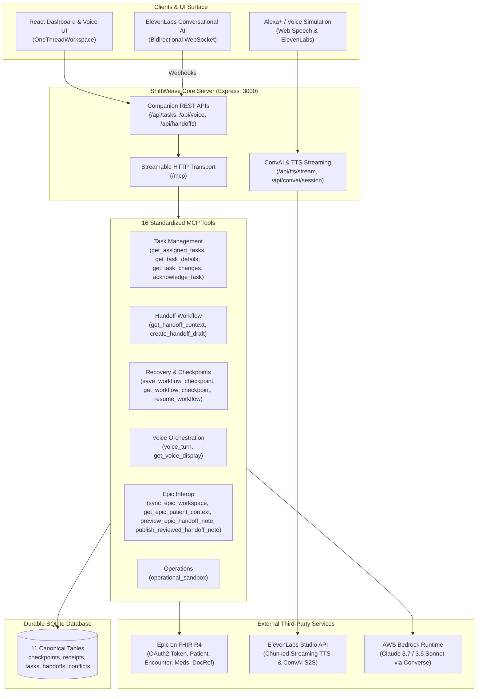

# ShiftWeave — Complete MCP & API Endpoints Reference

> **Document Purpose**: Comprehensive catalog of all MCP tools, internal Express HTTP endpoints, and external third-party API calls (Epic on FHIR, ElevenLabs, AWS Bedrock) active across the ShiftWeave platform.
> **Protocol Standard**: Model Context Protocol (MCP) Spec `2025-11-25` over **Streamable HTTP** (`StreamableHTTPServerTransport`).

---

## Architecture Overview

---

## 1. Official MCP Tools (16 Registered Tools)

All tools are mounted via `StreamableHTTPServerTransport` on `/mcp`. They enforce strict input validation via Zod schemas, write audit traces, and commit durable SQLite checkpoints.

| # | Tool Name | Description | Key Parameters | Durable State / Checkpoint |
|---|---|---|---|---|
| **1** | `get_assigned_tasks` | Fetches active clinical and bedside coordination tasks for an authenticated nurse during a specific shift. | `nurse_id` (string), `shift_id` (string, optional), `status_filter` (array) | Audited to `audit_logs`. |
| **2** | `get_task_details` | Retrieves full task parameters, room/bed, patient identity, and flags active discrepancies. | `task_id` (string) | Resolves linked records in `conflicts`. |
| **3** | `get_task_changes` | Returns task audit history and status modifications since a given ISO timestamp. | `since_timestamp` (ISO string), `unit_id` (string, optional) | Audited with query latency. |
| **4** | `get_handoff_context` | Aggregates all metrics, pending tasks, discrepancies, and Epic source summaries required to build an SBAR handoff. | `outgoing_nurse_id` (string), `incoming_nurse_id` (string), `shift_id` (string) | Returns authoritative metrics & field authority matrix. |
| **5** | `create_handoff_draft` | Compiles and persists a structured clinical shift handoff draft grounded in verified data. | `outgoing_nurse_id`, `incoming_nurse_id`, `shift_id`, `summary_markdown`, `carried_forward_task_ids`, `idempotency_key` | Commits to `handoffs` table; does **not** transfer custody automatically. |
| **6** | `get_workflow_checkpoint` | Retrieves the latest checkpoint state payload for an interrupted or active workflow run. | `workflow_run_id` (string) | Reads from `workflow_checkpoints`. |
| **7** | `save_workflow_checkpoint` | Commits intermediate workflow state to storage to guarantee zero-loss interruption recovery. | `workflow_run_id`, `step_index` (int), `step_name`, `state_payload` (JSON), `idempotency_key` | Writes atomic row into `workflow_checkpoints`. |
| **8** | `resume_workflow` | Reconciles state after a crash or disconnect, verifies remote commits, and plans remaining steps without duplicate actions. | `workflow_run_id`, `idempotency_key` | Reconciles SQLite state before resuming remaining actions. |
| **9** | `acknowledge_task` | Records explicit human verification, task completion, or conflict resolution. | `task_id`, `nurse_id`, `human_confirmed: true`, `action` (`ACCEPT_HANDOFF` \| `RESOLVE_CONFLICT` \| `FLAG_FOR_SUPERVISOR`), `idempotency_key` | Updates `task_assignments` and records immutable audit event. |
| **10** | `voice_turn` | Executes a multi-turn nursing voice turn with clinical guardrails, fact citations, and state recovery. | `utterance`, `session_id`, `expected_revision`, `idempotency_key` | Writes to `operation_receipts` and persists assistant speech. |
| **11** | `get_voice_display` | Reads the active session's screen state, nurse profile, task counts, conflicts, and imported Epic snapshots. | `session_id` (UUID) | Authorizes owning staff account if staff-auth mode is active. |
| **12** | `preview_epic_handoff_note` | Previews a single-patient handoff narrative with encounter linkage and cryptographic review hash. | `handoff_id`, `nurse_id` | Generates deterministic SHA-256 review hash without writing to Epic. |
| **13** | `publish_reviewed_handoff_note` | Writes a finalized, human-confirmed handoff note to external Epic FHIR R4 as a `DocumentReference`. | `handoff_id`, `nurse_id`, `human_confirmed: true`, `idempotency_key`, `review_hash`, `execution_mode` | Validates human confirmation before issuing FHIR `POST`. |
| **14** | `get_epic_patient_context` | Retrieves supplemental clinical records (encounters, orders, documents) for an allowlisted test patient. | `patient_id`, `idempotency_key` | Supplemental records only; orders do not establish administration. |
| **15** | `sync_epic_workspace` | Refreshes allowlisted Epic patients into durable local snapshots and coordination tasks. | `nurse_id`, `shift_id`, `idempotency_key` | Preserves existing task custody; no silent mock fallback. |
| **16** | `operational_sandbox` | Unified dispatcher for roster, care-team assignments, staff directory, notes, and sandbox document publishing. | `action` (string), `input` (record) | Validates role permissions and atomic schema operations. |

---

## 2. ShiftWeave Server HTTP Endpoints (Express App)

### A. Protocol Transport & Core Diagnostics
* `POST /mcp` — Initializes MCP Streamable HTTP session or handles client tool calls (`MCP-Protocol-Version: 2025-11-25`).
* `GET /mcp` — Server-Sent Events (SSE) stream for real-time MCP notifications.
* `DELETE /mcp` — Explicitly closes an active MCP session and flushes state.
* `GET /health` — Health check endpoint returning active provider status, LLM mode, Epic status, active sessions, and uptime.
* `GET /readyz` — Kubernetes/container readiness probe checking database connectivity.

### B. Voice & Speech Endpoints
* `POST /api/voice` — Submits a voice utterance through the MCP `voice_turn` bridge.
  * **Payload**: `{ "session_id": string, "utterance": string, "expected_revision": number, "idempotency_key": string }`
* `GET /api/voice/:sessionId` — Retrieves current voice workspace display, nurse scope, tasks, and speech transcript.
* `POST /api/tts` — High-fidelity Text-to-Speech synthesis returning full MP3 audio buffer (with automatic Web Speech API fallback).
* `ALL /api/tts/stream` — **Ultra-low latency streaming TTS** (`POST` or `GET`). Pipes chunked `audio/mpeg` frames from ElevenLabs Flash v2.5 directly to the client (first audio chunk in **~317ms**).
* `GET /api/convai/session` — Provides session configuration and signed WebSocket URL for ElevenLabs Conversational AI S2S mode.
* `POST /api/convai/tools` — Webhook handler for ElevenLabs Conversational AI server tools:
  * `tool_name: "get_voice_context"`: Reads current nurse context.
  * `tool_name: "execute_voice_turn"`: Executes workflow action with idempotency key.

### C. Clinical Dashboard Companion APIs
* `GET /api/tasks` — Lists assigned tasks, priority, room numbers, and conflict flags.
* `POST /api/tasks/:id/acknowledge` — Records nurse verification or handoff custody acceptance.
* `GET /api/handoffs` — Lists drafted, accepted, and finalized shift handoffs.
* `POST /api/handoffs/:id/finalize` — Locks handoff from further edits and prepares it for sign-off.
* `GET /api/handoffs/:id/epic-note-preview` — Generates encounter-linked note preview and hash.
* `POST /api/handoffs/:id/publish-note` — Publishes verified note to Epic FHIR R4.
* `GET /api/conflicts` — Lists active documentation discrepancies requiring human review.
* `POST /api/conflicts/:id/resolve` — Staged human resolution note and target status.
* `GET /api/execution-trace` — Returns recent structured audit logs for live transparency panels.
* `POST /api/chaos/simulate` — Injects test faults (network drops, worker crash, mid-turn restart) to test recovery.
* `POST /api/provider/switch` — Dynamically toggles between SQLite Edge Cache and Live FHIR API providers.
* `GET /api/providers` — Lists registered provider adapters.
* `POST /api/chat` — Fallback text chat endpoint using orchestrator planning.
* `GET /api/conversations/:id` — Retrieves historical multi-turn transcript for a session.

### D. Operational Staff & Auth Endpoints
* `GET /api/staff/config` — Checks if mandatory hospital staff authentication is required.
* `POST /api/staff/login` — Authenticates clinical staff credentials (nurse, supervisor, physician).
* `GET /api/staff/me` — Returns principal and active role of authenticated user.
* `POST /api/staff/logout` — Revokes session tokens and clears cached credentials.
* `POST /api/operations/:action` — Dispatches operational actions (roster updates, team assignment, sandbox publish).

---

## 3. External API Calls (Third-Party Integrations)

### A. ElevenLabs Voice & Conversational AI APIs

| Method & URL | Function in Codebase | Purpose | Latency Profile |
|---|---|---|---|
| `POST https://api.elevenlabs.io/v1/text-to-speech/{voiceId}/stream` | [`ElevenLabsService.streamSpeech`](file:///C:/Users/siddh/Desktop/dev_assist/src/services/elevenlabs.service.ts#L48-L92) | Chunked real-time MP3 streaming using `eleven_flash_v2_5`. Audio begins playing on first chunk. | **~317ms** first chunk |
| `POST https://api.elevenlabs.io/v1/text-to-speech/{voiceId}` | [`ElevenLabsService.synthesizeSpeech`](file:///C:/Users/siddh/Desktop/dev_assist/src/services/elevenlabs.service.ts#L94-L140) | Full-buffer audio synthesis fallback. | ~800ms–1,200ms |
| `GET https://api.elevenlabs.io/v1/convai/conversation/get-signed-url?agent_id={id}` | [`ElevenLabsService.getSignedConvaiUrl`](file:///C:/Users/siddh/Desktop/dev_assist/src/services/elevenlabs.service.ts#L32-L46) | Generates short-lived signed tokens for private Conversational AI agents. | ~150ms |
| `POST https://api.elevenlabs.io/v1/convai/agents/create` | Programmatic registration | Registers the `Medi` conversational agent with hospital guardrails. | One-time setup |
| `GET https://api.elevenlabs.io/v1/convai/agents` | Verification | Lists active Conversational AI agents and checks permission validity. | ~200ms |
| `WSS wss://api.elevenlabs.io/v1/convai/conversation?agent_id={id}` | Client WebRTC / WebSocket | Full-duplex speech-to-speech with live VAD and barge-in interruption. | <500ms end-to-end |

### B. Epic on FHIR R4 APIs

All Epic requests use **SMART on FHIR Backend Services OAuth 2.0** with asymmetric private-key JWT signatures (`RS384`).

| Epic API Name & Path | Method | ShiftWeave Usage | Safety & Data Boundary |
|---|---|---|---|
| `OAuth2 Token`: `/oauth2/token` | `POST` | Exchanges signed JWT assertion for scoped access token (`system/Patient.read`, `system/DocumentReference.write`, etc.). | Ephemeral tokens cached in memory. |
| `Patient.Read`: `/api/FHIR/R4/Patient/{id}` | `GET` | Fetches patient legal name, birthdate, and hospital MRN. | Demographics only; bed/unit not inferred. |
| `Encounter.Search`: `/api/FHIR/R4/Encounter?patient={id}` | `GET` | Discovers active ICU hospitalization, admission date, and attending service. | Location mappings strictly verified. |
| `MedicationRequest.Search`: `/api/FHIR/R4/MedicationRequest?patient={id}` | `GET` | Retrieves signed prescription orders for shift context. | **Prescribed ≠ Administered**. Orders never modified. |
| `DocumentReference.Search`: `/api/FHIR/R4/DocumentReference?patient={id}` | `GET` | Discovers historical shift handoffs and nursing clinical notes. | Attachment references identified. |
| `Binary.Read`: `/api/FHIR/R4/Binary/{id}` | `GET` | Reads underlying clinical text/markdown referenced by a `DocumentReference`. | Follows linked attachments when not inline. |
| `DocumentReference.Create`: `/api/FHIR/R4/DocumentReference` | `POST` | Publishes finalized, human-reviewed handoff note into Epic EHR. | **Disabled unless `EPIC_WRITES_ENABLED=true`**. Requires explicit human confirmation. |

### C. AWS Bedrock Runtime APIs (Optional Mini-Challenge)

| Service & Command | Model ID | Purpose |
|---|---|---|
| `BedrockRuntimeClient.send(ConverseCommand)` | `us.anthropic.claude-sonnet-4-6` (or configured `BEDROCK_MODEL_ID`) | Multi-turn semantic agent reasoning, natural language intent classification, and MCP tool orchestration. |

---

## 4. Client-Side API Call Mapping

The React frontend (`client/src`) accesses the platform via modular API wrappers:

* [`client/src/voice-api.ts`](file:///C:/Users/siddh/Desktop/dev_assist/client/src/voice-api.ts):
  * `readVoiceDisplay()` $\longrightarrow$ `GET /api/voice/:sessionId`
  * `sendVoiceTurn()` $\longrightarrow$ `POST /api/voice`
* [`client/src/useVoiceConversation.ts`](file:///C:/Users/siddh/Desktop/dev_assist/client/src/useVoiceConversation.ts):
  * `speak()` $\longrightarrow$ `ALL /api/tts/stream?text=...` (chunked streaming audio playback with native fallback)
* [`client/src/operational-api.ts`](file:///C:/Users/siddh/Desktop/dev_assist/client/src/operational-api.ts):
  * `staffRequest()` $\longrightarrow$ `/api/staff/*` and `/api/operations/*`
* [`client/src/api.ts`](file:///C:/Users/siddh/Desktop/dev_assist/client/src/api.ts):
  * `fetchTasks()` $\longrightarrow$ `GET /api/tasks`
  * `fetchConflicts()` $\longrightarrow$ `GET /api/conflicts`
  * `fetchHandoffs()` $\longrightarrow$ `GET /api/handoffs`
  * `fetchExecutionTrace()` $\longrightarrow$ `GET /api/execution-trace`
  * `switchProvider()` $\longrightarrow$ `POST /api/provider/switch`

---

## 5. Verification & Testing

Every listed endpoint and MCP tool is covered by automated verification scripts:
* **All MCP Tools & Workflow Contracts**: `npm test` (`scripts/run-tests.ts all`) — **165/165 passing**.
* **ElevenLabs Streaming & ConvAI S2S**: `npm run test:elevenlabs` (`scripts/test-elevenlabs.ts`).
* **Epic FHIR R4 Integration**: `npm run test:epic` (`scripts/test-epic-connection.ts`).
* **Bedrock Converse Runtime**: `scripts/verify-bedrock-connection.ts`.
