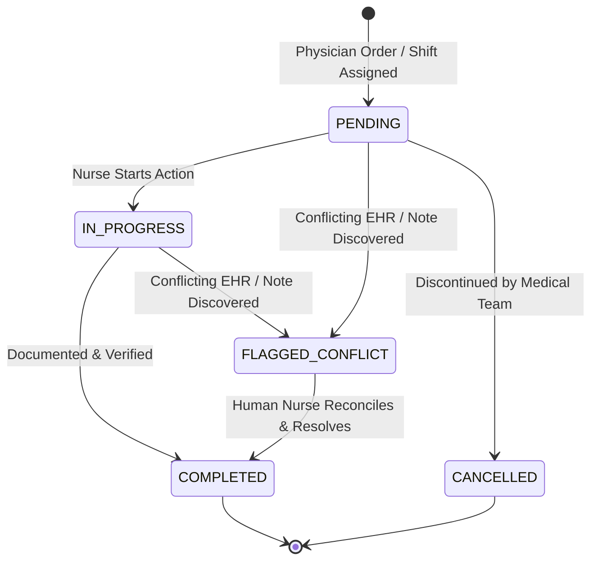
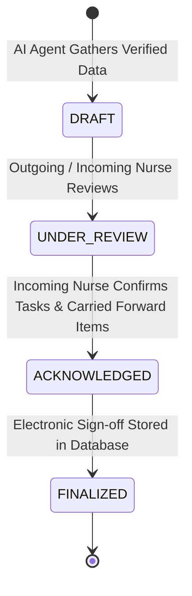
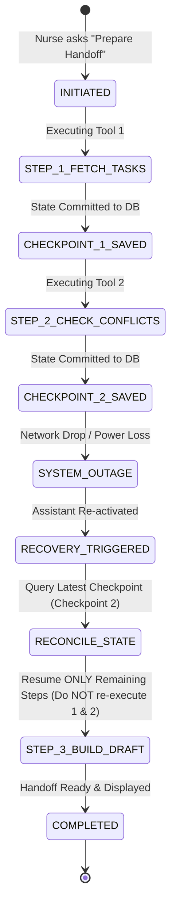

# ShiftWeave — Database & Workflow Plain Schema Specification

> **Target**: Amazon Developer Hackathon — Alexa+ Track  
> **Purpose**: Conceptual Database Blueprint, Complete Entity Relationships & Detailed Field Catalog  
> **Format**: Plain Descriptive Schema & Visual ER Diagrams (Zero Programming Code)

---

## 1. High-Level Architectural Context & Data Flow

ShiftWeave is designed to automate nursing shift handoffs (e.g., **Seema** handing off to **Reema**) on a **Hybrid Edge-Cache Architecture**:
* **External Layer**: Syncs patient rosters and medication orders via open-source healthcare APIs (Epic on FHIR / HAPI FHIR R4 standard).
* **Local Edge Cache (SQLite)**: Provides microsecond query speeds (0.1ms) at the nurse station tablet, guaranteeing 100% availability during hospital Wi-Fi drops, and preserving progress when a workflow is interrupted.

### Core Data Responsibilities:
1. **Clinical Roster & Task Core**: Patients, their assigned unit, clinical tasks, and real-time statuses synced into the local edge cache.
2. **Shift & Explicit Ownership**: Clear separation between who worked on a task (outgoing nurse) vs who takes responsibility (incoming nurse). Tasks are **never** silently transferred.
3. **Change History & Conflict Tracking**: Full event log of what changed during the shift and explicit flagging of discrepancies between hospital EHR data and nurse notes.
4. **Handoff Document**: The synthesized handoff summary, carried-forward tasks, and sign-offs.
5. **Workflow State & Zero-Loss Recovery**: Checkpoints and idempotency keys to ensure failure recovery resumes cleanly from the exact step of interruption.
6. **Execution Audit Log**: Complete observable trace of tool calls and actions.

---

## 2. Big Format Entity Relationship Diagram (ERD)

```mermaid
erDiagram
    PATIENTS ||--o{ TASKS : "has_clinical_orders"
    TASKS ||--o{ TASK_ASSIGNMENTS : "assigned_via"
    TASKS ||--o{ TASK_EVENTS : "generates_history"
    TASKS ||--o{ CONFLICTS : "triggers_discrepancies"

    NURSES ||--o{ TASK_ASSIGNMENTS : "performs_work"
    NURSES ||--o{ HANDOFFS : "gives_handoff_as_outgoing"
    NURSES ||--o{ HANDOFFS : "receives_handoff_as_incoming"
    NURSES ||--o{ WORKFLOW_RUNS : "initiates_actions"

    SHIFTS ||--o{ TASK_ASSIGNMENTS : "scoped_to_shift"
    SHIFTS ||--o{ HANDOFFS : "summarizes_shift"

    WORKFLOW_RUNS ||--o{ WORKFLOW_CHECKPOINTS : "persists_intermediate_steps"
    WORKFLOW_RUNS ||--o{ AUDIT_LOG : "records_execution_trace"

    PATIENTS {
        string id PK "Unique Patient Identifier"
        string mrn UK "Medical Record Number"
        string full_name "Patient Full Legal Name"
        string room_number "Room Identifier"
        string bed_number "Bed Designation"
        timestamp admission_date "Admission Timestamp"
        integer acuity_level "Clinical Severity (1 to 5)"
        string allergies "List of known patient allergies"
        string primary_diagnosis "Admitting Diagnosis"
        timestamp created_at "Record Creation Time"
    }

    NURSES {
        string id PK "Unique Nurse Identifier"
        string badge_number UK "Hospital Staff Badge ID"
        string full_name "Nurse Full Name with Credentials"
        string email UK "Official Hospital Email"
        string department "Assigned Clinical Unit / Ward"
        string role "Staff Nurse / Charge Nurse / Relief Nurse"
        timestamp created_at "Account Creation Time"
    }

    SHIFTS {
        string id PK "Unique Shift Identifier"
        string unit_id "Nursing Unit or Ward Code"
        string shift_type "Day / Night / Rotating"
        timestamp start_time "Official Shift Start"
        timestamp end_time "Official Shift End"
        string status "Upcoming / Active / Handoff In Progress / Closed"
        timestamp created_at "Creation Timestamp"
    }

    TASKS {
        string id PK "Unique Task Identifier"
        string patient_id FK "Reference to Patient"
        string title "Concise Clinical Action Title"
        string description "Detailed Instructions or Protocols"
        string category "Vital / Medication / Lab / Wound / Mobility / Consult"
        string status "Pending / In Progress / Completed / Cancelled / Flagged Conflict"
        string priority "STAT / Urgent / Routine"
        timestamp scheduled_time "Planned Execution Time"
        timestamp completed_time "Actual Completion Timestamp"
        string source_system "Originating Source (EHR / Lab / Manual)"
        timestamp created_at "Order Entry Timestamp"
        timestamp updated_at "Last Modified Timestamp"
    }

    TASK_ASSIGNMENTS {
        string id PK "Unique Assignment Identifier"
        string task_id FK "Reference to Task"
        string nurse_id FK "Assigned Nurse"
        string shift_id FK "Shift Context"
        string transfer_status "Active / Carried Forward / Transferred / Unassigned"
        timestamp assigned_at "Timestamp of Allocation"
        string assigned_by "Assigner (Charge Nurse / System / Self)"
    }

    TASK_EVENTS {
        string id PK "Unique Event Sequence ID"
        string task_id FK "Reference to Task"
        string event_type "Status Transition / Reassignment / Note Added"
        string previous_value "Previous State Snapshot"
        string new_value "New State Snapshot"
        string source "EHR Sync / Nurse Action / Agent Workflow"
        string actor_id "Nurse ID or System Service"
        string idempotency_key UK "Prevents Duplicate Event Ingestion"
        timestamp timestamp "Occurrence Timestamp"
        string metadata "Additional Contextual Data"
    }

    CONFLICTS {
        string id PK "Unique Conflict Tracking ID"
        string task_id FK "Associated Task"
        string conflict_type "Status Mismatch / Duplicate Order / Stale Data"
        string system_a_name "Primary System Name (e.g. EHR Core)"
        string system_a_val "Value Recorded in System A"
        string system_b_name "Secondary System Name (e.g. Nurse Notes)"
        string system_b_val "Value Recorded in System B"
        string status "Unresolved / Verified Resolved / Dismissed"
        string resolution_note "Clinical Nurse Explanation"
        string resolved_by FK "Nurse Resolving the Conflict"
        timestamp resolved_at "Resolution Timestamp"
        timestamp detected_at "Detection Timestamp"
    }

    HANDOFFS {
        string id PK "Unique Handoff Report ID"
        string shift_id FK "Associated Shift"
        string outgoing_nurse_id FK "Outgoing Nurse (Seema)"
        string incoming_nurse_id FK "Incoming Nurse (Reema)"
        string status "Draft / Under Review / Acknowledged / Finalized"
        string summary_markdown "AI-Generated Grounded Shift Summary"
        string data_snapshot "JSON Freeze of all Tasks & Patient States"
        integer unresolved_conflicts_count "Total Pending Conflicts"
        timestamp created_at "Generation Timestamp"
        timestamp acknowledged_at "Sign-off Timestamp"
    }

    WORKFLOW_RUNS {
        string id PK "Unique Workflow Execution ID"
        string workflow_type "Generate Handoff / Recover Interrupted Shift"
        string initiated_by FK "Nurse or System Initiator"
        string status "Initiated / In Progress / Interrupted / Completed / Failed"
        string error_message "Failure Diagnostics if Aborted"
        timestamp created_at "Start Timestamp"
        timestamp updated_at "Last Updated Timestamp"
    }

    WORKFLOW_CHECKPOINTS {
        string id PK "Unique Checkpoint ID"
        string workflow_run_id FK "Reference to Workflow Run"
        integer step_index "Ordered Step Number (1, 2, 3...)"
        string step_name "Named Phase (e.g. Fetch Tasks, Check Conflicts)"
        string state_payload "Frozen State of Step Calculations"
        string idempotency_key UK "Deduplication & Exact-Once Token"
        timestamp created_at "Checkpoint Persistence Time"
    }

    AUDIT_LOG {
        string id PK "Unique Audit Entry ID"
        string actor_type "Nurse / Agent / MCP Server / System"
        string actor_id "ID of Actor Performing Operation"
        string action "Specific Operation or Tool Invocated"
        string target_resource "Entity Affected"
        string outcome "Success / Failure / Recovered"
        string details "Full Tool Request/Response Details"
        integer latency_ms "Execution Time in Milliseconds"
        timestamp timestamp "Execution Timestamp"
    }
```

---

## 3. Detailed Entity & Field-by-Field Specifications

---

### Entity 1: `PATIENTS` (Clinical Care Roster)
* **Purpose**: Holds de-identified patient demographics, current bed locations, and clinical context.
* **Domain Role**: All nursing orders, vital checks, and handoff summaries anchor to a patient.

| Field Name | Type | Key / Constraint | Description & Purpose | Real-World Example |
| :--- | :--- | :--- | :--- | :--- |
| `id` | TEXT | **PRIMARY KEY** | Unique system patient identifier. | `pt_101` |
| `mrn` | TEXT | **UNIQUE, NOT NULL** | Medical Record Number for institutional tracking. | `MRN-90210` |
| `full_name` | TEXT | **NOT NULL** | Patient's full name. | `James Clark` |
| `room_number` | TEXT | **NOT NULL** | Hospital room number. | `Room 304` |
| `bed_number` | TEXT | **NOT NULL** | Specific bed identifier inside room. | `Bed A` |
| `admission_date` | TIMESTAMP | **NOT NULL** | Date/time patient was admitted to the unit. | `2026-10-15 14:30:00` |
| `acuity_level` | INTEGER | **NOT NULL (1 to 5)** | Clinical severity score (1 = critical/resuscitation, 5 = stable). | `2` (High care) |
| `allergies` | TEXT | *Nullable* | Comma-separated or listed substance allergies. | `Penicillin, Latex, NSAIDs` |
| `primary_diagnosis`| TEXT | **NOT NULL** | Chief medical reason for ongoing hospitalization. | `Post-op Laparoscopic Cholecystectomy` |
| `created_at` | TIMESTAMP | **DEFAULT NOW** | When record was established in the system. | `2026-10-15 14:30:00` |

---

### Entity 2: `NURSES` (Caregiver Directory)
* **Purpose**: Identifies registered nurses, their roles, credentials, and default nursing units.
* **Domain Role**: Enables clear identification of who did the work (**Seema**) and who takes over (**Reema**).

| Field Name | Type | Key / Constraint | Description & Purpose | Real-World Example |
| :--- | :--- | :--- | :--- | :--- |
| `id` | TEXT | **PRIMARY KEY** | Unique nurse identifier. | `nurse_seema_01` |
| `badge_number` | TEXT | **UNIQUE, NOT NULL** | Physical hospital badge identification number. | `RN-4402` |
| `full_name` | TEXT | **NOT NULL** | Full legal name and professional designation. | `Seema Patel, RN, BSN` |
| `email` | TEXT | **UNIQUE, NOT NULL** | Hospital system communication email. | `seema.patel@hospital.org` |
| `department` | TEXT | **NOT NULL** | Clinical unit or ward. | `ICU-B` |
| `role` | TEXT | **NOT NULL** | Allowed values: `STAFF_NURSE`, `CHARGE_NURSE`, `RELIEF_NURSE`. | `STAFF_NURSE` |
| `created_at` | TIMESTAMP | **DEFAULT NOW** | Account creation timestamp. | `2026-01-10 09:00:00` |

---

### Entity 3: `SHIFTS` (Shift Boundaries & Units)
* **Purpose**: Defines operational time windows for hospital shifts and their active status.
* **Domain Role**: Groups patient rosters, task assignments, and handoffs into concrete shift cycles.

| Field Name | Type | Key / Constraint | Description & Purpose | Real-World Example |
| :--- | :--- | :--- | :--- | :--- |
| `id` | TEXT | **PRIMARY KEY** | Unique shift identifier. | `shift_20261019_night` |
| `unit_id` | TEXT | **NOT NULL** | Designated hospital ward or intensive care pod. | `ICU-B` |
| `shift_type` | TEXT | **NOT NULL** | Allowed values: `DAY`, `NIGHT`, `ROTATING`. | `NIGHT` |
| `start_time` | TIMESTAMP | **NOT NULL** | Official start timestamp of the shift. | `2026-10-18 19:00:00` |
| `end_time` | TIMESTAMP | **NOT NULL** | Official end timestamp of the shift. | `2026-10-19 07:00:00` |
| `status` | TEXT | **NOT NULL** | Allowed: `UPCOMING`, `ACTIVE`, `HANDOFF_IN_PROGRESS`, `CLOSED`. | `HANDOFF_IN_PROGRESS` |
| `created_at` | TIMESTAMP | **DEFAULT NOW** | Record initialization timestamp. | `2026-10-18 18:00:00` |

---

### Entity 4: `TASKS` (Clinical Tasks & Orders)
* **Purpose**: Specific clinical activities or monitoring duties prescribed for a patient.
* **Domain Role**: The central unit of nursing work. Monitored for pending status, completion, or conflict.

| Field Name | Type | Key / Constraint | Description & Purpose | Real-World Example |
| :--- | :--- | :--- | :--- | :--- |
| `id` | TEXT | **PRIMARY KEY** | Unique task identifier. | `task_vital_101_01` |
| `patient_id` | TEXT | **FOREIGN KEY (PATIENTS.id)** | Links task directly to the patient receiving care. | `pt_101` |
| `title` | TEXT | **NOT NULL** | Short, standard action title. | `Q4 Vital Signs & Neuro Check` |
| `description` | TEXT | *Nullable* | Instructions, targets (e.g. keep MAP > 65), or parameters. | `Check Glasgow Coma Scale, pupil response, BP Q4H` |
| `category` | TEXT | **NOT NULL** | Category: `VITAL`, `MEDICATION_CHECK`, `LAB_DRAW`, `WOUND_CARE`, `MOBILITY`, `CONSULT`, `DISCHARGE_PREP`. | `VITAL` |
| `status` | TEXT | **NOT NULL** | State: `PENDING`, `IN_PROGRESS`, `COMPLETED`, `CANCELLED`, `FLAGGED_CONFLICT`. | `COMPLETED` |
| `priority` | TEXT | **NOT NULL** | Priority: `STAT` (immediate), `URGENT` (<2 hrs), `ROUTINE`. | `ROUTINE` |
| `scheduled_time` | TIMESTAMP | **NOT NULL** | Target execution time during the shift. | `2026-10-19 06:00:00` |
| `completed_time` | TIMESTAMP | *Nullable* | Timestamp when nurse marked task complete. | `2026-10-19 06:14:30` |
| `source_system` | TEXT | **NOT NULL** | Source system: `EHR_PRIMARY`, `LAB_FEED`, `MANUAL_ENTRY`. | `EHR_PRIMARY` |
| `created_at` | TIMESTAMP | **DEFAULT NOW** | Order creation timestamp. | `2026-10-18 20:00:00` |
| `updated_at` | TIMESTAMP | **DEFAULT NOW** | Last modification timestamp. | `2026-10-19 06:14:30` |

---

### Entity 5: `TASK_ASSIGNMENTS` (Ownership & Transfer Custody)
* **Purpose**: Explicitly maps which nurse is responsible for which task during which shift.
* **Domain Role**: Implements the fundamental business rule: **Tasks are never automatically assumed by incoming nurses; they must be formally carried forward and acknowledged.**

| Field Name | Type | Key / Constraint | Description & Purpose | Real-World Example |
| :--- | :--- | :--- | :--- | :--- |
| `id` | TEXT | **PRIMARY KEY** | Unique assignment entry ID. | `asgn_8812` |
| `task_id` | TEXT | **FOREIGN KEY (TASKS.id)** | Target task being assigned. | `task_vital_101_01` |
| `nurse_id` | TEXT | **FOREIGN KEY (NURSES.id)** | Nurse holding custody of the task. | `nurse_seema_01` |
| `shift_id` | TEXT | **FOREIGN KEY (SHIFTS.id)** | Shift in which the assignment is active. | `shift_20261019_night` |
| `transfer_status`| TEXT | **NOT NULL** | Allowed: `ACTIVE`, `CARRIED_FORWARD`, `TRANSFERRED`, `UNASSIGNED`. | `ACTIVE` |
| `assigned_at` | TIMESTAMP | **DEFAULT NOW** | When the assignment was made. | `2026-10-18 19:15:00` |
| `assigned_by` | TEXT | **NOT NULL** | Who assigned it (`CHARGE_NURSE`, `SYSTEM_AUTO`, `SEEMA_RN`). | `CHARGE_NURSE` |

---

### Entity 6: `TASK_EVENTS` (Immutable Audit Trail of Changes)
* **Purpose**: Records every change in status, reassignment, schedule modification, or note addition.
* **Domain Role**: Powers the "What changed during my shift?" query and prevents duplicate updates via idempotency keys.

| Field Name | Type | Key / Constraint | Description & Purpose | Real-World Example |
| :--- | :--- | :--- | :--- | :--- |
| `id` | TEXT | **PRIMARY KEY** | Unique event sequence identifier. | `evt_991823` |
| `task_id` | TEXT | **FOREIGN KEY (TASKS.id)** | Associated task ID. | `task_med_102_03` |
| `event_type` | TEXT | **NOT NULL** | Type: `STATUS_TRANSITION`, `REASSIGNMENT`, `SCHEDULE_CHANGE`, `NOTE_ADDED`, `CONFLICT_DETECTED`. | `STATUS_TRANSITION` |
| `previous_value`| TEXT | *Nullable* | Value prior to modification. | `PENDING` |
| `new_value` | TEXT | **NOT NULL** | Value after modification. | `FLAGGED_CONFLICT` |
| `source` | TEXT | **NOT NULL** | Origin: `EHR_FEED`, `NURSE_OVERRIDE`, `AGENT_AUTOMATION`. | `EHR_FEED` |
| `actor_id` | TEXT | **NOT NULL** | Nurse ID or background service ID responsible for the change. | `nurse_seema_01` |
| `idempotency_key`| TEXT | **UNIQUE, Nullable** | UUID token preventing double recording of retried actions. | `a0eebc99-9c0b-4ef8-bb6d-6bb9bd380a11` |
| `timestamp` | TIMESTAMP | **DEFAULT NOW** | When the event occurred. | `2026-10-19 06:45:10` |
| `metadata` | TEXT | *Nullable* | Contextual information (e.g. reason for delay). | `Dose delayed pending renal panel lab result` |

---

### Entity 7: `CONFLICTS` (Discrepancy & Verification Register)
* **Purpose**: Catches and stores conflicting records between disparate systems (e.g. EHR says "Administered" but Nurse Note says "Pending").
* **Domain Role**: Satisfies the safety rule: **Ambiguous clinical information is never resolved silently by AI; it is flagged for human nurse review.**

| Field Name | Type | Key / Constraint | Description & Purpose | Real-World Example |
| :--- | :--- | :--- | :--- | :--- |
| `id` | TEXT | **PRIMARY KEY** | Unique conflict identifier. | `conf_401` |
| `task_id` | TEXT | **FOREIGN KEY (TASKS.id)** | Target task in conflict. | `task_med_102_03` |
| `conflict_type` | TEXT | **NOT NULL** | Allowed: `STATUS_MISMATCH`, `DUPLICATE_ORDER`, `STALE_DATA`, `UNASSIGNED_CARRIED_FORWARD`. | `STATUS_MISMATCH` |
| `system_a_name` | TEXT | **NOT NULL** | Primary source name. | `OpenEMR Core Medication Module` |
| `system_a_val` | TEXT | **NOT NULL** | Value reported by System A. | `COMPLETED (Administered at 06:10)` |
| `system_b_name` | TEXT | **NOT NULL** | Secondary source name. | `Night Shift Nurse Notes` |
| `system_b_val` | TEXT | **NOT NULL** | Value reported by System B. | `PENDING (Waiting for pharmacy delivery)` |
| `status` | TEXT | **NOT NULL** | Allowed: `UNRESOLVED`, `VERIFIED_RESOLVED`, `DISMISSED`. | `UNRESOLVED` |
| `resolution_note`| TEXT | *Nullable* | Human note entered when conflict is reconciled. | `Pharmacy delivered at 06:45, confirmed administered by Seema` |
| `resolved_by` | TEXT | **FOREIGN KEY (NURSES.id)** | Nurse who verified and signed off on the resolution. | `nurse_reema_02` |
| `resolved_at` | TIMESTAMP | *Nullable* | When resolution occurred. | `2026-10-19 07:12:00` |
| `detected_at` | TIMESTAMP | **DEFAULT NOW** | When discrepancy was detected by system. | `2026-10-19 06:46:00` |

---

### Entity 8: `HANDOFFS` (Shift Transition Document)
* **Purpose**: The finalized or draft handoff package produced by the AI workflow coordinator.
* **Domain Role**: Bridges the outgoing nurse and incoming nurse with verified data, uncompleted items, and required sign-offs.

| Field Name | Type | Key / Constraint | Description & Purpose | Real-World Example |
| :--- | :--- | :--- | :--- | :--- |
| `id` | TEXT | **PRIMARY KEY** | Unique handoff document identifier. | `handoff_20261019_0700` |
| `shift_id` | TEXT | **FOREIGN KEY (SHIFTS.id)** | The shift that concluded. | `shift_20261019_night` |
| `outgoing_nurse_id`| TEXT | **FOREIGN KEY (NURSES.id)** | The nurse handing off duties (**Seema**). | `nurse_seema_01` |
| `incoming_nurse_id`| TEXT | **FOREIGN KEY (NURSES.id)** | The nurse receiving duties (**Reema**). | `nurse_reema_02` |
| `status` | TEXT | **NOT NULL** | Allowed: `DRAFT`, `UNDER_REVIEW`, `ACKNOWLEDGED`, `FINALIZED`. | `UNDER_REVIEW` |
| `summary_markdown`| TEXT | **NOT NULL** | The complete narrative text summarizing the shift. | Markdown summary of patient vitals and pending tasks |
| `data_snapshot` | TEXT | **NOT NULL** | Serialized freeze of patient & task data at generation time. | Snapshot of all tasks and their exact statuses at 06:58 |
| `unresolved_conflicts_count`| INTEGER| **NOT NULL DEFAULT 0** | Number of unresolved conflicts requiring review. | `1` |
| `created_at` | TIMESTAMP | **DEFAULT NOW** | When the draft was assembled. | `2026-10-19 06:58:30` |
| `acknowledged_at` | TIMESTAMP | *Nullable* | When incoming nurse officially signed off. | `2026-10-19 07:15:00` |

---

### Entity 9: `WORKFLOW_RUNS` (Execution Lifecycle)
* **Purpose**: Tracks end-to-end multi-step assistant workflows (e.g. Preparing Handoff, Recovering Interrupted State).
* **Domain Role**: Parent record for intermediate checkpoints, status tracking, and error diagnostic logs.

| Field Name | Type | Key / Constraint | Description & Purpose | Real-World Example |
| :--- | :--- | :--- | :--- | :--- |
| `id` | TEXT | **PRIMARY KEY** | Unique workflow run identifier. | `wf_run_98234` |
| `workflow_type` | TEXT | **NOT NULL** | Allowed: `GENERATE_HANDOFF`, `RECOVER_INTERRUPTED_SHIFT`, `VERIFY_CONFLICTS`. | `GENERATE_HANDOFF` |
| `initiated_by` | TEXT | **FOREIGN KEY (NURSES.id)** | Nurse requesting the action or system trigger. | `nurse_reema_02` |
| `status` | TEXT | **NOT NULL** | Allowed: `INITIATED`, `IN_PROGRESS`, `INTERRUPTED`, `COMPLETED`, `FAILED`. | `INTERRUPTED` |
| `error_message` | TEXT | *Nullable* | Description of unexpected stoppage if crashed. | `Connection timeout to EHR adapter at 06:57:12` |
| `created_at` | TIMESTAMP | **DEFAULT NOW** | When the run began. | `2026-10-19 06:56:00` |
| `updated_at` | TIMESTAMP | **DEFAULT NOW** | When status was last updated. | `2026-10-19 06:57:12` |

---

### Entity 10: `WORKFLOW_CHECKPOINTS` (Interruption & Zero-Loss Recovery)
* **Purpose**: Saves intermediate state after each successful step during a multi-step workflow.
* **Domain Role**: If the server drops or power is lost, the agent queries the latest checkpoint. Committed steps are **not repeated**, avoiding duplicate actions.

| Field Name | Type | Key / Constraint | Description & Purpose | Real-World Example |
| :--- | :--- | :--- | :--- | :--- |
| `id` | TEXT | **PRIMARY KEY** | Unique checkpoint identifier. | `chk_5510` |
| `workflow_run_id` | TEXT | **FOREIGN KEY (WORKFLOW_RUNS.id)** | Associated workflow execution run. | `wf_run_98234` |
| `step_index` | INTEGER | **NOT NULL (1, 2, 3...)** | Sequence order of the step completed. | `2` |
| `step_name` | TEXT | **NOT NULL** | Descriptive step label (e.g., `FETCH_TASKS`, `DETECT_CONFLICTS`). | `DETECT_CONFLICTS` |
| `state_payload` | TEXT | **NOT NULL** | Serialized state of all variables and outputs up to this step. | `{ "tasks_fetched": 12, "conflicts_found": 1 }` |
| `idempotency_key` | TEXT | **UNIQUE, NOT NULL** | UUID token preventing double recording of this checkpoint. | `d41d8cd9-8f00-4b20-80dd-bf6007e99e44` |
| `created_at` | TIMESTAMP | **DEFAULT NOW** | Timestamp checkpoint was committed to storage. | `2026-10-19 06:56:45` |

---

### Entity 11: `AUDIT_LOG` (Observable Trace & Competition Compliance)
* **Purpose**: Records all MCP tool invocations, inputs, outputs, errors, latencies, and recovery actions.
* **Domain Role**: Provides the data stream for the React dashboard's live execution trace and verifies hackathon criteria.

| Field Name | Type | Key / Constraint | Description & Purpose | Real-World Example |
| :--- | :--- | :--- | :--- | :--- |
| `id` | TEXT | **PRIMARY KEY** | Unique audit record identifier. | `aud_110293` |
| `actor_type` | TEXT | **NOT NULL** | Originator: `NURSE`, `AGENT`, `MCP_SERVER`, `SYSTEM`. | `AGENT` |
| `actor_id` | TEXT | **NOT NULL** | ID of the nurse, agent session, or tool. | `agent_alexa_plus_session_01` |
| `action` | TEXT | **NOT NULL** | Action executed: `MCP_TOOL_CALL:get_handoff_context`. | `MCP_TOOL_CALL:get_handoff_context` |
| `target_resource`| TEXT | **NOT NULL** | Resource queried or modified: `shift/shift_20261019_night`. | `shift_20261019_night` |
| `outcome` | TEXT | **NOT NULL** | Result: `SUCCESS`, `FAILURE`, `RECOVERED`. | `SUCCESS` |
| `details` | TEXT | *Nullable* | Serialized parameters, tool outputs, or failure notes. | `{ "returned_items": 12, "execution_time": "120ms" }` |
| `latency_ms` | INTEGER | *Nullable* | Processing latency in milliseconds. | `120` |
| `timestamp` | TIMESTAMP | **DEFAULT NOW** | Exact time of logged action. | `2026-10-19 06:56:50` |

---

## 4. State Machines & Status Transitions

### 4.1 Task Status Lifecycle

### 4.2 Handoff Document Lifecycle

### 4.3 Zero-Loss Interruption & Recovery Lifecycle

---

## 5. Domain Invariants & Business Rules

1. **Explicit Custody Transfer**:
   * A task assigned to **Seema** never automatically re-assigns to **Reema** merely because the shift ended.
   * Tasks must explicitly be transitioned to `CARRIED_FORWARD`, and then accepted by Reema during handoff acknowledgment.
2. **Conflict Isolation**:
   * When conflicting records exist (e.g. OpenEMR says medication was given at 06:10, but nursing notes state it was delayed), the system **must** set the task status to `FLAGGED_CONFLICT` and insert an entry into `CONFLICTS`.
   * The AI agent is prohibited from guessing or resolving the conflict autonomously.
3. **Idempotent Checkpointing**:
   * Every checkpoint requires a unique `idempotency_key`. If the same key is submitted twice (e.g., due to a client retry), the database rejects duplicate writes and returns the committed record.
4. **Safety & Diagnostic Boundary**:
   * The system strictly manages **workflow coordination**, **task visibility**, and **state recovery**.
   * It does not compute medication dosages, diagnose conditions, or alter physicians' clinical orders.

---

## 6. How this Blueprint Connects to the Project Files

* **`schema.md`**: Contains the companion technical implementation schemas (TypeScript interfaces, SQLite SQL DDL scripts, and Zod validator schemas).
* **`src/server.ts`**: The MCP server running Streamable HTTP that executes the 9 tools interacting directly with this database schema.
* **`important.md.docx`**: Aligns with the hackathon rules (MCP spec $\ge 2025-11-25$, Streamable HTTP, creative agentic multi-turn recovery).
* **`ShiftWeave_Project_Document.docx`**: Embodies the core hospital handoff scenario (Seema $\to$ Reema) and failure recovery demonstration.
