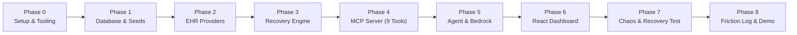

# ShiftWeave — Step-by-Step Implementation Plan

> **Document Version**: 1.0.0  
> **Target Track**: Amazon Developer Hackathon — Alexa+ Track  
> **Key References**: [`important.md`](file:///C:/Users/siddh/Desktop/dev_assist/important.md), [`architecture.md`](file:///C:/Users/siddh/Desktop/dev_assist/architecture.md), [`field_schema.md`](file:///C:/Users/siddh/Desktop/dev_assist/field_schema.md)  
> **Execution Constraint**: 100% Free, Local-First, Zero Cloud Cost ($0), Rapid 1–2 Day Delivery

---

## 1. Plan Overview & Milestone Roadmap

---

## Phase 0: Environment Setup & Core Dependencies
**Goal**: Prepare the local Node.js TypeScript workspace with all required libraries for SQLite and MCP execution.

- [ ] **Step 0.1**: Install SQLite library and supporting utilities.
  * Dependency: `better-sqlite3` (ultra-fast, zero-config local synchronous SQLite) and `@types/better-sqlite3`.
  * Dependency: `dotenv` for environment variables.
- [ ] **Step 0.2**: Update `package.json` scripts:
  * `"dev"`: Runs the MCP server with hot reload (`tsx watch src/server.ts`).
  * `"db:init"`: Initializes the SQLite database tables (`tsx src/db/init.ts`).
  * `"import:data"`: Ingests teammate's external clinical dataset into SQLite (`tsx src/db/ingest.ts`).
  * `"test:mcp"`: Runs automated client verification script for Streamable HTTP transport.
- [ ] **Step 0.3**: Configure `.env.example` with local defaults:
  * `PORT=3000`
  * `MCP_ENDPOINT=/mcp`
  * `SQLITE_DB_PATH=./data/shiftweave.db`
  * `INCOMING_DATA_DIR=./data/incoming`
  * `LLM_PROVIDER=gemini` (or `mock` / `bedrock`)

**Deliverable**: Workspace dependencies installed, scripts verified, clean directory structure (`src/db`, `src/providers`, `src/services`, `src/agent`, `data/incoming`).

---

## Phase 1: Database Layer & External Data Ingestion Pipeline
**Goal**: Implement the 11 SQLite tables defined in `field_schema.md` and build a flexible Ingestion & Mapping Pipeline to import the clinical dataset provided by your teammate.

- [ ] **Step 1.1**: Create `src/db/connection.ts`
  * Initialize `better-sqlite3` connecting to `./data/shiftweave.db`.
  * Enable WAL mode: `PRAGMA journal_mode = WAL;`.
  * Enable foreign keys: `PRAGMA foreign_keys = ON;`.
- [ ] **Step 1.2**: Create `src/db/schema.ts`
  * Auto-execute table creation for all 11 canonical entities from `field_schema.md`:
    1. `nurses`
    2. `shifts`
    3. `patients`
    4. `tasks`
    5. `task_assignments`
    6. `task_events`
    7. `conflicts`
    8. `handoffs`
    9. `workflow_runs`
    10. `workflow_checkpoints`
    11. `audit_log`
- [ ] **Step 1.3**: Create Data Drop-in Directory & Template for Teammate:
  * Create `./data/incoming/` directory.
  * Create `./data/incoming/TEMPLATE.json` (or sample CSV) mirroring `field_schema.md` so the teammate knows exactly where to drop the hospital files (`patients.json`, `nurses.json`, `tasks.json`, etc.).
- [ ] **Step 1.4**: Build Flexible Ingestion Pipeline (`src/db/ingest.ts`):
  * Reads incoming data files (JSON / CSV) from `./data/incoming/`.
  * **Schema Normalizer & Validator**: Maps teammate's fields to the 11 canonical tables, handling varying column names or formats gracefully.
  * **Relational Integrity Verifier**: Validates foreign keys (e.g. `patient_id` in tasks matches a valid patient).
  * **Automated Discrepancy Detector**: Scans incoming task statuses for conflicts between EHR records and nurse notes, automatically populating the `conflicts` table.
  * Ingests everything into SQLite inside a single atomic transaction.

**Deliverable**: Running `npm run import:data` takes the teammate's external dataset from `./data/incoming/` and populates the SQLite database with full relational integrity and conflict detection in seconds.

---

## Phase 2: Swappable Provider Abstraction (`IEHRProvider`)
**Goal**: Build the clinical provider abstraction to guarantee architectural interoperability without Docker or external servers.

- [ ] **Step 2.1**: Define `src/providers/types.ts`
  * Interface `IEHRProvider` with methods:
    * `ping(): Promise<boolean>`
    * `getPatientsByUnit(unitId: string): Promise<Patient[]>`
    * `getTasksForNurse(nurseId: string, shiftId: string): Promise<Task[]>`
    * `getRecentEvents(since: Date): Promise<TaskEvent[]>`
    * `updateTaskStatus(taskId: string, newStatus: TaskStatus, idempotencyKey: string): Promise<Result>`
- [ ] **Step 2.2**: Implement `src/providers/mock-provider.ts`
  * Reads/writes directly to the SQLite clinical tables for the ICU-B ward.
- [ ] **Step 2.3**: Implement `src/providers/alternate-provider.ts`
  * Implements `IEHRProvider` simulating a secondary regional healthcare system format (JSON payload mapping).
  * Enables instant runtime provider-switching for hackathon judges with zero code refactoring.

**Deliverable**: Two swappable provider implementations passing identical contract test suites.

---

## Phase 3: Core Workflow & Interruption Recovery Engine
**Goal**: Build the deterministic checkpointing and state reconciliation logic to ensure zero-loss failure recovery.

- [ ] **Step 3.1**: Create `src/services/audit.service.ts`
  * Logs all tool invocations, inputs, outputs, outcomes, and latencies into `audit_log`.
- [ ] **Step 3.2**: Create `src/services/checkpoint.service.ts`
  * `saveCheckpoint(runId, stepIndex, stepName, payload, idempotencyKey)`:
    * Commits snapshot to `workflow_checkpoints`.
    * Enforces duplicate protection: if `idempotency_key` already exists, returns existing checkpoint without writing duplicate records.
  * `getLatestCheckpoint(runId)`: Retrieves the most recent confirmed state.
- [ ] **Step 3.3**: Create `src/services/recovery.service.ts`
  * `reconcileAndResume(runId, idempotencyKey)`:
    1. Loads latest checkpoint from `workflow_checkpoints`.
    2. Queries current database state in `tasks` and `task_assignments` to verify what actually committed before interruption.
    3. Identifies only the remaining unexecuted actions.
    4. Updates `workflow_runs` status from `INTERRUPTED` to `IN_PROGRESS`.
    5. Returns safe execution plan avoiding duplicated writes.
- [ ] **Step 3.4**: Create `src/services/conflict.service.ts`
  * Evaluates task status against EHR feeds and nurse notes; automatically flags mismatches into `conflicts` and sets task status to `FLAGGED_CONFLICT`.

**Deliverable**: Unit tests demonstrating that an interrupted multi-step workflow recovers seamlessly from a checkpoint without repeating steps.

---

## Phase 4: MCP Server & 9 Tool Implementations
**Goal**: Implement the complete MCP server over Streamable HTTP transport exposing the 9 tools using `@modelcontextprotocol/sdk`.

- [ ] **Step 4.1**: Enhance `src/server.ts` with Streamable HTTP Transport
  * Ensure Express endpoint `POST /mcp` mounts `StreamableHTTPServerTransport` with dynamic UUID session generator.
- [ ] **Step 4.2**: Register Tools 1 to 3 (Task & Change Retrieval)
  * Tool 1: `get_assigned_tasks` (nurse ID, shift ID, status filter).
  * Tool 2: `get_task_details` (task ID, patient info, event history, conflicts).
  * Tool 3: `get_task_changes` (changes since timestamp/checkpoint).
- [ ] **Step 4.3**: Register Tools 4 & 5 (Handoff Context & Synthesis)
  * Tool 4: `get_handoff_context` (outgoing nurse, incoming nurse, shift window, uncompleted tasks, flags).
  * Tool 5: `create_handoff_draft` (generates structured markdown handoff, links carried-forward tasks, requires `idempotency_key`).
- [ ] **Step 4.4**: Register Tools 6 to 8 (Checkpoints & Interruption Recovery)
  * Tool 6: `get_workflow_checkpoint` (workflow run ID).
  * Tool 7: `save_workflow_checkpoint` (run ID, step index, step name, payload, `idempotency_key`).
  * Tool 8: `resume_workflow` (reconciles state, identifies uncommitted actions, requires `idempotency_key`).
- [ ] **Step 4.5**: Register Tool 9 (Task Acknowledgment & Custody Transfer)
  * Tool 9: `acknowledge_task` (records human verification, resolves conflict, transfers custody).
- [ ] **Step 4.6**: Build Verification Script `scripts/test-mcp-client.ts`
  * Sends JSON-RPC `tools/list` and `tools/call` over `POST /mcp` via HTTP.
  * Validates that runtime discovery and tool execution work flawlessly over Streamable HTTP.

**Deliverable**: 100% compliant MCP server running on `http://localhost:3000/mcp` with all 9 tools passing automated protocol tests.

---

## Phase 5: Agent Orchestrator & Conversational Layer
**Goal**: Connect the LLM agent to the MCP server via Streamable HTTP, simulating the Alexa+ conversational assistant.

- [ ] **Step 5.1**: Build `src/agent/mcp-client-bridge.ts`
  * Implements MCP Client connecting to `http://localhost:3000/mcp`.
  * Dynamically queries `tools/list` to discover tools at runtime.
- [ ] **Step 5.2**: Build `src/agent/orchestrator.ts`
  * Multi-turn conversational loop:
    1. Nurse asks: *"Alexa, what is pending for my shift, and what did Seema leave unresolved?"*
    2. Agent dispatches `get_assigned_tasks` & `get_handoff_context`.
    3. Agent identifies the Room 305-B conflict and interrupted workflow.
    4. Agent calls `resume_workflow` and `create_handoff_draft`.
    5. Agent returns grounded speech text + structured dashboard directive.
- [ ] **Step 5.3**: Pluggable LLM Adapter:
  * **Default (100% Free)**: Google Gemini API (or Mock Orchestrator for instant offline testing).
  * **AWS Bedrock Adapter (Mini-Challenge)**: Uses AWS Bedrock Converse API (`anthropic.claude-3-5-sonnet` / `amazon.nova-pro`) when AWS credentials exist in `.env`.

**Deliverable**: A fully functioning conversational agent capable of autonomous multi-step tool execution and grounded handoff synthesis.

---

## Phase 6: Clinical Shift Dashboard (React + TypeScript)
**Goal**: Build a clean, responsive, nurse-facing dashboard that displays real-time task states, conflict review, and live execution traces.

- [ ] **Step 6.1**: Scaffold React UI in `client/` using Vite + Tailwind CSS.
- [ ] **Step 6.2**: Shift & Nurse Status Header:
  * Current Unit: `ICU-B`
  * Outgoing: `Seema Patel, RN` | Incoming: `Reema Roy, RN`
  * Active Shift Countdown & Last Sync indicator.
- [ ] **Step 6.3**: Task Board & Filters:
  * Categorized columns: Pending, In Progress, Completed, Flagged Conflict.
  * Color-coded priority badges: STAT, Urgent, Routine.
- [ ] **Step 6.4**: Conflict Review Drawer:
  * Displays Room 305-B Vancomycin discrepancy (System A vs System B).
  * Action buttons: "Verify & Resolve", "Flag for Supervisor".
- [ ] **Step 6.5**: Live MCP Execution Trace Panel:
  * Real-time stream of tools invoked (`get_assigned_tasks` $\to$ `get_handoff_context` $\to$ `save_checkpoint`).
  * Shows execution latencies (e.g. `45ms`), input payloads, and checkpoint IDs.
- [ ] **Step 6.6**: Alexa+ Voice / Chat Simulation Bubble:
  * Conversational chat box with speech playback option simulating the Alexa+ assistant.
- [ ] **Step 6.7**: Chaos Disconnect & Recovery Simulator Button:
  * "Simulate Network Interruption" button that intentionally cuts the server connection mid-handoff.
  * Shows the dashboard detecting the outage and seamlessly resuming via `resume_workflow`.

**Deliverable**: Visual, professional clinical dashboard running on `http://localhost:5173` demonstrating real-time MCP state.

---

## Phase 7: End-to-End Testing & Interruption Chaos Verification
**Goal**: Rigorously test the happy path, failure recovery, and provider-switching scenarios.

- [ ] **Step 7.1**: Test Scenario 1 — Happy Path Shift Handoff:
  * Reema logs in $\to$ Alexa+ summarizes tasks $\to$ Handoff draft generated and reviewed.
- [ ] **Step 7.2**: Test Scenario 2 — Interruption & Zero-Loss Recovery:
  * Start handoff generation $\to$ Click "Simulate Interruption" after Step 2 $\to$ Verify checkpoint saved $\to$ Reconnect $\to$ Click "Resume" $\to$ Verify Step 1 & 2 are NOT repeated and draft is finalized.
- [ ] **Step 7.3**: Test Scenario 3 — Conflict Isolation:
  * Verify that Room 305-B medication discrepancy is flagged, preventing silent automated approval.
- [ ] **Step 7.4**: Test Scenario 4 — Swappable Provider Interoperability:
  * Toggle from `MockEHRProvider` to `AlternateHospitalMock` $\to$ Verify that MCP tools discover and serve the secondary hospital data with zero prompt modifications.

**Deliverable**: Complete end-to-end verification report with zero failed test cases.

---

## Phase 8: Submission Packaging, Friction Log & Demo
**Goal**: Prepare all hackathon submission assets to maximize scoring and capture the 10% bonus.

- [ ] **Step 8.1**: Create `FRICTION_LOG.md`:
  * Document authentic developer feedback on working with the MCP TypeScript SDK, Streamable HTTP transport, and agent skills to earn the **up to 10% bonus points** from Amazon judges.
- [ ] **Step 8.2**: Write comprehensive `README.md`:
  * Architecture summary, step-by-step local setup (1-click run), video link, and judging checklist.
- [ ] **Step 8.3**: Record 3-Minute Demo Video (following Section 15 of project doc):
  * **Minute 1**: Introduce Seema $\to$ Reema shift handoff, Alexa+ query, live MCP tool execution trace.
  * **Minute 2**: Show deliberately seeded conflict in Room 305-B; trigger server interruption and demonstrate zero-loss recovery from checkpoint.
  * **Minute 3**: Demonstrate provider swapping, show audit log, and conclude with impact.

---

## 2. Phase-by-Phase Timeline & Effort Matrix

| Phase | Milestone | Est. Time | Cost | Status |
| :--- | :--- | :--- | :--- | :--- |
| **Phase 0** | Workspace & Dependencies Setup | 30 mins | $0.00 | Ready to Start |
| **Phase 1** | SQLite DB & Ingestion Pipeline (Teammate Data) | 1 hour | $0.00 | Planned |
| **Phase 2** | Swappable Provider Abstraction | 1 hour | $0.00 | Planned |
| **Phase 3** | Checkpoint & Recovery Engine | 2 hours | $0.00 | Planned |
| **Phase 4** | MCP Server & 9 Tools (Streamable HTTP) | 3 hours | $0.00 | Planned |
| **Phase 5** | Agent Orchestrator & Alexa+ Simulator | 2 hours | $0.00 | Planned |
| **Phase 6** | Clinical Dashboard UI (React + Tailwind) | 4 hours | $0.00 | Planned |
| **Phase 7** | Chaos Testing & Provider Swap Demo | 1.5 hours| $0.00 | Planned |
| **Phase 8** | Friction Log & Submission Packaging | 1.5 hours| $0.00 | Planned |
| **Total** | **End-to-End Production Ready Submission** | **~16 hours** | **$0.00** | **On Schedule** |
