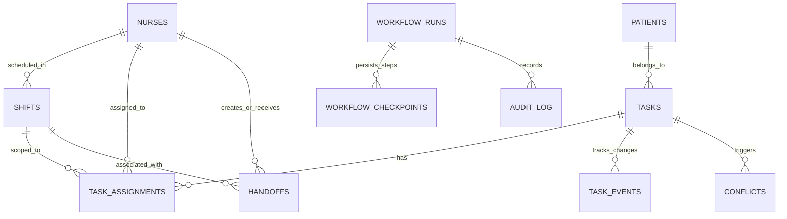

# ShiftWeave — Complete System Schema & Technical Specifications (A to Z)

> **Document Version**: 1.0.0  
> **Status**: Approved Architectural & Data Baseline  
> **Target Track**: Amazon Developer Hackathon — Alexa+ Track  
> **Transport**: Streamable HTTP (`StreamableHTTPServerTransport`)  
> **MCP Protocol Spec Version**: `2025-11-25` (or later)  
> **AWS Integration**: Bedrock Converse API (AWS Builder Mini Challenge)

---

## 1. Executive Blueprint & Core Tenets

ShiftWeave is an MCP-native, AI-powered nursing shift handoff and workflow recovery system. This document defines the **exhaustive, production-grade schemas** for all data layers, protocols, and interfaces:

1. **Safety Boundaries**: Strictly workflow coordination, verified status reconciliation, and state persistence. **No clinical diagnoses, autonomous order modifications, or prescription alterations.**
2. **Deterministic State & Recovery**: Every state mutation requires an `idempotency_key` and creates a `workflow_checkpoint`. If an outage occurs mid-turn, the system reconciles database state against external EHR truth before re-executing actions.
3. **Provider Interoperability**: Abstracted behind an `IEHRProvider` interface, allowing the MCP server to swap between EHR backends (e.g., OpenEMR FHIR vs. Alternate Hospital API) without altering agent orchestration.
4. **Observable Execution**: All MCP tool discoveries, invocations, and database checkpoints stream directly to the nurse dashboard and execution trace audit logs.

---

## 2. Database Schema (SQLite DDL & Data Dictionary)

The database uses SQLite with Foreign Key constraints and WAL (Write-Ahead Logging) enabled.

```sql
PRAGMA foreign_keys = ON;
PRAGMA journal_mode = WAL;
```

### 2.1 Entity Relationship Diagram (ERD)



---

### 2.2 Table Definitions (DDL)

#### A. `nurses` (Staff Directory)
Stores nurse identities, credentials, badge identifiers, and department assignments.

```sql
CREATE TABLE nurses (
    id TEXT PRIMARY KEY,                       -- e.g., 'nurse_seema_01', 'nurse_reema_02'
    badge_number TEXT NOT NULL UNIQUE,         -- e.g., 'RN-4402'
    full_name TEXT NOT NULL,                  -- e.g., 'Seema Patel, RN'
    email TEXT NOT NULL UNIQUE,
    department TEXT NOT NULL,                 -- e.g., 'ICU', 'Med-Surg-West'
    role TEXT NOT NULL DEFAULT 'STAFF_NURSE', -- 'CHARGE_NURSE', 'STAFF_NURSE', 'RELIEF_NURSE'
    created_at TIMESTAMP NOT NULL DEFAULT CURRENT_TIMESTAMP
);
```

#### B. `shifts` (Shift Scheduling & Boundaries)
Defines operating windows, unit designations, and active staff.

```sql
CREATE TABLE shifts (
    id TEXT PRIMARY KEY,                       -- e.g., 'shift_20261019_night'
    unit_id TEXT NOT NULL,                    -- e.g., 'ICU-B'
    shift_type TEXT NOT NULL CHECK(shift_type IN ('DAY', 'NIGHT', 'ROTATING')),
    start_time TIMESTAMP NOT NULL,
    end_time TIMESTAMP NOT NULL,
    status TEXT NOT NULL DEFAULT 'ACTIVE' CHECK(status IN ('UPCOMING', 'ACTIVE', 'HANDOFF_IN_PROGRESS', 'CLOSED')),
    created_at TIMESTAMP NOT NULL DEFAULT CURRENT_TIMESTAMP
);
CREATE INDEX idx_shifts_unit_status ON shifts(unit_id, status);
```

#### C. `patients` (Synthetic / Authorized Test Roster)
De-identified clinical subjects receiving nursing care within a specific ward.

```sql
CREATE TABLE patients (
    id TEXT PRIMARY KEY,                       -- e.g., 'pt_101'
    mrn TEXT NOT NULL UNIQUE,                  -- Medical Record Number (e.g., 'MRN-90210')
    full_name TEXT NOT NULL,                  -- e.g., 'James Clark'
    room_number TEXT NOT NULL,                -- e.g., 'Room 304'
    bed_number TEXT NOT NULL DEFAULT 'A',     -- e.g., 'A' or 'B'
    admission_date TIMESTAMP NOT NULL,
    acuity_level INTEGER NOT NULL CHECK(acuity_level BETWEEN 1 AND 5), -- 1: Resuscitation, 5: Non-urgent
    allergies TEXT,                            -- JSON Array: '["Penicillin", "Latex"]'
    primary_diagnosis TEXT NOT NULL,          -- e.g., 'Post-op Laparoscopic Cholecystectomy'
    created_at TIMESTAMP NOT NULL DEFAULT CURRENT_TIMESTAMP
);
```

#### D. `tasks` (Clinical & Operational Orders)
Individual actionable nursing tasks tied to a patient.

```sql
CREATE TABLE tasks (
    id TEXT PRIMARY KEY,                       -- e.g., 'task_vital_101_01'
    patient_id TEXT NOT NULL,
    title TEXT NOT NULL,                      -- e.g., 'Q4 Vital Signs & Neuro Check'
    description TEXT,
    category TEXT NOT NULL CHECK(category IN ('VITAL', 'MEDICATION_CHECK', 'LAB_DRAW', 'WOUND_CARE', 'MOBILITY', 'CONSULT', 'DISCHARGE_PREP')),
    status TEXT NOT NULL CHECK(status IN ('PENDING', 'IN_PROGRESS', 'COMPLETED', 'CANCELLED', 'FLAGGED_CONFLICT')),
    priority TEXT NOT NULL CHECK(priority IN ('STAT', 'URGENT', 'ROUTINE')),
    scheduled_time TIMESTAMP NOT NULL,
    completed_time TIMESTAMP,
    source_system TEXT NOT NULL DEFAULT 'EHR_PRIMARY', -- 'EHR_PRIMARY', 'LAB_FEED', 'MANUAL_ENTRY'
    created_at TIMESTAMP NOT NULL DEFAULT CURRENT_TIMESTAMP,
    updated_at TIMESTAMP NOT NULL DEFAULT CURRENT_TIMESTAMP,
    FOREIGN KEY (patient_id) REFERENCES patients(id) ON DELETE RESTRICT
);
CREATE INDEX idx_tasks_patient_status ON tasks(patient_id, status);
CREATE INDEX idx_tasks_scheduled ON tasks(scheduled_time);
```

#### E. `task_assignments` (Nurse-to-Task Allocation & Custody)
Defines explicit ownership; distinguishes outgoing nurse assignments from carried-forward tasks.

```sql
CREATE TABLE task_assignments (
    id TEXT PRIMARY KEY,                       -- e.g., 'asgn_8812'
    task_id TEXT NOT NULL,
    nurse_id TEXT NOT NULL,
    shift_id TEXT NOT NULL,
    transfer_status TEXT NOT NULL DEFAULT 'ACTIVE' CHECK(transfer_status IN ('ACTIVE', 'CARRIED_FORWARD', 'TRANSFERRED', 'UNASSIGNED')),
    assigned_at TIMESTAMP NOT NULL DEFAULT CURRENT_TIMESTAMP,
    assigned_by TEXT NOT NULL,                -- 'SYSTEM_AUTO', 'CHARGE_NURSE', 'SEEMA_RN'
    FOREIGN KEY (task_id) REFERENCES tasks(id) ON DELETE CASCADE,
    FOREIGN KEY (nurse_id) REFERENCES nurses(id) ON DELETE RESTRICT,
    FOREIGN KEY (shift_id) REFERENCES shifts(id) ON DELETE RESTRICT
);
CREATE INDEX idx_assignments_nurse_shift ON task_assignments(nurse_id, shift_id);
```

#### F. `task_events` (Immutable Audit Trail of Changes)
Captures every field transition, EHR synchronization delta, and nurse action.

```sql
CREATE TABLE task_events (
    id TEXT PRIMARY KEY,                       -- e.g., 'evt_991823'
    task_id TEXT NOT NULL,
    event_type TEXT NOT NULL CHECK(event_type IN ('STATUS_TRANSITION', 'REASSIGNMENT', 'SCHEDULE_CHANGE', 'NOTE_ADDED', 'CONFLICT_DETECTED')),
    previous_value TEXT,                      -- Serialized JSON or scalar string
    new_value TEXT NOT NULL,                  -- Serialized JSON or scalar string
    source TEXT NOT NULL,                     -- 'EHR_FEED', 'NURSE_OVERRIDE', 'AGENT_AUTOMATION'
    actor_id TEXT NOT NULL,                   -- Nurse ID or System service ID
    idempotency_key TEXT UNIQUE,               -- Prevents duplicate events from retries
    timestamp TIMESTAMP NOT NULL DEFAULT CURRENT_TIMESTAMP,
    metadata TEXT,                            -- Arbitrary JSON payload
    FOREIGN KEY (task_id) REFERENCES tasks(id) ON DELETE CASCADE
);
CREATE INDEX idx_events_task_time ON task_events(task_id, timestamp);
```

#### G. `conflicts` (Discrepancy & Verification Register)
Holds detected discrepancies between disparate EHR systems or notes awaiting human resolution.

```sql
CREATE TABLE conflicts (
    id TEXT PRIMARY KEY,                       -- e.g., 'conf_401'
    task_id TEXT NOT NULL,
    conflict_type TEXT NOT NULL CHECK(conflict_type IN ('STATUS_MISMATCH', 'DUPLICATE_ORDER', 'STALE_DATA', 'UNASSIGNED_CARRIED_FORWARD')),
    system_a_name TEXT NOT NULL,              -- e.g., 'OpenEMR Core'
    system_a_val TEXT NOT NULL,               -- e.g., 'COMPLETED'
    system_b_name TEXT NOT NULL,              -- e.g., 'Nurse Note / Shift Handoff'
    system_b_val TEXT NOT NULL,               -- e.g., 'PENDING'
    status TEXT NOT NULL DEFAULT 'UNRESOLVED' CHECK(status IN ('UNRESOLVED', 'VERIFIED_RESOLVED', 'DISMISSED')),
    resolution_note TEXT,
    resolved_by TEXT,
    resolved_at TIMESTAMP,
    detected_at TIMESTAMP NOT NULL DEFAULT CURRENT_TIMESTAMP,
    FOREIGN KEY (task_id) REFERENCES tasks(id) ON DELETE CASCADE,
    FOREIGN KEY (resolved_by) REFERENCES nurses(id)
);
```

#### H. `handoffs` (Shift Transition Records)
Structured handoff drafts generated by the agent and approved by incoming/outgoing nurses.

```sql
CREATE TABLE handoffs (
    id TEXT PRIMARY KEY,                       -- e.g., 'handoff_20261019_0700'
    shift_id TEXT NOT NULL,
    outgoing_nurse_id TEXT NOT NULL,
    incoming_nurse_id TEXT NOT NULL,
    status TEXT NOT NULL DEFAULT 'DRAFT' CHECK(status IN ('DRAFT', 'UNDER_REVIEW', 'ACKNOWLEDGED', 'FINALIZED')),
    summary_markdown TEXT NOT NULL,           -- Formatted handoff narrative
    data_snapshot TEXT NOT NULL,              -- Full JSON snapshot of tasks & states at generation
    unresolved_conflicts_count INTEGER NOT NULL DEFAULT 0,
    created_at TIMESTAMP NOT NULL DEFAULT CURRENT_TIMESTAMP,
    acknowledged_at TIMESTAMP,
    FOREIGN KEY (shift_id) REFERENCES shifts(id),
    FOREIGN KEY (outgoing_nurse_id) REFERENCES nurses(id),
    FOREIGN KEY (incoming_nurse_id) REFERENCES nurses(id)
);
```

#### I. `workflow_runs` & `workflow_checkpoints` (Failure Recovery Engine)
Guarantees resilience across power failures, network drops, or LLM timeouts.

```sql
CREATE TABLE workflow_runs (
    id TEXT PRIMARY KEY,                       -- e.g., 'wf_run_98234'
    workflow_type TEXT NOT NULL CHECK(workflow_type IN ('GENERATE_HANDOFF', 'RECOVER_INTERRUPTED_SHIFT', 'VERIFY_CONFLICTS')),
    initiated_by TEXT NOT NULL,               -- Nurse ID
    status TEXT NOT NULL DEFAULT 'INITIATED' CHECK(status IN ('INITIATED', 'IN_PROGRESS', 'INTERRUPTED', 'COMPLETED', 'FAILED')),
    error_message TEXT,
    created_at TIMESTAMP NOT NULL DEFAULT CURRENT_TIMESTAMP,
    updated_at TIMESTAMP NOT NULL DEFAULT CURRENT_TIMESTAMP
);

CREATE TABLE workflow_checkpoints (
    id TEXT PRIMARY KEY,                       -- e.g., 'chk_5510'
    workflow_run_id TEXT NOT NULL,
    step_index INTEGER NOT NULL,              -- 1, 2, 3...
    step_name TEXT NOT NULL,                  -- 'FETCH_TASKS', 'DETECT_CONFLICTS', 'BUILD_DRAFT'
    state_payload TEXT NOT NULL,              -- Serialized JSON snapshot of intermediate calculations
    idempotency_key TEXT NOT NULL UNIQUE,      -- Ensures exact-once step execution
    created_at TIMESTAMP NOT NULL DEFAULT CURRENT_TIMESTAMP,
    FOREIGN KEY (workflow_run_id) REFERENCES workflow_runs(id) ON DELETE CASCADE
);
CREATE INDEX idx_checkpoints_run ON workflow_checkpoints(workflow_run_id, step_index DESC);
```

#### J. `audit_log` (Compliance & Execution Traceability)
Observable log for UI execution traces and competition review friction logs.

```sql
CREATE TABLE audit_log (
    id TEXT PRIMARY KEY,                       -- e.g., 'aud_110293'
    actor_type TEXT NOT NULL CHECK(actor_type IN ('NURSE', 'AGENT', 'MCP_SERVER', 'SYSTEM')),
    actor_id TEXT NOT NULL,
    action TEXT NOT NULL,                     -- e.g., 'MCP_TOOL_CALL:get_assigned_tasks'
    target_resource TEXT NOT NULL,            -- e.g., 'tasks/nurse_seema_01'
    outcome TEXT NOT NULL CHECK(outcome IN ('SUCCESS', 'FAILURE', 'RECOVERED')),
    details TEXT,                             -- Serialized JSON
    latency_ms INTEGER,
    timestamp TIMESTAMP NOT NULL DEFAULT CURRENT_TIMESTAMP
);
CREATE INDEX idx_audit_time ON audit_log(timestamp DESC);
```

---

## 3. TypeScript Interfaces & Data Models

Matches the SQLite models for backend type safety:

```typescript
export type ShiftType = 'DAY' | 'NIGHT' | 'ROTATING';
export type TaskCategory = 'VITAL' | 'MEDICATION_CHECK' | 'LAB_DRAW' | 'WOUND_CARE' | 'MOBILITY' | 'CONSULT' | 'DISCHARGE_PREP';
export type TaskStatus = 'PENDING' | 'IN_PROGRESS' | 'COMPLETED' | 'CANCELLED' | 'FLAGGED_CONFLICT';
export type TaskPriority = 'STAT' | 'URGENT' | 'ROUTINE';
export type TransferStatus = 'ACTIVE' | 'CARRIED_FORWARD' | 'TRANSFERRED' | 'UNASSIGNED';

export interface Patient {
  id: string;
  mrn: string;
  fullName: string;
  roomNumber: string;
  bedNumber: string;
  admissionDate: string;
  acuityLevel: 1 | 2 | 3 | 4 | 5;
  allergies: string[];
  primaryDiagnosis: string;
}

export interface Task {
  id: string;
  patientId: string;
  title: string;
  description?: string;
  category: TaskCategory;
  status: TaskStatus;
  priority: TaskPriority;
  scheduledTime: string;
  completedTime?: string;
  sourceSystem: string;
  createdAt: string;
  updatedAt: string;
}

export interface TaskAssignment {
  id: string;
  taskId: string;
  nurseId: string;
  shiftId: string;
  transferStatus: TransferStatus;
  assignedAt: string;
  assignedBy: string;
}

export interface ConflictRecord {
  id: string;
  taskId: string;
  conflictType: 'STATUS_MISMATCH' | 'DUPLICATE_ORDER' | 'STALE_DATA' | 'UNASSIGNED_CARRIED_FORWARD';
  systemAName: string;
  systemAVal: string;
  systemBName: string;
  systemBVal: string;
  status: 'UNRESOLVED' | 'VERIFIED_RESOLVED' | 'DISMISSED';
  detectedAt: string;
}

export interface HandoffDraft {
  id: string;
  shiftId: string;
  outgoingNurseId: string;
  incomingNurseId: string;
  status: 'DRAFT' | 'UNDER_REVIEW' | 'ACKNOWLEDGED' | 'FINALIZED';
  summaryMarkdown: string;
  dataSnapshot: {
    totalAssigned: number;
    completedCount: number;
    pendingCount: number;
    carriedForwardCount: number;
    unresolvedConflicts: ConflictRecord[];
    tasks: Task[];
  };
  createdAt: string;
}

export interface WorkflowCheckpoint {
  id: string;
  workflowRunId: string;
  stepIndex: number;
  stepName: string;
  statePayload: Record<string, unknown>;
  idempotencyKey: string;
  createdAt: string;
}
```

---

## 4. MCP Tool Contracts (Zod & JSON Schemas)

Each tool adheres strictly to the MCP specification version `2025-11-25`, complete with input schemas, output schemas, and bounded execution rules.

```
                    ┌────────────────────────┐
                    │   LLM Agent / Alexa+   │
                    └───────────┬────────────┘
                                │ JSON-RPC 2.0 (Streamable HTTP)
                                ▼
                    ┌────────────────────────┐
                    │     MCP Server         │
                    │   (dev-assist v1.0)    │
                    └───────────┬────────────┘
         ┌──────────────────────┼──────────────────────┐
         ▼                      ▼                      ▼
┌──────────────────┐  ┌──────────────────┐  ┌──────────────────┐
│   EHR Adapter    │  │  SQLite Storage  │  │ Checkpoint/Audit │
│ (OpenEMR / Mock) │  │  (Tasks/Events)  │  │  Recovery Store  │
└──────────────────┘  └──────────────────┘  └──────────────────┘
```

---

### Tool 1: `get_assigned_tasks`
* **Purpose**: Retrieve all tasks assigned to a specific nurse for a specific shift, with optional status filtering.
* **Idempotent**: Yes (`read-only`)

#### Input Schema (Zod)
```typescript
import { z } from "zod";

export const GetAssignedTasksInputSchema = z.object({
  nurse_id: z.string().min(1, "nurse_id is required").describe("Unique ID of the authenticated nurse (e.g., 'nurse_seema_01')"),
  shift_id: z.string().optional().describe("Target shift ID; defaults to active shift if omitted"),
  status_filter: z.array(z.enum(['PENDING', 'IN_PROGRESS', 'COMPLETED', 'CANCELLED', 'FLAGGED_CONFLICT'])).optional().describe("Filter tasks by specific statuses")
});
```

#### Output Schema (JSON)
```json
{
  "shift_id": "shift_20261019_night",
  "nurse_id": "nurse_seema_01",
  "tasks_count": 4,
  "tasks": [
    {
      "task_id": "task_vital_101_01",
      "patient_id": "pt_101",
      "patient_name": "James Clark",
      "room_number": "Room 304-A",
      "title": "Q4 Vital Signs & Neuro Check",
      "category": "VITAL",
      "status": "COMPLETED",
      "priority": "ROUTINE",
      "scheduled_time": "2026-10-19T06:00:00Z",
      "completed_time": "2026-10-19T06:15:20Z",
      "transfer_status": "ACTIVE"
    }
  ]
}
```

---

### Tool 2: `get_task_details`
* **Purpose**: Retrieve in-depth context, patient history, clinical flags, and recent events for a given task.
* **Idempotent**: Yes (`read-only`)

#### Input Schema (Zod)
```typescript
export const GetTaskDetailsInputSchema = z.object({
  task_id: z.string().min(1, "task_id is required").describe("Target task ID (e.g., 'task_vital_101_01')")
});
```

#### Output Schema (JSON)
```json
{
  "task": {
    "id": "task_vital_101_01",
    "title": "Q4 Vital Signs & Neuro Check",
    "patient": {
      "id": "pt_101",
      "mrn": "MRN-90210",
      "name": "James Clark",
      "room": "Room 304-A",
      "acuity": 2,
      "diagnosis": "Post-op Laparoscopic Cholecystectomy",
      "allergies": ["Penicillin"]
    },
    "status": "COMPLETED",
    "priority": "ROUTINE",
    "events_history": [
      {
        "event_id": "evt_101",
        "type": "STATUS_TRANSITION",
        "from": "PENDING",
        "to": "IN_PROGRESS",
        "timestamp": "2026-10-19T06:05:00Z"
      },
      {
        "event_id": "evt_102",
        "type": "STATUS_TRANSITION",
        "from": "IN_PROGRESS",
        "to": "COMPLETED",
        "timestamp": "2026-10-19T06:15:20Z"
      }
    ],
    "conflicts": []
  }
}
```

---

### Tool 3: `get_task_changes`
* **Purpose**: Retrieve change events, status modifications, and alerts that occurred since a given timestamp or checkpoint.
* **Idempotent**: Yes (`read-only`)

#### Input Schema (Zod)
```typescript
export const GetTaskChangesInputSchema = z.object({
  since_timestamp: z.string().datetime().describe("ISO 8601 timestamp starting the query window"),
  unit_id: z.string().optional().describe("Filter changes by nursing unit/ward"),
  shift_id: z.string().optional().describe("Filter changes within a specific shift")
});
```

#### Output Schema (JSON)
```json
{
  "since": "2026-10-19T06:00:00Z",
  "change_count": 2,
  "changes": [
    {
      "event_id": "evt_9918",
      "task_id": "task_med_102_03",
      "patient_id": "pt_102",
      "event_type": "STATUS_TRANSITION",
      "previous_value": "PENDING",
      "new_value": "FLAGGED_CONFLICT",
      "source": "EHR_FEED",
      "timestamp": "2026-10-19T06:45:10Z"
    }
  ]
}
```

---

### Tool 4: `get_handoff_context`
* **Purpose**: Compiles all cross-patient operational summaries, uncompleted tasks, and carried-forward candidates between outgoing and incoming nurses.
* **Idempotent**: Yes (`read-only`)

#### Input Schema (Zod)
```typescript
export const GetHandoffContextInputSchema = z.object({
  outgoing_nurse_id: z.string().min(1).describe("Nurse ending shift (e.g., 'nurse_seema_01')"),
  incoming_nurse_id: z.string().min(1).describe("Nurse beginning shift (e.g., 'nurse_reema_02')"),
  shift_id: z.string().min(1).describe("Outgoing shift identifier")
});
```

#### Output Schema (JSON)
```json
{
  "outgoing_nurse": { "id": "nurse_seema_01", "name": "Seema Patel, RN" },
  "incoming_nurse": { "id": "nurse_reema_02", "name": "Reema Roy, RN" },
  "shift_window": { "shift_id": "shift_20261019_night", "end_time": "2026-10-19T07:00:00Z" },
  "patients_under_care": 3,
  "summary": {
    "total_tasks": 12,
    "completed": 9,
    "pending": 2,
    "conflicts": 1
  },
  "critical_flags": [
    {
      "task_id": "task_med_102_03",
      "patient_room": "Room 305-B",
      "issue": "EHR indicates IV antibiotic given; nurse medication log indicates dose delayed awaiting pharmacist verification."
    }
  ]
}
```

---

### Tool 5: `create_handoff_draft`
* **Purpose**: Generates and stores a structured shift handoff draft grounded directly in database records.
* **Idempotent**: Requires `idempotency_key`

#### Input Schema (Zod)
```typescript
export const CreateHandoffDraftInputSchema = z.object({
  outgoing_nurse_id: z.string().min(1),
  incoming_nurse_id: z.string().min(1),
  shift_id: z.string().min(1),
  summary_markdown: z.string().min(10).describe("Synthesized, grounded clinical narrative"),
  carried_forward_task_ids: z.array(z.string()).describe("List of task IDs to officially carry over to next shift"),
  idempotency_key: z.string().uuid().describe("Unique UUIDv4 idempotency key")
});
```

#### Output Schema (JSON)
```json
{
  "handoff_id": "handoff_20261019_0700",
  "status": "DRAFT",
  "created_at": "2026-10-19T06:58:30Z",
  "carried_forward_count": 3,
  "unresolved_conflicts_count": 1,
  "requires_review": true
}
```

---

### Tool 6: `get_workflow_checkpoint`
* **Purpose**: Fetches the most recent saved checkpoint for an interrupted or active workflow run.
* **Idempotent**: Yes (`read-only`)

#### Input Schema (Zod)
```typescript
export const GetWorkflowCheckpointInputSchema = z.object({
  workflow_run_id: z.string().min(1).describe("Target workflow run ID (e.g., 'wf_run_98234')")
});
```

#### Output Schema (JSON)
```json
{
  "workflow_run_id": "wf_run_98234",
  "status": "INTERRUPTED",
  "last_checkpoint": {
    "checkpoint_id": "chk_5510",
    "step_index": 2,
    "step_name": "GET_HANDOFF_CONTEXT",
    "saved_at": "2026-10-19T06:55:00Z",
    "state_summary": "Retrieved 12 tasks; 1 conflict flagged in Room 305-B."
  },
  "next_pending_step": "CREATE_HANDOFF_DRAFT"
}
```

---

### Tool 7: `save_workflow_checkpoint`
* **Purpose**: Commits intermediate execution progress to SQLite, enabling zero-loss recovery upon network or server interruption.
* **Idempotent**: Requires `idempotency_key`

#### Input Schema (Zod)
```typescript
export const SaveWorkflowCheckpointInputSchema = z.object({
  workflow_run_id: z.string().min(1),
  step_index: z.number().int().positive(),
  step_name: z.string().min(1),
  state_payload: z.record(z.unknown()).describe("JSON serializable state dictionary"),
  idempotency_key: z.string().uuid()
});
```

#### Output Schema (JSON)
```json
{
  "checkpoint_id": "chk_5511",
  "workflow_run_id": "wf_run_98234",
  "step_index": 3,
  "step_name": "SAVE_DRAFT",
  "status": "COMMITTED",
  "timestamp": "2026-10-19T06:56:12Z"
}
```

---

### Tool 8: `resume_workflow`
* **Purpose**: Re-establishes state following an outage; validates current database truth against the checkpoint before proceeding, guaranteeing that already committed actions are **never duplicated**.
* **Idempotent**: Requires `idempotency_key`

#### Input Schema (Zod)
```typescript
export const ResumeWorkflowInputSchema = z.object({
  workflow_run_id: z.string().min(1).describe("Interrupted workflow ID"),
  idempotency_key: z.string().uuid()
});
```

#### Output Schema (JSON)
```json
{
  "workflow_run_id": "wf_run_98234",
  "recovery_status": "RECOVERED",
  "resumed_from_step": 3,
  "resumed_step_name": "CREATE_HANDOFF_DRAFT",
  "already_committed_steps": ["FETCH_TASKS", "DETECT_CONFLICTS"],
  "actions_to_execute": ["GENERATE_FINAL_DRAFT", "NOTIFY_DASHBOARD"],
  "state_reconciled": true
}
```

---

### Tool 9: `acknowledge_task`
* **Purpose**: Records explicit human nurse verification or assignment acceptance against controlled test data.
* **Idempotent**: Requires `idempotency_key`

#### Input Schema (Zod)
```typescript
export const AcknowledgeTaskInputSchema = z.object({
  task_id: z.string().min(1),
  nurse_id: z.string().min(1),
  action: z.enum(['ACCEPT_HANDOFF', 'RESOLVE_CONFLICT', 'FLAG_FOR_SUPERVISOR']),
  resolution_note: z.string().optional(),
  idempotency_key: z.string().uuid()
});
```

#### Output Schema (JSON)
```json
{
  "task_id": "task_med_102_03",
  "nurse_id": "nurse_reema_02",
  "action_recorded": "ACCEPT_HANDOFF",
  "status": "IN_PROGRESS",
  "updated_at": "2026-10-19T07:05:00Z"
}
```

---

## 5. Hybrid EHR Interoperability & Provider Interface Schema

ShiftWeave operates on a **Hybrid Edge-Cache Architecture**:
* **External System of Record**: Connects via FHIR R4 REST APIs to open-source health platforms (e.g. HAPI FHIR Public Testbed or Epic on FHIR Sandboxes).
* **Local Edge Cache**: Embedded SQLite in WAL mode delivers instant sub-millisecond query responses (0.1ms) during nursing shift handoffs and guarantees 100% availability during network drops.

```typescript
export interface IEHRProvider {
  readonly providerId: string;
  readonly providerName: string;
  readonly isEdgeCache: boolean;

  /** Health & capability check */
  ping(): Promise<boolean>;

  /** Fetch active patient roster for a nursing unit */
  getPatientsByUnit(unitId: string): Promise<Patient[]>;

  /** Fetch clinical tasks assigned to a nurse */
  getTasksForNurse(nurseId: string, shiftId: string): Promise<Task[]>;

  /** Fetch real-time event updates since a timestamp */
  getRecentEvents(since: Date): Promise<TaskEvent[]>;

  /** Update task status in EHR with idempotency protection */
  updateTaskStatus(taskId: string, newStatus: TaskStatus, idempotencyKey: string): Promise<{ success: boolean; committedVersion: string }>;

  /** Optional: Sync external FHIR R4 bundle into local edge SQLite cache */
  syncFromExternalFHIR?(endpointUrl: string, unitId: string): Promise<{ syncedPatients: number; syncedOrders: number }>;
}
```

### Implementations:
1. **`SQLiteCacheProvider`**: Direct high-speed local queries on SQLite for active shift coordination, conflict isolation, and failure recovery.
2. **`LiveFHIRProvider`**: External HTTP REST client mapping standard FHIR R4 `Patient` and `MedicationRequest` resources from public open-source FHIR servers (e.g. HAPI FHIR or Epic on FHIR).

---

## 6. Alexa+ Simulated Interaction & AWS Bedrock Schema

In accordance with [`important.md.docx`](file:///C:/Users/siddh/Desktop/dev_assist/important.md.docx), the system simulates the Alexa+ multi-turn conversational interaction while leveraging the **AWS Bedrock Converse API** (supporting the AWS Builder Mini Challenge).

### 6.1 Conversational Frame Schema

```json
{
  "session_id": "sess_alexa_plus_9912",
  "nurse_context": {
    "authenticated_nurse": "nurse_reema_02",
    "name": "Reema Roy, RN",
    "incoming_shift": "shift_20261019_day",
    "outgoing_nurse": "nurse_seema_01"
  },
  "turn_request": {
    "intent": "PREPARE_SHIFT_HANDOFF",
    "utterance": "Alexa, what is pending for my shift, and what did Seema leave unresolved?",
    "timestamp": "2026-10-19T07:01:00Z"
  },
  "turn_response": {
    "speech": "Good morning Reema. I reviewed Seema's night shift. There are 3 tasks remaining: 2 pending routine checks, and 1 medication check in Room 305-B with conflicting records between the EHR and Seema's notes. An earlier handoff draft preparation was interrupted, but I verified current state before continuing. The draft is ready on your dashboard.",
    "directives": [
      {
        "type": "DISPLAY_DASHBOARD_CARD",
        "card_type": "HANDOFF_SUMMARY",
        "handoff_id": "handoff_20261019_0700",
        "conflict_badge": true
      }
    ],
    "execution_trace_ref": "wf_run_98234"
  }
}
```

### 6.2 AWS Bedrock Converse Tool Spec

```json
{
  "toolConfig": {
    "tools": [
      {
        "toolSpec": {
          "name": "get_assigned_tasks",
          "description": "Retrieve tasks assigned to the authenticated nurse for a specific shift.",
          "inputSchema": {
            "json": {
              "type": "object",
              "properties": {
                "nurse_id": { "type": "string" },
                "shift_id": { "type": "string" },
                "status_filter": { "type": "array", "items": { "type": "string" } }
              },
              "required": ["nurse_id"]
            }
          }
        }
      }
    ]
  }
}
```

---

## 7. Frontend Telemetry & Execution Trace Contract

The dashboard exposes real-time state via HTTP polling or SSE/WebSocket on `GET /api/execution-trace`.

```typescript
export interface ExecutionTraceEntry {
  id: string;
  timestamp: string;
  toolName: string;
  transport: 'STREAMABLE_HTTP';
  inputPayload: Record<string, unknown>;
  outputPayload: Record<string, unknown>;
  durationMs: number;
  status: 'SUCCESS' | 'ERROR' | 'RETRY_RECOVERY';
  checkpointCreated?: {
    checkpointId: string;
    stepIndex: number;
  };
}
```

---

## 8. Summary Checklist (Project Baseline Verification)

| Requirement Area | Specification Defined in `schema.md` | Target Reference |
| :--- | :--- | :--- |
| **Transport** | Streamable HTTP (`StreamableHTTPServerTransport`) on Express `/mcp` | [`important.md.docx`](file:///C:/Users/siddh/Desktop/dev_assist/important.md.docx) |
| **MCP Spec Version** | `2025-11-25` compliant schemas and tool contracts | [`important.md.docx`](file:///C:/Users/siddh/Desktop/dev_assist/important.md.docx) |
| **Safety Guardrails** | Strict workflow coordination, no clinical diagnosis/treatment | [`ShiftWeave_Project_Document.docx`](file:///C:/Users/siddh/Desktop/dev_assist/ShiftWeave_Project_Document.docx) |
| **Persistence** | 10 Relational SQLite DDL tables with FKs and indices | [`ShiftWeave_Project_Document.docx`](file:///C:/Users/siddh/Desktop/dev_assist/ShiftWeave_Project_Document.docx) |
| **MCP Tools** | All 9 application-specific tool contracts detailed with Zod | [`ShiftWeave_Project_Document.docx`](file:///C:/Users/siddh/Desktop/dev_assist/ShiftWeave_Project_Document.docx) |
| **Failure Recovery** | `workflow_checkpoints`, `workflow_runs`, idempotency keys | [`ShiftWeave_Project_Document.docx`](file:///C:/Users/siddh/Desktop/dev_assist/ShiftWeave_Project_Document.docx) |
| **Interoperability** | `IEHRProvider` with pluggable mock and real adapters | [`ShiftWeave_Project_Document.docx`](file:///C:/Users/siddh/Desktop/dev_assist/ShiftWeave_Project_Document.docx) |
| **AWS Mini-Challenge** | Bedrock Converse API tool configuration schema | [`important.md.docx`](file:///C:/Users/siddh/Desktop/dev_assist/important.md.docx) |
